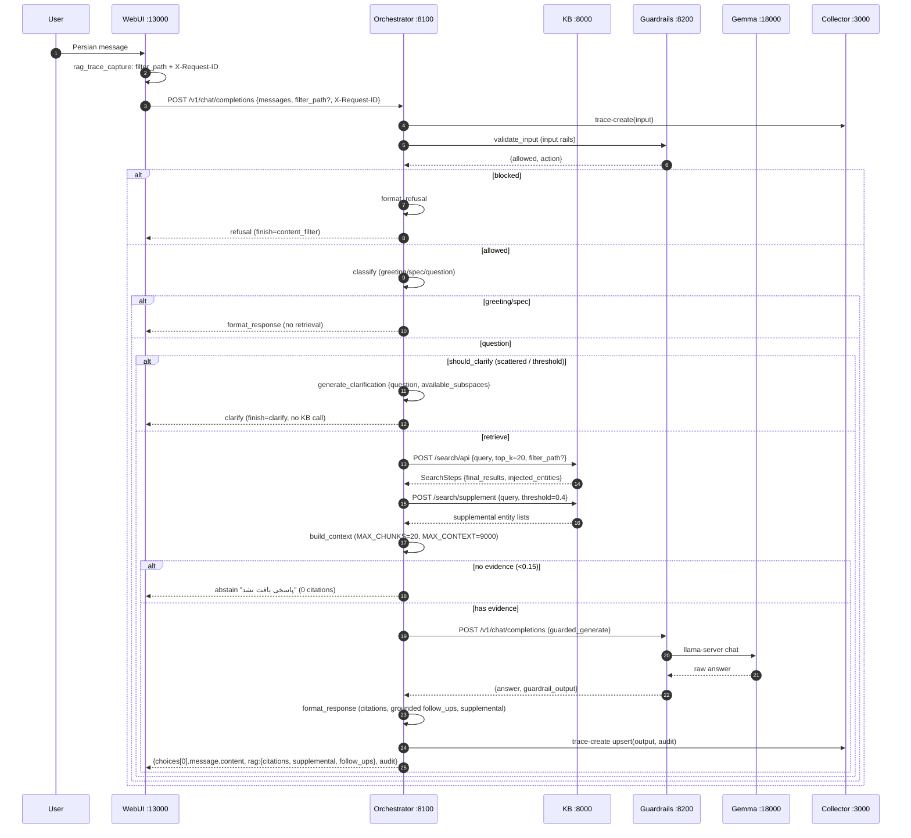
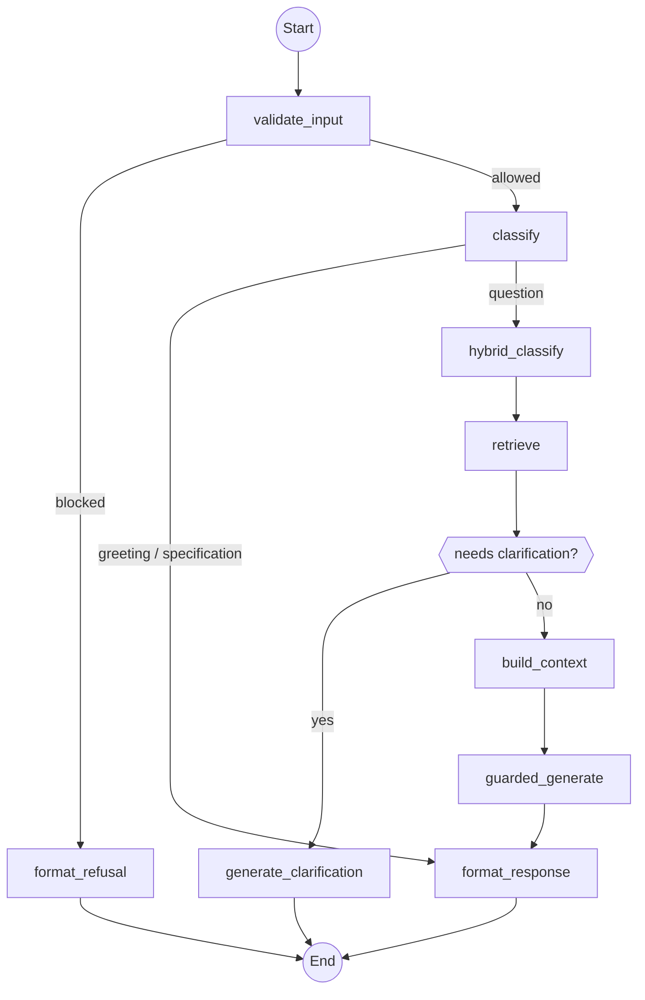

# Work Credit RAG — Phase 1

[](https://www.python.org/downloads/release/python-3110/)
[](LICENSE)
[]()

Self-hosted, Persian-capable conversational RAG platform. Production code lives in independently maintained Git submodules (orchestrator, knowledgebase, guardrails, server-setup) pinned to exact commits; the parent repo owns pins, integrated startup (`deploy/vast/`), and E2E evaluation.

> **Status:** Active on `main`. Deployed on Vast.ai (RTX 3090) and H200 host via `Work_RAG-Server-Setup` LLM manager `:9000`. Current KB `v13` — 18 docs / 1123 chunks · pgvector HNSW · `MAX_CHUNKS=20`.

<details>
<summary>Repository composition &amp; layers</summary>

Production implementation is split into Git submodules. Each gitlink is pinned to an exact commit; advancing a component requires a component-repo commit followed by a parent-repo commit that advances the gitlink.

| Path | Repository | Branch | Current pin | Responsibility |
|------|------------|--------|-------------|----------------|
| `components/server-setup` | Work_RAG-Server-Setup | `main` | `ff8c5a8` | Hardware, LLM manager `:9000`, embed `:8001-8003`, infra |
| `components/knowledgebase` | Work_RAG-KB | `master` | `92503e5` | Ingestion, `folder_hierarchy` tagging, `filter_path`, `supplement` tool, retrieval `:8000` |
| `components/guardrails` | Work_RAG-Guardrails | `main` | `1002ea8` | Persian safety policy, guarded Gemma `:8200` |
| `components/orchestrator` | Work_RAG-Orchestrator | `main` | `75cf970` | LangGraph API `:8100`, sticky `MemorySaver`, `filter_path`, evidence guard |
| `components/tracing` | parent (not a submodule) | — | — | Fallback trace collector `:3000`, `observability.db` |
| `agent-state` | ICS_ChatBot_agent-state | `main` | `a0d454e` | Agent context/history/skills — agent only, not production |

Run `git submodule status --recursive` for live pins.

Layer separation:

| Layer | Directory | Production? | Purpose |
|-------|-----------|-------------|---------|
| Entry points | `api/` | Yes | Thin wrappers → `components/` submodules |
| Implementation | `components/` | Yes | Production code (submodules, pinned commits) |
| Contracts | `contracts/` | Yes | API request/response JSON schemas |
| Deployment | `deploy/` | Yes | Start/stop/health scripts per host (Vast/H200/Docker) |
| Testing | `eval/` | Yes | E2E, guardrails, LLM-judge evaluation |
| Utilities | `scripts/` | Yes | README TOC generation, system checks |
| Agent context | `agent-state/` | Agent only | Agent mission, history, skills, standards |
| Development | `dev/` | No | Patches, ad-hoc tests, investigation scripts |
| Archive | `archive/`, `deprecated/` | No | Historical reference, read-only |

</details>

<details>
<summary>Architecture — production diagrams</summary>

### System overview

```mermaid
flowchart TB
    subgraph Client["Client layer"]
        Browser["Browser"]
        WebUI["Open WebUI :13000\nICS Helper · rag_trace_capture filter"]
    end

    subgraph Orch["Orchestration :8100"]
        Orch["Orchestrator\nLangGraph · MemorySaver · X-Request-ID sticky thread"]
    end

    subgraph KB["Retrieval :8000"]
        KBMgr["KB Manager\nBM25 tantivy + dense MiniLM-384\n+ RRF k=60 + BGE-m3 rerank\npgvector HNSW · 1123 chunks"]
        Filter["filter_path · folder_hierarchy"]
        Suppl["supplement tool\nPOST /search/supplement · entity lists"]
    end

    subgraph GR["Safety :8200"]
        Guard["Guardrails\nPOST /v1/rails/check input\nPOST /v1/chat/completions guarded_generate\nPersian signals + LLM judge"]
    end

    subgraph Gen["Generation"]
        Gemma["Gemma 4 31B\nunsloth/gemma-4-31B-it-GGUF UD-Q4_K_XL\n:18000 Vast · :9000 Manager H200"]
        Embed["Embed trio :8001-8003\ne5-small · bge-m3 · MiniLM"]
    end

    subgraph Obs["Observability"]
        Coll["Collector :3000\nobservability.db SQLite"]
        LF2["Langfuse v2 :3001"]
        Studio["Studio :2024\nLangGraph API"]
    end

    Browser --> WebUI
    WebUI -- "OPENAI_API_BASE_URL=8100/v1\n+ X-Request-ID" --> Orch
    Orch --> Guard
    Guard -- "blocked" --> WebUI
    Guard -- "allowed" --> KBMgr
    KBMgr --> Filter
    KBMgr --> Suppl
    Suppl -- "merged into context" --> Orch
    Orch -- "guarded_generate" --> Guard
    Guard --> Gemma
    Embed -.-> KBMgr
    Orch -.-> Coll
    Coll --> LF2
    Coll -.-> Studio
```

### Request flow — sticky + filtered RAG



### Orchestrator LangGraph graph



Graph nodes match `components/orchestrator/src/work_rag_orchestrator/graph.py`: `validate_input → classify → hybrid_classify → retrieve`, then conditional `should_clarify` branches to `generate_clarification` (ends) or `build_context → guarded_generate → format_response` (ends). Blocked input short-circuits to `format_refusal` (ends). Greeting/specification queries bypass retrieval and go straight to `format_response`.

</details>

<details>
<summary>Request lifecycle</summary>

1. **WebUI filter** (`components/openwebui-filters/rag_trace_capture.py`) — captures `filter_path` from scope/`[چک]` prefix, injects `X-Request-ID`, records trace start.
2. **`validate_input`** — Guardrails input rails; short-circuits to refusal if blocked.
3. **`classify` + `infer_specification`** — classifies `greeting/spec/question`; maps query to `applied_subspace` via `subspace_map`; `general` exempt from clarify gate.
4. **`should_clarify?`** — scattered/ambiguous query with no resolved subspace → `generate_clarification` returns `finish=clarify` with available subspaces, **no KB call**.
5. **`retrieve`** — `POST /search/api` with rewritten query, `top_k=20`, `filter_path` (explicit or sticky). KB returns `SearchSteps` + `injected_entities`. Parallel `POST /search/supplement` (threshold 0.4) for entity lists.
6. **`build_context`** — `MAX_CHUNKS=20`, `MAX_CONTEXT_CHARS=9000`; evidence guard per-subspace (`cheque 0.05`, `facilities_person 0.10`, `facilities_legal 0.15`, `general 0.15`) — below threshold → abstain.
7. **`guarded_generate`** — `Guardrails :8200 → Gemma :18000` (`enable_thinking:false`, `--no-mmproj --jinja`).
8. **`format_response`** — citations ≤20, `rag.supplemental`, grounded `follow_ups`, `stage_timing_ms`.
9. **Observability** — async trace to `:3000` (`observability.db`) + Langfuse `:3001`; DLQ `/tmp/dlq_retrieval.jsonl` on empty filtered retrieval.

`subspace_map`: `cheque → گزارش اعتبارسنجی چک`, `facilities_person → اشخاص حقیقی/اعتبارسنجی تسهیلات`, `facilities_legal → اشخاص حقوقی/اعتبارسنجی تسهیلات`, `general → پایگاه دانش عمومی`.

`filter_path` travels WebUI filter → Orchestrator → KB and sticks via `X-Request-ID` thread until re-specified (`چک` re-spec switches subspace).

</details>

<details>
<summary>Models &amp; libraries</summary>

| Role | Model | Version | Size | Key config |
|------|-------|---------|------|------------|
| Generation | Gemma 4 31B Instruct | `unsloth/gemma-4-31B-it-GGUF:UD-Q4_K_XL` | 18.8 GiB | `--no-mmproj --jinja --ctx-size 8192 --temp 0.2` + `enable_thinking:false` |
| Embedding | paraphrase-multilingual-MiniLM-L12-v2 | `sentence-transformers/...` | 384-dim | `KB_EMBED_DEVICE=cpu/cuda` |
| Reranker | BGE-m3 `BAAI/bge-reranker-v2-m3` | default | 568M | `KB_RERANK_POOL=15` CPU / `30` GPU |
| Reranker fallback | MiniLM `mmarco-mMiniLMv2-L12-H384-v1` | — | 118M | lightweight fallback |
| Guardrails | Ghadeer mmBERT | toxicity/hate/intent | — | thresholds: toxicity 0.80, hate 0.80, PII 0.90, injection 0.85 |
| Judge (bench) | gemma-4-31b | via `:9000` | — | RAGAS LLM-as-judge |

Key production libraries (+ versions):

| Library | Version | Used by |
|---------|---------|---------|
| Python | 3.11 | all components |
| FastAPI | >=0.115.0 | orchestrator, guardrails, KB |
| uvicorn[standard] | >=0.30.0 | orchestrator, guardrails |
| pydantic / pydantic-settings | >=2.10.0 / >=2.5.0 | orchestrator, guardrails |
| httpx | >=0.27.0 | orchestrator, guardrails |
| langgraph | >=0.2.0 | orchestrator |
| langchain-core | >=0.3.0 | orchestrator |
| langfuse | >=2.60.0 | orchestrator, guardrails, tracing |
| opentelemetry-* | >=1.24.0 | orchestrator |
| sentence-transformers | — | KB, embed servers |
| scikit-learn | — | ambiguity SVM-RBF classifier |

</details>

<details>
<summary>Configuration — key environment variables</summary>

| Component | Variable | Default | Production (Vast) | Notes |
|-----------|----------|---------|-------------------|-------|
| Orchestrator | `ORCHESTRATOR_PORT` | 8100 | 8100 | public API |
| | `KB_BASE_URL` | `http://127.0.0.1:8000` | same | `kb_search_url = {KB}/search/api` |
| | `GUARDRAILS_BASE_URL` | `http://127.0.0.1:8200` | same | guarded generate + rails |
| | `retrieval_top_k` | 20 | 20 | up from 5 (MVP) |
| | `subspace_threshold` | 0.8 | 0.8 | clarify gate |
| | `evidence_min_score` | 0.15 | 0.15 | G5 hallucination guard |
| | `evidence_min_score_cheque` | 0.05 | 0.05 | per-subspace (T3) |
| | `evidence_min_score_facilities_person` | 0.10 | 0.10 | per-subspace (T3) |
| | `evidence_min_score_facilities_legal` | 0.15 | 0.15 | per-subspace (T3) |
| | `evidence_min_score_general` | 0.15 | 0.15 | per-subspace (T3) |
| | `MAX_CHUNKS` / `MAX_CONTEXT` | 20 / 9000 | 20 / 9000 | up from 5 / 6000 |
| | `hybrid_classifier_enabled` | false | false | SVM-RBF + Gemma escalation |
| | `hybrid_classifier_confidence_threshold` | 0.60 | 0.60 | escalate to Gemma when < |
| | `sticky_decay_turns` | 3 | 3 | generic-turn stale subspace |
| | `response_detail` | production | production | hides GT block |
| | `LANGFUSE_HOST` | `http://127.0.0.1:3001` | `http://127.0.0.1:3001` | `TRACE_ENABLED=true` |
| KB | `KB_WEB_PORT` | 8000 | 8000 | |
| | `KB_DB_URL` | `sqlite+aiosqlite:///./data/kb_test.db` | `postgresql+asyncpg://...:5432/kb_manager` | `mode=pgvector` → HNSW |
| | `KB_EMBED_MODEL` | `paraphrase-multilingual-MiniLM-L12-v2` | same | 384-d |
| | `KB_RERANKER_MODEL` | `BAAI/bge-reranker-v2-m3` | same | or MiniLM fallback |
| | `KB_RERANK_POOL` | 15 | 15 CPU / 30 GPU | |
| Guardrails | `GUARDRAILS_PORT` | 8200 | 8200 | |
| | `UPSTREAM_LLM_BASE_URL` | `http://127.0.0.1:9000/v1` | `http://127.0.0.1:18000/v1` | Vast bare Gemma |
| | `UPSTREAM_LLM_MODEL` | `gemma-4-31b` | `unsloth/gemma-4-31B-it-GGUF:UD-Q4_K_XL` | |
| Gemma | `MODEL` | — | `/tmp/hf_clean/...UD-Q4_K_XL.gguf` | H200 uses manager `:9000` |
| | `CTX_SIZE` | 8192 | 8192 (4096 if OOM) | |
| WebUI | `OPENAI_API_BASE_URL` | — | `http://127.0.0.1:8100/v1` | ICS Helper |
| | `WEBUI_AUTH` | false | false | `true` for per-user `user_id` |

Full reference: `AGENTS.md` §1–4 and `components/orchestrator/src/work_rag_orchestrator/config.py`.

</details>

<details>
<summary>Observability &amp; services</summary>

| Tool | URL | Purpose |
|------|-----|---------|
| Unified Dashboard | `http://localhost:3000/dashboard/observability` | 8-stage chunk cards, subspace badge, export JSONL/CSV |
| Langfuse v2 | `http://localhost:3001` | Full trace UI (Postgres+ClickHouse) |
| Fallback Collector | `http://localhost:3000` | `POST /api/observability/traces` → `observability.db` + JSONL |
| Local Timeline | `http://localhost:3000/observe` | Request → validate → classify → retrieve → generate → format |
| Graph Debugger / Studio | `http://localhost:3000/studio` + `:2024` | LangGraph API threads/runs/state |
| KB dashboard & search tester | `http://localhost:8000` + `/search` | doc/chunk counts, pipeline transparency (`SearchSteps`) |
| Guardrails dashboard | `http://localhost:8200/dashboard` | decision counts, block rate, per-category bars |
| LLM Manager | `http://localhost:9000` | 11-model registry, health, load/unload (H200) |

Health check:
```bash
for p in 18000 8000 8200 8100 3000 9000 13000; do
  printf "%s: " "$p"; curl -s --max-time 8 http://127.0.0.1:$p/health | head -c 100; echo
done
curl -s --max-time 8 http://127.0.0.1:8100/ready | head -c 300; echo
```

</details>

<details>
<summary>Quick start</summary>

```bash
# 1. Clone with submodules
git clone --recurse-submodules https://github.com/AliNikkhah2001/Work_Credit-RAG_Phase1.git
cd Work_Credit-RAG_Phase1
git switch main
git submodule sync --recursive && git submodule update --init --recursive

# 2. Full startup (postgres → Gemma → KB → guardrails → collector → orchestrator → WebUI)
bash deploy/vast/start.sh

# 3. Health check
bash deploy/vast/health.sh

# 4. Access via SSH tunnel
ssh -p <ssh_port> root@<ssh_host> \
  -L 13000:localhost:13000 -L 8100:localhost:8100 \
  -L 3000:localhost:3000 -L 3001:localhost:3001 -L 2024:localhost:2024
# Open http://localhost:13000 (WebUI → ICS Helper)
# Open http://localhost:3000/dashboard/observability (unified trace dashboard)
# Open http://localhost:3001 (Langfuse)
```

H200 host: LLM manager `:9000` + Gemma backends `8080-8084` + embed `8001-8003` managed by `Work_RAG-Server-Setup`; Orchestrator points `GUARDRAILS` at `:9000` there.

Docker (privileged host only):
```bash
cd deploy/docker
cp .env.example .env   # Set MODEL_FILE to your Gemma GGUF path
docker compose up -d --build
# WebUI at http://<host>:13000
```

</details>

<details>
<summary>Changelog — summary by version</summary>

| Version | Date | Summary |
|---------|------|---------|
| v13 | 2026-10-28 | KB `1405-07-06`: 18 docs / 1123 chunks · `folder_hierarchy` + `filter_path` + `supplement` tool (cos 0.4/0.6) · pgvector HNSW |
| v13 | 2026-10-24 | Orchestrator LangGraph conditional clarify (`should_clarify` → `generate_clarification`), sticky `MemorySaver` (`X-Request-ID`), `MAX_CHUNKS=20/9000`, evidence `0.15` G5 guard, grounded `follow_ups`, DLQ; ambiguity resolver (SVM-RBF, 1000-sample dataset) |
| v12 | 2026-10-12 | Guardrails `:8200` Persian rails, HurtLex 19 lemmas, `enable_thinking:false` / `--no-mmproj --jinja` clean Persian; Generation Gemma 4 31B via `:18000` (Vast) / `:9000` manager (H200); embed trio `:8001-8003` |
| v11 | 2026-10-12 | WebUI `:13000` ICS Helper (Arena OFF) · `rag_trace_capture` filter + 4 actions (`rate`/`report`/`view`/`truth`) · `WEBUI_AUTH=false` |
| v10 | 2026-10-12 | Observability `:3000/dashboard/observability` (unified `observability.db`, chunk cards, subspace badge, export) + Langfuse `:3001` + Studio `:2024` |
| v9 | 2026-10-12 | Benchmark: multi-agent conversational 41 turns · RAGAS per-subspace · `docs/benchmark-report-2026-10-12.md` |

Pins: `main d1c9b33` + submodules `c3c7476`/`d040c63`/`14c5f97`/`d615f66` (historical); current live pins via `git submodule status --recursive`.

</details>

<details>
<summary>Done vs pending</summary>

Done:
- KB v13 with `filter_path`, `supplement` tool, pgvector HNSW
- Orchestrator LangGraph conditional clarify, sticky `MemorySaver`, evidence guard, grounded follow-ups
- Guardrails Persian rails, guarded Gemma `:8200`
- Generation Gemma 4 31B via `:18000`/`:9000`; embed trio `:8001-8003`
- WebUI ICS Helper with trace capture + 4 actions
- Observability unified dashboard + Langfuse + Studio
- 41-turn conversational benchmark with RAGAS per-subspace

Pending:
- Clarify gate: `0/6` scattered failures — lower `subspace_threshold` / explicit `ambiguous` classifier
- Evidence threshold per-subspace tuning (cheque `0.028` starves hits)
- Sticky carry: generic follow-ups lose `applied_subspace`
- Generation faithfulness — citation gate too strict on 2 abstains
- Latency — generation `5.3s` dominates; batch Gemma / reranker on GPU
- Supervision — `llama-server` nohup → supervisor

</details>

## Verification

```bash
# Health all services
for p in 18000 8000 8200 8100 3000 9000 13000; do
  printf "%s: " "$p"; curl -s --max-time 8 http://127.0.0.1:$p/health | head -c 100; echo
done

# RAG E2E (sticky + filter_path)
curl -s http://127.0.0.1:8100/v1/chat/completions -H 'Content-Type: application/json' -H 'X-Request-ID: test-001' \
  -d '{"model":"ics-helper-agent","messages":[{"role":"user","content":"چک"}],"filter_path":"گزارش اعتباری چک"}' | jq '.audit.applied_subspace'
curl -s http://127.0.0.1:8100/v1/chat/completions -H 'Content-Type: application/json' \
  -d '{"model":"ics-helper-agent","messages":[{"role":"user","content":"اعتبارسنجی چیست؟"}]}' | jq -c '{finish:.choices[0].finish_reason, citations:(.rag.citations|length)}'

# KB filtered vs supplement
curl -s http://127.0.0.1:8000/search/api -H 'Content-Type: application/json' -d '{"query":"سهامداران","top_k":5}' | jq '.injected_entities|length'
curl -s http://127.0.0.1:8000/search/supplement -H 'Content-Type: application/json' -d '{"query":"سهامداران","threshold":0.4}' | jq '.results|length'
```

## Updating a submodule

```bash
cd components/orchestrator
git switch main && git pull --ff-only
cd ../..
git add components/orchestrator
git commit -m "chore: advance orchestrator submodule"
```

Always run health + `python3 -m evaluation.bench_runner --dry-run` before advancing a production pin.

---

## License

See [LICENSE](LICENSE). Each submodule may also declare its own license and dependency obligations.

## Links

- Runbook: [AGENTS.md](AGENTS.md) §2–3 + `deploy/vast/start.sh` + `deploy/vast/health.sh`
- Bench report: [docs/benchmark-report-2026-10-12.md](docs/benchmark-report-2026-10-12.md) (also `evaluation/artifacts/bench_report_latest.html`)
- Compose: [compose.mvp.yml](compose.mvp.yml) + [deploy/docker/docker-compose.yml](deploy/docker/docker-compose.yml)
- Guardrails allowlist: `components/guardrails/kb/hurtlex_allowlist.json`
- Evaluation docs: [docs/evaluation.md](docs/evaluation.md) · [docs/cross_encoder_benchmark_results.md](docs/cross_encoder_benchmark_results.md)

<!-- docs-toc:start -->
## Documentation Index

> Auto-generated from this repository's tracked Markdown notes (**107** files). Refresh with `python scripts/gen_readme_toc.py` — the `docs-toc` workflow does this automatically on push.

### Repository root

- [AGENTS.md — Agent Operating Manual (umbrella repo)](AGENTS.md) — Umbrella repo; implementation lives in submodules. Do NOT duplicate component code in parent.
- [DevOps & Deployment Research Plan — Work Credit RAG Phase 1](DEVOPS_RESEARCH_PLAN.md) — 1. Multi-service Docker Compose for privileged hosts (H200, local dev)

### `.opencode/`

- [Plan: Fix 142 Code Audit Errors (2026-09-27)](.opencode/plans/audit-fix-2026-09-27.md) — 1. git switch -c chore/fix-critical-kb in components/knowledgebase

### `archive/`

- [Archive — Non-code artifacts](archive/README.md) — This directory holds artifacts moved off main during chore/cleanup-consolidated.
- [Documentation Audit — Work Credit RAG Phase 1](archive/audit-2026-09-12/documentation_audit.md) — Generated: 2026-09-12 | Auditor: Agent 1 (Repository Documentation Explorer)
- [Documentation Changes Summary](archive/audit-2026-09-12/documentation_changes.md) — Generated: 2026-09-12 | Agents 1-8 Documentation Upgrade
- [Final Documentation Review Checklist](archive/audit-2026-09-12/final_review_checklist.md) — Generated: 2026-09-12 | Agent 8 — Final Review
- [Archived Benchmark Scripts](archive/benchmark-scripts/README.md) — Two near-duplicate reranker benchmark scripts archived from scripts/ — canonical is scripts/cross_encoder_benchmark.py.
- [Opencode session export](archive/handoff-sessions/SESSION_WAVE1_HANDOFF.md) — Session: ses_f6b058c02ffej8lpFUThWHsld0
- [Session index](archive/handoff-sessions/sessions/INDEX.md)
- [Commit + push all repos (@general subagent)](archive/handoff-sessions/sessions/ses_f662eaa09ffek59tAqzqgrzmk3_commit-push-all-repos-general-subagent.md) — Session: ses_f662eaa09ffek59tAqzqgrzmk3
- [Validate stack + E2E smoke (@general subagent)](archive/handoff-sessions/sessions/ses_f662eaa2cffeqIf44RU7HD6lr5_validate-stack-e2e-smoke-general-subagen.md) — Session: ses_f662eaa2cffeqIf44RU7HD6lr5
- [Finish wave-1 bench + aggregate (@general subagent)](archive/handoff-sessions/sessions/ses_f662eaa64ffeVRZClGRfuksXF6_finish-wave-1-bench-aggregate-general-su.md) — Session: ses_f662eaa64ffeVRZClGRfuksXF6
- [Fact-check guardrails+setup (@general subagent)](archive/handoff-sessions/sessions/ses_f69bd0067ffeYkQj7BGbueJNdi_fact-check-guardrails-setup-general-suba.md) — Session: ses_f69bd0067ffeYkQj7BGbueJNdi
- [Fact-check KB submodule (@general subagent)](archive/handoff-sessions/sessions/ses_f69bd00e1ffeZpMuACZP7ACDqh_fact-check-kb-submodule-general-subagent.md) — Session: ses_f69bd00e1ffeZpMuACZP7ACDqh
- [Fact-check orchestrator (@general subagent)](archive/handoff-sessions/sessions/ses_f69bd0132ffe2p2YKzUyAoAX4g_fact-check-orchestrator-general-subagent.md) — Session: ses_f69bd0132ffe2p2YKzUyAoAX4g
- [Fact-check root+deploy (@general subagent)](archive/handoff-sessions/sessions/ses_f69bd0148ffeo0kdaWGrhDa6gn_fact-check-root-deploy-general-subagent.md) — Session: ses_f69bd0148ffeo0kdaWGrhDa6gn
- [Doc explorer inventory (@general subagent)](archive/handoff-sessions/sessions/ses_f69bd019cffe7w8mbt1Nvf53kO_doc-explorer-inventory-general-subagent.md) — Session: ses_f69bd019cffe7w8mbt1Nvf53kO
- [Audit mystery observe code (@general subagent)](archive/handoff-sessions/sessions/ses_f69fe249effefURDV1vv5x7Ttk_audit-mystery-observe-code-general-subag.md) — Session: ses_f69fe249effefURDV1vv5x7Ttk
- [Find observability tooling (@explore subagent)](archive/handoff-sessions/sessions/ses_f6a50d043ffe5vMowwTpZc2eul_find-observability-tooling-explore-subag.md) — Session: ses_f6a50d043ffe5vMowwTpZc2eul
- [Find conversation history (@explore subagent)](archive/handoff-sessions/sessions/ses_f6a50d05cffef0ThivrPDUeYeI_find-conversation-history-explore-subage.md) — Session: ses_f6a50d05cffef0ThivrPDUeYeI
- [RAG agent history location and observability](archive/handoff-sessions/sessions/ses_f6a50ebb5ffeHsJtLNMo7LEtg5_rag-agent-history-location-and-observabi.md) — Session: ses_f6a50ebb5ffeHsJtLNMo7LEtg5
- [FlagEmbedding big-model loaders (@general subagent)](archive/handoff-sessions/sessions/ses_f6a52d486ffeKuQPQG2ppRetTT_flagembedding-big-model-loaders-general.md) — Session: ses_f6a52d486ffeKuQPQG2ppRetTT
- [Orchestrator memory code (@general subagent)](archive/handoff-sessions/sessions/ses_f6a575eeaffeM2uwbOgHGye6ef_orchestrator-memory-code-general-subagen.md) — Session: ses_f6a575eeaffeM2uwbOgHGye6ef
- [KB reranker registry code (@general subagent)](archive/handoff-sessions/sessions/ses_f6a575ef9ffenaUjaoyJIMHrEG_kb-reranker-registry-code-general-subage.md) — Session: ses_f6a575ef9ffenaUjaoyJIMHrEG
- [Download rerankers set B (@general subagent)](archive/handoff-sessions/sessions/ses_f6a575f11fferEABLFMd57wGM6_download-rerankers-set-b-general-subagen.md) — Session: ses_f6a575f11fferEABLFMd57wGM6
- [Download 9B reranker (@general subagent)](archive/handoff-sessions/sessions/ses_f6a575f29ffecMT5puzXMjSxCv_download-9b-reranker-general-subagent.md) — Session: ses_f6a575f29ffecMT5puzXMjSxCv
- [Download rerankers set A (@general subagent)](archive/handoff-sessions/sessions/ses_f6a575f42ffe8YMbPSYvlfdqbA_download-rerankers-set-a-general-subagen.md) — Session: ses_f6a575f42ffe8YMbPSYvlfdqbA
- [Map reranker and memory code (@explore subagent)](archive/handoff-sessions/sessions/ses_f6a5ca448ffe8q908qHWfK4yfS_map-reranker-and-memory-code-explore-sub.md) — Session: ses_f6a5ca448ffe8q908qHWfK4yfS
- [Write docker stack files (@general subagent)](archive/handoff-sessions/sessions/ses_f6a7738f9ffe6RAZA5rnjuvxBe_write-docker-stack-files-general-subagen.md) — Session: ses_f6a7738f9ffe6RAZA5rnjuvxBe
- [Write AGENTS.md + commands (@general subagent)](archive/handoff-sessions/sessions/ses_f6a773916ffeTskweHocLEiRAC_write-agents-md-commands-general-subagen.md) — Session: ses_f6a773916ffeTskweHocLEiRAC
- [Build real Langfuse v2 UI (@general subagent)](archive/handoff-sessions/sessions/ses_f6a97a23affe977umsOKmNDWKm_build-real-langfuse-v2-ui-general-subage.md) — Session: ses_f6a97a23affe977umsOKmNDWKm
- [Setup LangGraph Studio (@general subagent)](archive/handoff-sessions/sessions/ses_f6a97a260ffeNWjOmUVpgAKRNd_setup-langgraph-studio-general-subagent.md) — Session: ses_f6a97a260ffeNWjOmUVpgAKRNd
- [Create py venvs install deps (@general subagent)](archive/handoff-sessions/sessions/ses_f6ad8e88effer0fXVBgn30KyXr_create-py-venvs-install-deps-general-sub.md) — Session: ses_f6ad8e88effer0fXVBgn30KyXr
- [Setup postgres pgvector DB (@general subagent)](archive/handoff-sessions/sessions/ses_f6ad8e89dffegpnjRGd8kSSLW1_setup-postgres-pgvector-db-general-subag.md) — Session: ses_f6ad8e89dffegpnjRGd8kSSLW1
- [Build llama.cpp CUDA (@general subagent)](archive/handoff-sessions/sessions/ses_f6ad8e8c3ffeKEoTAsrQxIu6Ya_build-llama-cpp-cuda-general-subagent.md) — Session: ses_f6ad8e8c3ffeKEoTAsrQxIu6Ya
- [Explore llama-server build/run docs (@explore subagent)](archive/handoff-sessions/sessions/ses_f6ae9b92dffeCirKJEEjVK2fdE_explore-llama-server-build-run-docs-expl.md) — Session: ses_f6ae9b92dffeCirKJEEjVK2fdE
- [Explore orchestrator+guardrails run (@explore subagent)](archive/handoff-sessions/sessions/ses_f6ae9f317ffeSmRPrDg6hREnnA_explore-orchestrator-guardrails-run-expl.md) — Session: ses_f6ae9f317ffeSmRPrDg6hREnnA
- [Explore KB pgvector setup (@explore subagent)](archive/handoff-sessions/sessions/ses_f6aea1199ffe0EIUQ3IBkDuBL2_explore-kb-pgvector-setup-explore-subage.md) — Session: ses_f6aea1199ffe0EIUQ3IBkDuBL2
- [Sync orchestrator git (@general subagent)](archive/handoff-sessions/sessions/ses_f6af2b3a1ffeqp0RpKmQCp9t0g_sync-orchestrator-git-general-subagent.md) — Session: ses_f6af2b3a1ffeqp0RpKmQCp9t0g
- [Sync guardrails git (@general subagent)](archive/handoff-sessions/sessions/ses_f6af2c18effebM96RGD21aMR6h_sync-guardrails-git-general-subagent.md) — Session: ses_f6af2c18effebM96RGD21aMR6h
- [Sync knowledgebase git (@general subagent)](archive/handoff-sessions/sessions/ses_f6af2da53ffeZAu3vFPZU39v3C_sync-knowledgebase-git-general-subagent.md) — Session: ses_f6af2da53ffeZAu3vFPZU39v3C
- [Sync server-setup git (@general subagent)](archive/handoff-sessions/sessions/ses_f6af303aaffe5bPJzZj0L31OED_sync-server-setup-git-general-subagent.md) — Session: ses_f6af303aaffe5bPJzZj0L31OED
- [Sync parent repo git (@general subagent)](archive/handoff-sessions/sessions/ses_f6af32e65ffe85ebRy2z0t20qB_sync-parent-repo-git-general-subagent.md) — Session: ses_f6af32e65ffe85ebRy2z0t20qB
- [Find chat history for RAG agent project](archive/handoff-sessions/sessions/ses_f6b058c02ffej8lpFUThWHsld0_find-chat-history-for-rag-agent-project.md) — Session: ses_f6b058c02ffej8lpFUThWHsld0
- [Handoff Archive](archive/handoff/README.md) — Raw evaluation artifacts moved from handoff/ on chore/cleanup-phase2.
- [Vast.ai Gemma-4 Migration — Execution Log](archive/migration-history/VAST_GEMMA4_MIGRATION.md) — Discovery report (architecture map, 14 inspection items, H/I/J/K/L findings) approved before this log.
- [Wave-2 GPU Runbook — heavy reranker shootout on a bigger machine](archive/migration-history/WAVE2_GPU_RUNBOOK.md) — Date: 2026-09-13. Wave 1 (CPU, 800 remapped queries) is done for
- [Guardrails v2 Plan — Risk Scoring + Semantic + Observability](archive/plans/GUARDRAILS_V2_PLAN.md) — Every POST /v1/rails/check and POST /v1/chat/completions will expose (in logs and optional response header X-Guardrails-Observability):
- [Task: reranker benchmark + conversation memory (branch feat/reranker-memory)](archive/plans/RERANKER_MEMORY_TASK.md) — 1. Compare cross-encoder rerankers (incl. biggest SOTA) on our Persian credit KB and pick the winner.
- [Vast.ai Runbook — Work Credit RAG Phase 1 (Public)](archive/plans/RUNBOOK_VAST.md) — Existing Gemma is external http://127.0.0.1:18000/v1 (unsloth/gemma-4-31B-it-GGUF:UD-Q4_K_XL, llama-server pid 676). Do NOT launch gemma-manager, do…
- [System Architecture — Work Credit RAG Phase 1](archive/plans/architecture.md)
- [Model Cards — Work Credit RAG Phase 1](archive/plans/models.md)
- [Training & Pipeline — Work Credit RAG Phase 1](archive/plans/training.md) — 1. Fresh corpus from kb-source/1405-05-31/ (legal/individual/other/technical)
- [Archived Scripts](archive/scripts/README.md) — Utilities moved from scripts/ — not in deploy/vast/start.sh hot path.
- [Windows Launchers (archived)](archive/windows-launchers/README.md) — Linux host uses deploy/vast/start.sh + scripts/run_mvp.sh. Windows artifacts archived:

### `components/`

- [Work Credit RAG — Benchmark Report](components/evaluation/artifacts/bench_report_latest.md) — Artifacts: bench_results_latest.json + ragas_results_latest.json → bench_report_latest.html / .md
- [OpenWebUI RAG Filters & Actions — Agent Testing UI (Phase 2 & 4)](components/openwebui-filters/README.md) — Three OpenWebUI Functions that connect the chat UI to the Work Credit RAG
- [Work RAG Tracing](components/tracing/README.md) — Fallback trace collector and local observation UI for the Work Credit RAG platform.

### `contracts/`

- [Cross-Component Contracts](contracts/README.md) — This directory contains versioned JSON Schema contracts for the MVP integration.

### `deploy/`

- [Work Credit RAG — Docker deployment (privileged CUDA host)](deploy/docker/README.md) — Full-stack docker compose version of the platform. Mirrors

### `deprecated/`

- [Deprecated Files — Reconstruction Guide](deprecated/README.md) — These files were moved here on 2026-09-27 during a repository cleanup.
- [AGENTS — Fix Plan for 142 Audit Errors (2026-09-27)](deprecated/audits/AGENTS_FIX_PLAN.md) — This file is the agent operating manual for fixing the audit. Use with AGENTS.md (repo map, ports, workflows) and README.md (architecture). For how t…
- [Plan: Fix 142 Code Audit Errors (2026-09-27)](deprecated/audits/opencode_audit-fix-2026-09-27.md) — 1. git switch -c chore/fix-critical-kb in components/knowledgebase
- [GUARDRAILS_V2_PLAN — Archived](deprecated/plans/GUARDRAILS_V2_PLAN.md) — Historical content archived at archive/plans/GUARDRAILS_V2_PLAN.md (2026-09-27, chore/cleanup-phase2).
- [Work Credit RAG Integration Plan](deprecated/plans/MVP_INTEGRATION_PLAN.md) — This plan converts Work_Credit-RAG_Phase1 from a monolithic prototype into the composition and release repository for four independently maintained c…
- [Work Credit RAG — Full Project Hierarchy](deprecated/plans/PROJECT_HIERARCHY.md) — Generated: 2026-09-27 | Root: /splunk-data/v1/Work_Credit-RAG_Phase1 | Branch: main @ f402517
- [RERANKER_MEMORY_TASK — Archived](deprecated/plans/RERANKER_MEMORY_TASK.md) — Historical content archived at archive/plans/RERANKER_MEMORY_TASK.md (2026-09-27, chore/cleanup-phase2).
- [RUNBOOK_VAST — Archived](deprecated/plans/RUNBOOK_VAST.md) — Historical content archived at archive/plans/RUNBOOK_VAST.md (2026-09-27, chore/cleanup-phase2).
- [architecture — Archived](deprecated/plans/architecture.md) — Historical content archived at archive/plans/architecture.md (2026-09-27, chore/cleanup-phase2).
- [models — Archived](deprecated/plans/models.md) — Historical content archived at archive/plans/models.md (2026-09-27, chore/cleanup-phase2).
- [training — Archived](deprecated/plans/training.md) — Historical content archived at archive/plans/training.md (2026-09-27, chore/cleanup-phase2).
- [Continuation prompt — paste into a new opencode session on the bigger GPU machine](deprecated/session-artifacts/handoff_CONTINUE.md) — You are continuing the Persian Credit RAG Phase-1 project. Context files (read first):
- [Handoff — Archived](deprecated/session-artifacts/handoff_README.md)
- [COMMANDS.md — Vast.ai command reference (instance 50713720, 2026-09-12, 1x RTX 3090)](deprecated/session-artifacts/vast_COMMANDS.md) — Copy-pasteable. Root = /workspace/Work_Credit-RAG_Phase1. All RAG services bind 0.0.0.0 except Gemma (127.0.0.1:18000 by design).
- [Opencode session export](deprecated/session-artifacts/vast_SESSION_WAVE1_HANDOFF.md) — Session: ses_f6b058c02ffej8lpFUThWHsld0

### `dev/`

- [Tester Credentials — ICS RAG Evaluation](dev/tests/tester-credentials.md) — 1. Open http://127.0.0.1:13000.

### `docs/`

- [Documentation Index](docs/README.md) — This directory contains project-wide documentation.
- [Benchmark Report — Multi-Agent Conversational RAG Evaluation (2026-10-12)](docs/benchmark-report-2026-10-12.md) — filter_path maps to components/knowledgebase/kb-manager doc_metadata.folder_hierarchy (گزارش اعتباری چک | اشخاص حقیقی/اعتبارسنجی تسهیلات | اشخاص حقوق…
- [Cross-Encoder Reranker Benchmark Results](docs/cross_encoder_benchmark_results.md) — Tested 7 cross-encoder reranker models on the Work Credit RAG KB (v8 pgvector, 6593 chunks, 103 docs) using 20 diverse Persian credit queries.
- [Evaluation — Work Credit RAG Phase 1](docs/evaluation.md) — Historical per-version tables (v5 baseline, v7 IVA 15, v8 HNSW) were moved to archive/migration-history/ and eval/results/. See README.md#evaluation…
- [History — Code Audit 2026-09-27: 142 Errors & Anti-Patterns Found](docs/history/CODE_AUDIT_2026-09-27.md) — 1. components/knowledgebase/kb-manager — 7 Critical + 10 High (path traversal, unauth DB, unbounded disk, silent failures, ilike wildcard DoS, Vector…
- [Comprehensive Million-User Scaling Architecture Plan](docs/plans/million-user-scale-plan.md) — This document serves as the master architectural blueprint for scaling the Knowledge Base Retrieval system to support 1,000,000+ concurrent users.

### `eval/`

- [Wrong Samples Findings — Detailed Analysis (2026-09-02)](eval/FINDINGS.md) — This document details every RAG response that was wrong (blocked, fallback, English, or missing citations) when evaluated against KB ground truth, ho…
- [KB RAG Evaluation — 2026-09-02](eval/README.md) — This directory contains end-to-end evaluation of the RAG agent against KB ground truth on Vast VM.

### `evaluation/`

- [Work Credit RAG — Benchmark Report](evaluation/artifacts/bench_report_latest.md) — Artifacts: bench_results_latest.json + ragas_results_latest.json → bench_report_latest.html / .md

### `research-site/`

- [Architectures](research-site/architectures.md) — Mermaid diagrams of paper architectures: SPLIT-RAG, PC-RAG, RAC, ICR, CPP, CALMem, H-RAG, 5ting, GUIR, DUTIR, CoRAG, IM-RAG
- [Benchmarks](research-site/benchmarks.md) — MTRAG, MTRAGEval, CORAL, RAD-Bench, SemEval 2026 Task 8 - 842-turn multi-turn benchmark, nDCG@5, RAGAS, human evaluation, automated eval
- [Overview](research-site/index.md) — Comprehensive research on multi-turn RAG challenges: subspace filtering, ambiguity resolution, sticky context, and their 2025-2026 state-of-the-art s…
- [Our Implementation](research-site/our-impl.md) — T1-T8 fixes, code pointers, benchmark deltas, deployment notes, and remaining gaps
- [Advanced RAG Paradigms Papers](research-site/papers/advanced-rag.md) — CoRAG, IM-RAG, CoopRAG, MMOA-RAG, Reflective RAG, CalibRAG - Chain-of-Retrieval, Inner Monologues, Cooperative RAG, Multi-agent RL, Self-evaluation
- [Ambiguity & Clarification Papers](research-site/papers/ambiguity-clarification.md) — RAC, ICR, Qulac/ClariQ/ClariT, CLARITY - Retrieval-grounded clarification, iterative clarify-rewrite loops, multi-facet ambiguity
- [Benchmarks & Evaluation Papers](research-site/papers/benchmarks.md) — MTRAG, MTRAGEval, CORAL, RAD-Bench, SemEval 2026 Task 8 - 842-turn multi-turn benchmark, nDCG@5, RAGAS, human evaluation, automated eval
- [Faithfulness & Hallucination Papers](research-site/papers/faithfulness.md) — DUTIR, Reflective RAG, 5ting, CoRAG, CoopRAG, CalibRAG - Faithfulness guards, self-evaluation, evidence-constrained generation, calibration
- [Papers & Solutions](research-site/papers/index.md) — 40+ papers from ACL 2025, EMNLP 2025, SIGIR 2024/25, SIGDIAL 2025/26, SemEval 2026, NeurIPS 2025, ICML 2025
- [Memory Architectures Papers](research-site/papers/memory-architectures.md) — CALMem, CPP, Context Recycling, Rag.NET, OpenAI Sessions - Dual memory, segmented episodic memory, bounded hierarchical context
- [Retrieval Fusion & RRF Papers](research-site/papers/retrieval-fusion.md) — GUIR, 5ting, H-RAG, Sifei, IITKanBDone, AILS-NTUA, uva-irlab - Multi-query fusion, dual-query merge, nested-RRF, hybrid dense+sparse, parent-child re…
- [Sticky Context & Memory Papers](research-site/papers/sticky-context.md) — CPP, CALMem, Context Recycling, Rag.NET, OpenAI Sessions - Segmented episodic memory, dual memory layers, bounded hierarchical context
- [Subspace & Domain Partitioning Papers](research-site/papers/subspace-filtering.md) — PC-RAG, SPLIT-RAG, DSRAG, EvoRAG - Domain-partitioned retrieval, question-driven graph partitioning, hierarchical KGs
- [Ambiguity Resolution Failure](research-site/problems/ambiguity-resolution.md) — 6/6 scattered queries failed to clarify. Fixed with retrieval-grounded clarification gate + iterative rewrite loop.
- [Hallucination Control](research-site/problems/hallucination.md) — Weak-evidence answers hallucinated. Fixed with coverage+score guard + lexical evidence bypass + per-subspace thresholds.
- [Problems](research-site/problems/index.md) — Detailed breakdown of each multi-turn RAG problem: root cause, production impact, and our fixes
- [CPU Latency Bottleneck](research-site/problems/latency.md) — Dense embed 2.3s dominated latency. Fixed with GPU embed + reranker + pool 30 = 100× speedup.
- [Retrieval Degradation](research-site/problems/retrieval-degradation.md) — Filtered retrieval = hard filter, no fallback. Fixed with RRF fusion + broadened retry + GPU acceleration.
- [Sticky Context Decay](research-site/problems/sticky-context.md) — Context lost after 3-4 generic turns. Fixed with sticky carry + decay after 3 generic turns + semantic segmentation.
- [Subspace Filtering Failure](research-site/problems/subspace-filtering.md) — Root cause: subspace_map mismatch ('چک' vs KB folder 'گزارش اعتباراتنجی چک'). Fixed with map correction + RRF fusion.
- [Relevance Mapping](research-site/relevance.md) — Detailed table mapping each of our fixes to the specific paper, section, and mechanism that validates it

<!-- docs-toc:end -->
