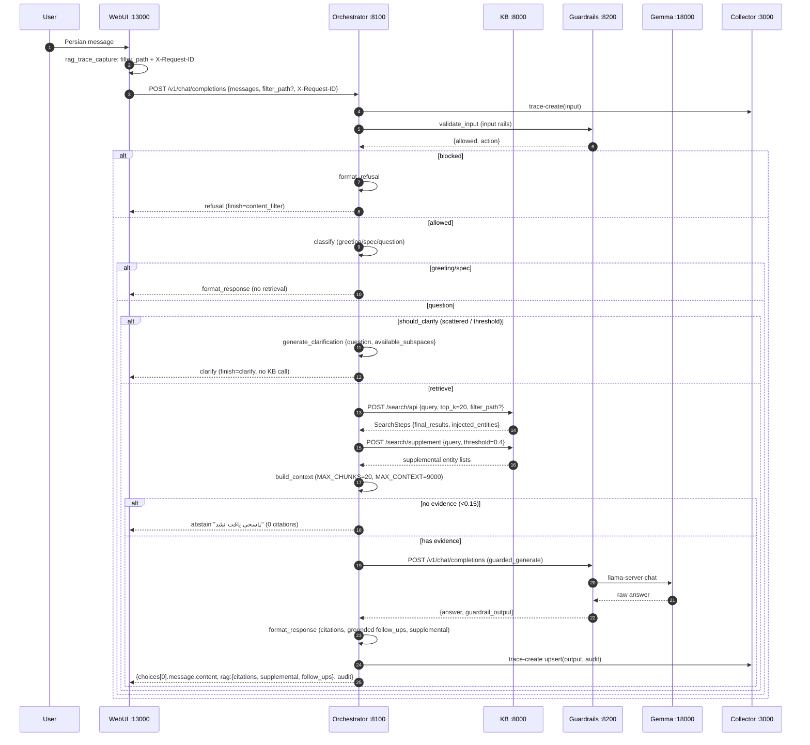
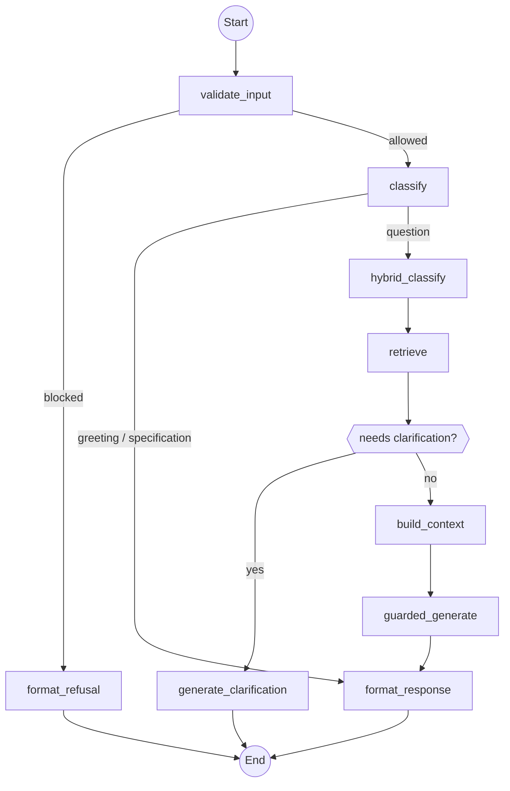
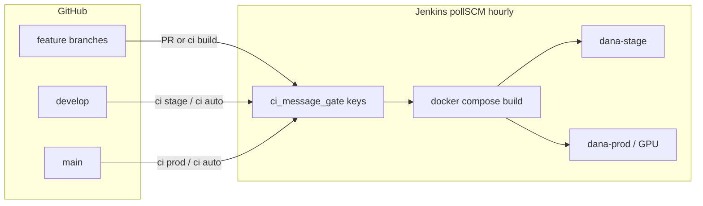

# Work Credit RAG — Phase 1

[](https://www.python.org/downloads/release/python-3110/)
[](LICENSE)
[]()

Self-hosted, Persian-capable conversational RAG platform. Production code lives in independently maintained Git submodules (orchestrator, knowledgebase, guardrails, server-setup) pinned to exact commits; the parent repo owns pins, integrated startup (`deploy/vast/`), and E2E evaluation.

> **Status:** Active on `main`. Deployed on Vast.ai (RTX 3090) and H200 host via `Work_RAG-Server-Setup` LLM manager `:9000`. Current KB `v13` — 18 docs / 1123 chunks · pgvector HNSW · `MAX_CHUNKS=20`.

<details>
<summary>Repository composition &amp; layers</summary>

Production implementation is split into Git submodules. Each gitlink is pinned to an exact commit; advancing a component requires a component-repo commit followed by a parent-repo commit that advances the gitlink.

| Path | Repository | Branch | Current pin | Responsibility |
|------|------------|--------|-------------|----------------|
| `components/server-setup` | Work_RAG-Server-Setup | `main` | `ff8c5a8` | Hardware, LLM manager `:9000`, embed `:8001-8003`, infra |
| `components/knowledgebase` | Work_RAG-KB | `master` | `92503e5` | Ingestion, `folder_hierarchy` tagging, `filter_path`, `supplement` tool, retrieval `:8000` |
| `components/guardrails` | Work_RAG-Guardrails | `main` | `1002ea8` | Persian safety policy, guarded Gemma `:8200` |
| `components/orchestrator` | Work_RAG-Orchestrator | `main` | `75cf970` | LangGraph API `:8100`, sticky `MemorySaver`, `filter_path`, evidence guard |
| `components/tracing` | parent (not a submodule) | — | — | Fallback trace collector `:3000`, `observability.db` |
| `agent-state` | ICS_ChatBot_agent-state | `main` | `a0d454e` | Agent context/history/skills — agent only, not production |

Run `git submodule status --recursive` for live pins.

Layer separation:

| Layer | Directory | Production? | Purpose |
|-------|-----------|-------------|---------|
| Entry points | `api/` | Yes | Thin wrappers → `components/` submodules |
| Implementation | `components/` | Yes | Production code (submodules, pinned commits) |
| Contracts | `contracts/` | Yes | API request/response JSON schemas |
| Deployment | `deploy/` | Yes | Start/stop/health scripts per host (Vast/H200/Docker) |
| Testing | `eval/` | Yes | E2E, guardrails, LLM-judge evaluation |
| Utilities | `scripts/` | Yes | README TOC generation, system checks |
| Agent context | `agent-state/` | Agent only | Agent mission, history, skills, standards |
| Development | `dev/` | No | Patches, ad-hoc tests, investigation scripts |
| Archive | `archive/`, `deprecated/` | No | Historical reference, read-only |

</details>

<details>
<summary>Architecture — production diagrams</summary>

### System overview

```mermaid
flowchart TB
    subgraph Client["Client layer"]
        Browser["Browser"]
        WebUI["Open WebUI :13000\nICS Helper · rag_trace_capture filter"]
    end

    subgraph Orch["Orchestration :8100"]
        Orch["Orchestrator\nLangGraph · MemorySaver · X-Request-ID sticky thread"]
    end

    subgraph KB["Retrieval :8000"]
        KBMgr["KB Manager\nBM25 tantivy + dense MiniLM-384\n+ RRF k=60 + BGE-m3 rerank\npgvector HNSW · 1123 chunks"]
        Filter["filter_path · folder_hierarchy"]
        Suppl["supplement tool\nPOST /search/supplement · entity lists"]
    end

    subgraph GR["Safety :8200"]
        Guard["Guardrails\nPOST /v1/rails/check input\nPOST /v1/chat/completions guarded_generate\nPersian signals + LLM judge"]
    end

    subgraph Gen["Generation"]
        Gemma["Gemma 4 31B\nunsloth/gemma-4-31B-it-GGUF UD-Q4_K_XL\n:18000 Vast · :9000 Manager H200"]
        Embed["Embed trio :8001-8003\ne5-small · bge-m3 · MiniLM"]
    end

    subgraph Obs["Observability"]
        Coll["Collector :3000\nobservability.db SQLite"]
        LF2["Langfuse v2 :3001"]
        Studio["Studio :2024\nLangGraph API"]
    end

    Browser --> WebUI
    WebUI -- "OPENAI_API_BASE_URL=8100/v1\n+ X-Request-ID" --> Orch
    Orch --> Guard
    Guard -- "blocked" --> WebUI
    Guard -- "allowed" --> KBMgr
    KBMgr --> Filter
    KBMgr --> Suppl
    Suppl -- "merged into context" --> Orch
    Orch -- "guarded_generate" --> Guard
    Guard --> Gemma
    Embed -.-> KBMgr
    Orch -.-> Coll
    Coll --> LF2
    Coll -.-> Studio
```

### Request flow — sticky + filtered RAG



### Orchestrator LangGraph graph



Graph nodes match `components/orchestrator/src/work_rag_orchestrator/graph.py`: `validate_input → classify → hybrid_classify → retrieve`, then conditional `should_clarify` branches to `generate_clarification` (ends) or `build_context → guarded_generate → format_response` (ends). Blocked input short-circuits to `format_refusal` (ends). Greeting/specification queries bypass retrieval and go straight to `format_response`.

</details>

<details>
<summary>Request lifecycle</summary>

1. **WebUI filter** (`components/openwebui-filters/rag_trace_capture.py`) — captures `filter_path` from scope/`[چک]` prefix, injects `X-Request-ID`, records trace start.
2. **`validate_input`** — Guardrails input rails; short-circuits to refusal if blocked.
3. **`classify` + `infer_specification`** — classifies `greeting/spec/question`; maps query to `applied_subspace` via `subspace_map`; `general` exempt from clarify gate.
4. **`should_clarify?`** — scattered/ambiguous query with no resolved subspace → `generate_clarification` returns `finish=clarify` with available subspaces, **no KB call**.
5. **`retrieve`** — `POST /search/api` with rewritten query, `top_k=20`, `filter_path` (explicit or sticky). KB returns `SearchSteps` + `injected_entities`. Parallel `POST /search/supplement` (threshold 0.4) for entity lists.
6. **`build_context`** — `MAX_CHUNKS=20`, `MAX_CONTEXT_CHARS=9000`; evidence guard per-subspace (`cheque 0.05`, `facilities_person 0.10`, `facilities_legal 0.15`, `general 0.15`) — below threshold → abstain.
7. **`guarded_generate`** — `Guardrails :8200 → Gemma :18000` (`enable_thinking:false`, `--no-mmproj --jinja`).
8. **`format_response`** — citations ≤20, `rag.supplemental`, grounded `follow_ups`, `stage_timing_ms`.
9. **Observability** — async trace to `:3000` (`observability.db`) + Langfuse `:3001`; DLQ `/tmp/dlq_retrieval.jsonl` on empty filtered retrieval.

`subspace_map`: `cheque → گزارش اعتبارسنجی چک`, `facilities_person → اشخاص حقیقی/اعتبارسنجی تسهیلات`, `facilities_legal → اشخاص حقوقی/اعتبارسنجی تسهیلات`, `general → پایگاه دانش عمومی`.

`filter_path` travels WebUI filter → Orchestrator → KB and sticks via `X-Request-ID` thread until re-specified (`چک` re-spec switches subspace).

</details>

<details>
<summary>Models &amp; libraries</summary>

| Role | Model | Version | Size | Key config |
|------|-------|---------|------|------------|
| Generation | Gemma 4 31B Instruct | `unsloth/gemma-4-31B-it-GGUF:UD-Q4_K_XL` | 18.8 GiB | `--no-mmproj --jinja --ctx-size 8192 --temp 0.2` + `enable_thinking:false` |
| Embedding | paraphrase-multilingual-MiniLM-L12-v2 | `sentence-transformers/...` | 384-dim | `KB_EMBED_DEVICE=cpu/cuda` |
| Reranker | BGE-m3 `BAAI/bge-reranker-v2-m3` | default | 568M | `KB_RERANK_POOL=15` CPU / `30` GPU |
| Reranker fallback | MiniLM `mmarco-mMiniLMv2-L12-H384-v1` | — | 118M | lightweight fallback |
| Guardrails | Ghadeer mmBERT | toxicity/hate/intent | — | thresholds: toxicity 0.80, hate 0.80, PII 0.90, injection 0.85 |
| Judge (bench) | gemma-4-31b | via `:9000` | — | RAGAS LLM-as-judge |

Key production libraries (+ versions):

| Library | Version | Used by |
|---------|---------|---------|
| Python | 3.11 | all components |
| FastAPI | >=0.115.0 | orchestrator, guardrails, KB |
| uvicorn[standard] | >=0.30.0 | orchestrator, guardrails |
| pydantic / pydantic-settings | >=2.10.0 / >=2.5.0 | orchestrator, guardrails |
| httpx | >=0.27.0 | orchestrator, guardrails |
| langgraph | >=0.2.0 | orchestrator |
| langchain-core | >=0.3.0 | orchestrator |
| langfuse | >=2.60.0 | orchestrator, guardrails, tracing |
| opentelemetry-* | >=1.24.0 | orchestrator |
| sentence-transformers | — | KB, embed servers |
| scikit-learn | — | ambiguity SVM-RBF classifier |

</details>

<details>
<summary>Configuration — key environment variables</summary>

| Component | Variable | Default | Production (Vast) | Notes |
|-----------|----------|---------|-------------------|-------|
| Orchestrator | `ORCHESTRATOR_PORT` | 8100 | 8100 | public API |
| | `KB_BASE_URL` | `http://127.0.0.1:8000` | same | `kb_search_url = {KB}/search/api` |
| | `GUARDRAILS_BASE_URL` | `http://127.0.0.1:8200` | same | guarded generate + rails |
| | `retrieval_top_k` | 20 | 20 | up from 5 (MVP) |
| | `subspace_threshold` | 0.8 | 0.8 | clarify gate |
| | `evidence_min_score` | 0.15 | 0.15 | G5 hallucination guard |
| | `evidence_min_score_cheque` | 0.05 | 0.05 | per-subspace (T3) |
| | `evidence_min_score_facilities_person` | 0.10 | 0.10 | per-subspace (T3) |
| | `evidence_min_score_facilities_legal` | 0.15 | 0.15 | per-subspace (T3) |
| | `evidence_min_score_general` | 0.15 | 0.15 | per-subspace (T3) |
| | `MAX_CHUNKS` / `MAX_CONTEXT` | 20 / 9000 | 20 / 9000 | up from 5 / 6000 |
| | `hybrid_classifier_enabled` | false | false | SVM-RBF + Gemma escalation |
| | `hybrid_classifier_confidence_threshold` | 0.60 | 0.60 | escalate to Gemma when < |
| | `sticky_decay_turns` | 3 | 3 | generic-turn stale subspace |
| | `response_detail` | production | production | hides GT block |
| | `LANGFUSE_HOST` | `http://127.0.0.1:3001` | `http://127.0.0.1:3001` | `TRACE_ENABLED=true` |
| KB | `KB_WEB_PORT` | 8000 | 8000 | |
| | `KB_DB_URL` | `sqlite+aiosqlite:///./data/kb_test.db` | `postgresql+asyncpg://...:5432/kb_manager` | `mode=pgvector` → HNSW |
| | `KB_EMBED_MODEL` | `paraphrase-multilingual-MiniLM-L12-v2` | same | 384-d |
| | `KB_RERANKER_MODEL` | `BAAI/bge-reranker-v2-m3` | same | or MiniLM fallback |
| | `KB_RERANK_POOL` | 15 | 15 CPU / 30 GPU | |
| Guardrails | `GUARDRAILS_PORT` | 8200 | 8200 | |
| | `UPSTREAM_LLM_BASE_URL` | `http://127.0.0.1:9000/v1` | `http://127.0.0.1:18000/v1` | Vast bare Gemma |
| | `UPSTREAM_LLM_MODEL` | `gemma-4-31b` | `unsloth/gemma-4-31B-it-GGUF:UD-Q4_K_XL` | |
| Gemma | `MODEL` | — | `/tmp/hf_clean/...UD-Q4_K_XL.gguf` | H200 uses manager `:9000` |
| | `CTX_SIZE` | 8192 | 8192 (4096 if OOM) | |
| WebUI | `OPENAI_API_BASE_URL` | — | `http://127.0.0.1:8100/v1` | ICS Helper |
| | `WEBUI_AUTH` | false | false | `true` for per-user `user_id` |

Full reference: `AGENTS.md` §1–4 and `components/orchestrator/src/work_rag_orchestrator/config.py`.

</details>

<details>
<summary>Observability &amp; services</summary>

| Tool | URL | Purpose |
|------|-----|---------|
| Unified Dashboard | `http://localhost:3000/dashboard/observability` | 8-stage chunk cards, subspace badge, export JSONL/CSV |
| Langfuse v2 | `http://localhost:3001` | Full trace UI (Postgres+ClickHouse) |
| Fallback Collector | `http://localhost:3000` | `POST /api/observability/traces` → `observability.db` + JSONL |
| Local Timeline | `http://localhost:3000/observe` | Request → validate → classify → retrieve → generate → format |
| Graph Debugger / Studio | `http://localhost:3000/studio` + `:2024` | LangGraph API threads/runs/state |
| KB dashboard & search tester | `http://localhost:8000` + `/search` | doc/chunk counts, pipeline transparency (`SearchSteps`) |
| Guardrails dashboard | `http://localhost:8200/dashboard` | decision counts, block rate, per-category bars |
| LLM Manager | `http://localhost:9000` | 11-model registry, health, load/unload (H200) |

Health check:
```bash
for p in 18000 8000 8200 8100 3000 9000 13000; do
  printf "%s: " "$p"; curl -s --max-time 8 http://127.0.0.1:$p/health | head -c 100; echo
done
curl -s --max-time 8 http://127.0.0.1:8100/ready | head -c 300; echo
```

</details>

<details>
<summary>Quick start</summary>

```bash
# 1. Clone with submodules
git clone --recurse-submodules https://github.com/AliNikkhah2001/Work_Credit-RAG_Phase1.git
cd Work_Credit-RAG_Phase1
git switch main
git submodule sync --recursive && git submodule update --init --recursive

# 2. Full startup (postgres → Gemma → KB → guardrails → collector → orchestrator → WebUI)
bash deploy/vast/start.sh

# 3. Health check
bash deploy/vast/health.sh

# 4. Access via SSH tunnel
ssh -p <ssh_port> root@<ssh_host> \
  -L 13000:localhost:13000 -L 8100:localhost:8100 \
  -L 3000:localhost:3000 -L 3001:localhost:3001 -L 2024:localhost:2024
# Open http://localhost:13000 (WebUI → ICS Helper)
# Open http://localhost:3000/dashboard/observability (unified trace dashboard)
# Open http://localhost:3001 (Langfuse)
```

H200 host: LLM manager `:9000` + Gemma backends `8080-8084` + embed `8001-8003` managed by `Work_RAG-Server-Setup`; Orchestrator points `GUARDRAILS` at `:9000` there.

Docker (privileged host only):
```bash
cd deploy/docker
cp .env.example .env   # Set MODEL_FILE to your Gemma GGUF path
docker compose up -d --build
# WebUI at http://<host>:13000
```

</details>

<details>
<summary>Changelog — summary by version</summary>

| Version | Date | Summary |
|---------|------|---------|
| v13 | 2026-10-28 | KB `1405-07-06`: 18 docs / 1123 chunks · `folder_hierarchy` + `filter_path` + `supplement` tool (cos 0.4/0.6) · pgvector HNSW |
| v13 | 2026-10-24 | Orchestrator LangGraph conditional clarify (`should_clarify` → `generate_clarification`), sticky `MemorySaver` (`X-Request-ID`), `MAX_CHUNKS=20/9000`, evidence `0.15` G5 guard, grounded `follow_ups`, DLQ; ambiguity resolver (SVM-RBF, 1000-sample dataset) |
| v12 | 2026-10-12 | Guardrails `:8200` Persian rails, HurtLex 19 lemmas, `enable_thinking:false` / `--no-mmproj --jinja` clean Persian; Generation Gemma 4 31B via `:18000` (Vast) / `:9000` manager (H200); embed trio `:8001-8003` |
| v11 | 2026-10-12 | WebUI `:13000` ICS Helper (Arena OFF) · `rag_trace_capture` filter + 4 actions (`rate`/`report`/`view`/`truth`) · `WEBUI_AUTH=false` |
| v10 | 2026-10-12 | Observability `:3000/dashboard/observability` (unified `observability.db`, chunk cards, subspace badge, export) + Langfuse `:3001` + Studio `:2024` |
| v9 | 2026-10-12 | Benchmark: multi-agent conversational 41 turns · RAGAS per-subspace · `docs/benchmark-report-2026-10-12.md` |

Pins: `main d1c9b33` + submodules `c3c7476`/`d040c63`/`14c5f97`/`d615f66` (historical); current live pins via `git submodule status --recursive`.

</details>

<details>
<summary>Done vs pending</summary>

Done:
- KB v13 with `filter_path`, `supplement` tool, pgvector HNSW
- Orchestrator LangGraph conditional clarify, sticky `MemorySaver`, evidence guard, grounded follow-ups
- Guardrails Persian rails, guarded Gemma `:8200`
- Generation Gemma 4 31B via `:18000`/`:9000`; embed trio `:8001-8003`
- WebUI ICS Helper with trace capture + 4 actions
- Observability unified dashboard + Langfuse + Studio
- 41-turn conversational benchmark with RAGAS per-subspace

Pending:
- Clarify gate: `0/6` scattered failures — lower `subspace_threshold` / explicit `ambiguous` classifier
- Evidence threshold per-subspace tuning (cheque `0.028` starves hits)
- Sticky carry: generic follow-ups lose `applied_subspace`
- Generation faithfulness — citation gate too strict on 2 abstains
- Latency — generation `5.3s` dominates; batch Gemma / reranker on GPU
- Supervision — `llama-server` nohup → supervisor

</details>

## CI/CD & Jenkins (dev / stage / prod)

Full operator guide: [`deploy/jenkins/README.md`](deploy/jenkins/README.md). Compose overlays: [`deploy/compose/README.md`](deploy/compose/README.md).  
GPU first-time Jenkins: [`components/server-setup/README.md`](components/server-setup/README.md) § Jenkins / CI on H200.

### Design (no paid webhook)

Jenkins **polls GitHub every hour** (`pollSCM` in root [`Jenkinsfile`](Jenkinsfile)). No Cloudflare tunnel required. After you push, either wait for the hourly scan or click **Scan Multibranch Pipeline Now** / **Build Now**.

| Space | Branch | What runs | LLM |
|-------|--------|-----------|-----|
| **dev** | `feature/*` / PR | lint + optional image build | — |
| **stage** | `develop` | build → `dana-stage` compose (alt ports) + E2E | OpenRouter (`LLM_UPSTREAM_MODE=openrouter`) on laptop |
| **prod** | `main` | build → `dana-prod` (laptop sim) or GPU self-hosted | OpenRouter on laptop; Gemma/Manager/TRT on H200 |

Self-hosted Gemma / TRT paths (`deploy/vast/`, `deploy/docker/`, server-setup manager) are **unchanged**. Laptop OpenRouter is used **only** when `DANA_ENV=test` and `LLM_UPSTREAM_MODE=openrouter` with `compose.local.yml`.

### Commit-message triggers (bold + red)

These tokens are case-insensitive and may appear anywhere in the commit subject/body:

| Token | Effect |
|-------|--------|
| $\textcolor{red}{\textbf{[ci skip]}}$ / $\textcolor{red}{\textbf{[skip ci]}}$ | Skip pipeline work |
| $\textcolor{red}{\textbf{[ci build]}}$ | Build Docker images |
| $\textcolor{red}{\textbf{[ci stage]}}$ | Build + **stage** deploy on `develop` — **no human approval** |
| $\textcolor{red}{\textbf{[ci prod]}}$ | Build + **prod** deploy on `main` — **no human approval** |
| $\textcolor{red}{\textbf{[ci auto]}}$ | Unattended: stage on `develop`, prod on `main` |

Without $\textcolor{red}{\textbf{[ci prod]}}$ / $\textcolor{red}{\textbf{[ci auto]}}$ on `main`, Jenkins still asks for a manual **Deploy** confirmation if a build was requested.

```bash
# Stage (develop) — unattended after poll/scan
git commit -m "feat: retrieval tweak [ci stage]"
git push origin develop

# Prod (main) — unattended (laptop prod-sim or H200 when DANA_HOST=gpu)
git commit -m "chore: release pins [ci prod]"
git push origin main

# Skip noise
git commit -m "docs: fix typo [ci skip]"
```

Gate logic (local test): `python3 scripts/ci_message_gate.py --self-test`

### CI architecture



### Docker containers (laptop test stack)

| Service | Port (local) | Image |
|---------|--------------|-------|
| Open WebUI | `13000` | `ghcr.io/open-webui/open-webui` |
| Orchestrator | `8100` | `rag-orchestrator` |
| Guardrails | `8200` | `rag-guardrails` |
| KB | `8000` | `rag-kb` |
| LiteLLM | `4000` | LiteLLM (OpenRouter) |
| Postgres pgvector | `15432` | `pgvector/pgvector` |
| Redis | `16379` | `redis:7` |
| Tracing | `13002` | `rag-tracing` |
| Jenkins | `8085` | `jenkins/jenkins:lts` |

Stage uses alt ports (`18100`, `18200`, …) via `compose.stage.yml`.

---

## Verification

```bash
# Health all services
for p in 18000 8000 8200 8100 3000 9000 13000; do
  printf "%s: " "$p"; curl -s --max-time 8 http://127.0.0.1:$p/health | head -c 100; echo
done

# RAG E2E (sticky + filter_path)
curl -s http://127.0.0.1:8100/v1/chat/completions -H 'Content-Type: application/json' -H 'X-Request-ID: test-001' \
  -d '{"model":"ics-helper-agent","messages":[{"role":"user","content":"چک"}],"filter_path":"گزارش اعتباری چک"}' | jq '.audit.applied_subspace'
curl -s http://127.0.0.1:8100/v1/chat/completions -H 'Content-Type: application/json' \
  -d '{"model":"ics-helper-agent","messages":[{"role":"user","content":"اعتبارسنجی چیست؟"}]}' | jq -c '{finish:.choices[0].finish_reason, citations:(.rag.citations|length)}'

# KB filtered vs supplement
curl -s http://127.0.0.1:8000/search/api -H 'Content-Type: application/json' -d '{"query":"سهامداران","top_k":5}' | jq '.injected_entities|length'
curl -s http://127.0.0.1:8000/search/supplement -H 'Content-Type: application/json' -d '{"query":"سهامداران","threshold":0.4}' | jq '.results|length'
```

## Updating a submodule

```bash
cd components/orchestrator
git switch main && git pull --ff-only
cd ../..
git add components/orchestrator
git commit -m "chore: advance orchestrator submodule"
```

Always run health + `python3 -m evaluation.bench_runner --dry-run` before advancing a production pin.

---

## License

See [LICENSE](LICENSE). Each submodule may also declare its own license and dependency obligations.

## Links

- Runbook: [AGENTS.md](AGENTS.md) §2–3 + `deploy/vast/start.sh` + `deploy/vast/health.sh`
- CI/CD: [deploy/jenkins/README.md](deploy/jenkins/README.md) · Compose: [deploy/compose/README.md](deploy/compose/README.md)
- Bench report: [docs/benchmark-report-2026-10-12.md](docs/benchmark-report-2026-10-12.md) (also `evaluation/artifacts/bench_report_latest.html`)
- Compose: [compose.mvp.yml](compose.mvp.yml) + [deploy/docker/docker-compose.yml](deploy/docker/docker-compose.yml)
- Guardrails allowlist: `components/guardrails/kb/hurtlex_allowlist.json`
- Evaluation docs: [docs/evaluation.md](docs/evaluation.md) · [docs/cross_encoder_benchmark_results.md](docs/cross_encoder_benchmark_results.md)
