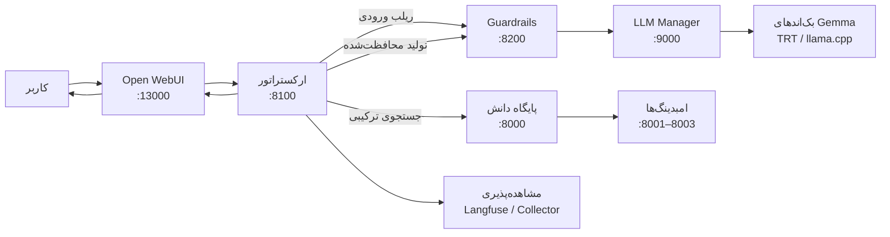
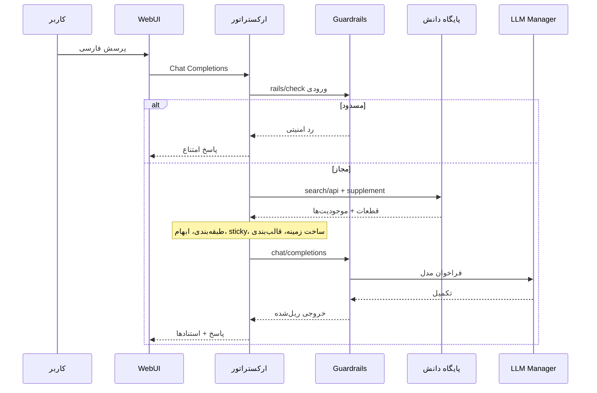
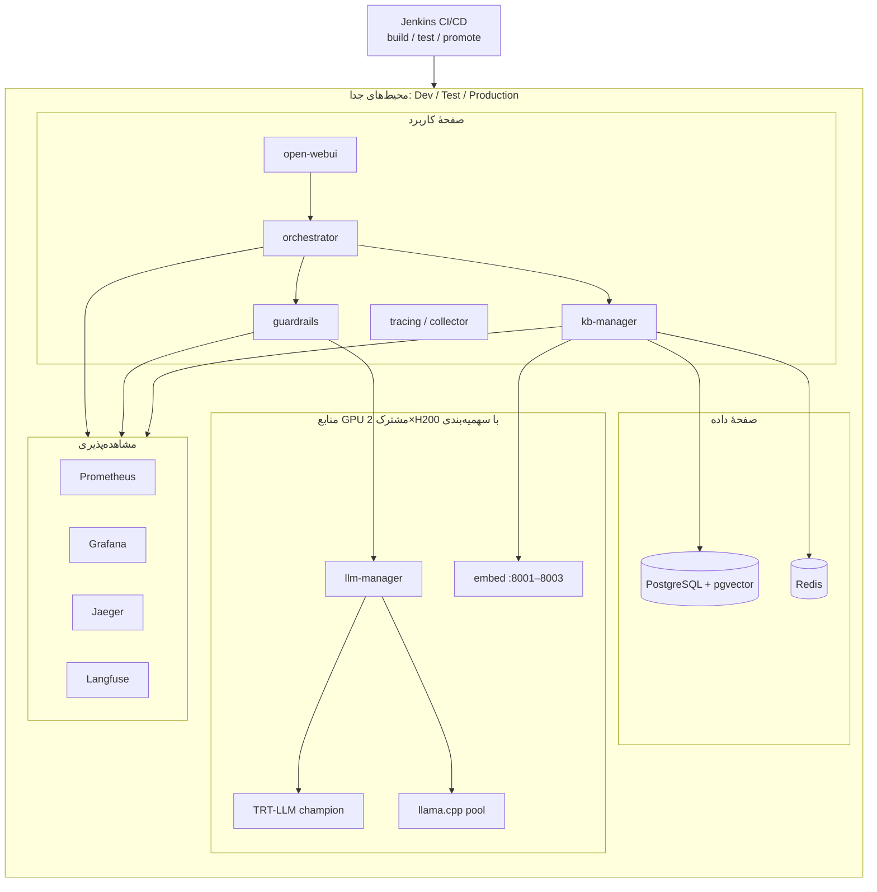
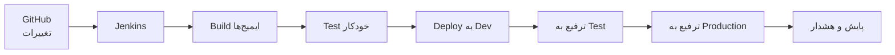

# نامهٔ فنی — معرفی سامانهٔ دانا و نیازمندی‌های زیر‌ساخت

**مخاطب:** تیم زیر‌ساخت / عملیات نرم‌افزار  
**فرستنده:** تیم توسعهٔ سامانهٔ اعتبارسنجی گفت‌وگویی  
**موضوع:** معرفی پروژهٔ **دانا**، شمای فنی سطح‌بالا، و نیازهای میان‌مدت و بلندمدت استقرار  
**تاریخ پیشنهادی اعلام عمومی:** **۱ آذر ۱۴۰۵**  
**وضعیت سند:** پیش‌نویس توضیحی برای هم‌راستایی با تیم زیر‌ساخت

---

با سلام و احترام،

پیرو برنامه‌ریزی اعلام عمومی سامانه در تاریخ **۱ آذر ۱۴۰۵**، این نامه صرفاً برای **آشنایی رسمی** تیم محترم زیر‌ساخت با پروژهٔ تازهٔ **دانا**، جزئیات فنی سطح‌بالای آن، و **نیازها و ملاحظات استقرار** نگاشته شده است. هدف، اعلام شفاف نیازمندی‌های محصول و مهندسی نرم‌افزار است تا طراحی نهایی محیط‌ها، شبکه، ظرفیت پردازشی و ابزارهای عملیات توسط تیم زیر‌ساخت — با توجه به قیود سازمانی و هم‌بستگی نزدیک با تیم‌های نرم‌افزار — تعیین و اجرا شود.

هر فناوری، الگو یا معماری نام‌برده در این نامه **پیشنهاد و توصیه** است و **انتخاب نهایی** ابزار، توپولوژی و استانداردهای استقرار بر عهدهٔ تیم زیر‌ساخت خواهد بود.

---

## ۱. معرفی پروژهٔ دانا

**دانا** سامانهٔ گفت‌وگویی خودمیزبان و فارسی‌محور برای پاسخ‌گویی به پرسش‌های حوزهٔ گزارش اعتباری، چک، تسهیلات اشخاص حقیقی و حقوقی، و دانش سازمانی مرتبط است. معماری فعلی بر پایهٔ بازیابی ترکیبی (RAG)، ارکستراسیون مبتنی بر گراف، دروازهٔ ایمنی محتوا (Guardrails)، و سروینگ مدل زبانی بزرگ روی آزمایشگاه **H200** (دو کارت NVIDIA H200) بنا شده است.

مسیر درخواست در سطح محصول به‌صورت خلاصه چنین است: رابط کاربری (Open WebUI) فراخوان OpenAI-سازگار را به **ارکستراتور** می‌فرستد؛ ارکستراتور ورودی را از **Guardrails** عبور می‌دهد، شواهد را از **پایگاه دانش (Knowledge Base)** بازیابی می‌کند، زمینه را می‌سازد، تولید را دوباره از مسیر Guardrails به **مدیر استنتاج (LLM Manager)** و بک‌اندهای Gemma می‌سپارد، و پاسخ استناددار را بازمی‌گرداند. ردپای زمانی و رویدادها برای پایش سلامت سامانه ثبت می‌شوند.

---

## ۲. جریان درخواست تا پاسخ (سطح بالا)

نمودار زیر مرز سرویس‌ها و ترتیب فراخوانی را نشان می‌دهد؛ جزئیات گره‌های LangGraph و پارامترهای بازیابی در مستندات فنی پروژه آمده است.

مراحل داخلی که برای پایش دقیق باید قابل ردگیری باشند، دست‌کم شامل این‌هاست: گره‌های گراف ارکستراتور، سیگنال‌ها و داوری Guardrails، بازیابی متراکم و تنک، ادغام RRF، ریرنکر، مکمل EntityList، حل‌کنندهٔ ابهام زیرفضایی، حلقه‌ها و بازنویسی، ساخت زمینه، و قالب‌بندی/استناد پاسخ.

---

## ۳. شمای کانتینری سطح‌بالا (پیشنهادی برای استقرار)

وضعیت فعلی آزمایشگاه H200 ترکیبی از فرایندهای میزبان (مدیر مدل، امبدینگ، استخر Gemma، TensorRT-LLM) و صفحهٔ دادهٔ Docker (WebUI، پایگاه‌بردار، Redis، پایش) است. برای اعلام عمومی و پایداری عملیاتی، **جداسازی محیط‌ها** و انسجام کانتینری پیشنهاد می‌شود؛ شکل دقیق شبکه، رجیستری ایمیج و ارکستراسیون کانتینر توسط تیم زیر‌ساخت نهایی می‌شود.

---

## ۴. نیازمندی‌ها و ملاحظات برای تیم زیر‌ساخت

### ۴.۱. محیط‌های جدا و CI/CD

برای کنترل کیفیت پیش از اعلام عمومی و پس از آن، نیاز به **سه محیط جداگانهٔ Dev / Test / Production** و زنجیرهٔ **CI/CD** (برای نمونه Jenkins) وجود دارد تا هر تغییر در مخزن GitHub بتواند به‌صورت تکرارپذیر **ساخت، آزمون و استقرار** شود. هر سه محیط باید بتوانند — با **سهمیه‌بندی و جداسازی منطقی** — به منابع GPU سرور (**۲×H200**) دسترسی داشته باشند تا نسخه‌های مختلف نرم‌افزار و نسخه‌های مختلف داده/پیکرهٔ دانش به‌صورت موازی یا زمان‌بندی‌شده آزمایش شوند، بدون تداخل مخرب با ترافیک تولید.

### ۴.۲. مشاهده‌پذیری یکپارچه

ابزارهای مشاهده‌پذیری اختصاصی — از جمله **Prometheus** و **Grafana**، و **Jaeger** برای ردگیری توزیع‌شده (در کنار بستر فعلی ردیابی پروژه مانند Langfuse/کلکتور) — باید به‌صورت محکم با سامانه هم‌بند شوند تا انواع داده از بخش‌های زیر در محور زمان ثبت و برای پایش سلامت قابل استفاده باشد:

- Guardrails (سیگنال، داوری، ریل ورودی/خروجی، `finish_reason`)
- گره‌های گراف ارکستراتور و زمان‌بندی هر مرحله
- بازیابی: متراکم، تنک (BM25)، ادغام، ریرنکر
- حل‌کنندهٔ ابهام، حلقه‌ها، بازنویسی و قالب‌بندی پاسخ
- کل مسیر درخواست تا پاسخ، با همبستگی `request_id`

هدف، امکان **ردیابی سلامت سامانه**، تشخیص گلوگاه، و تحلیل رگرسیون پس از هر انتشار است. جزئیات بک‌اند متریک/تریس و نگهداری دادهٔ پایش در اختیار طراحی زیر‌ساخت است.

### ۴.۳. محدودسازی نرخ و دفاع در ابتدای جریان

در ابتدای مسیر درخواست (لبهٔ ورودی نزدیک WebUI / ارکستراتور) لازم است **محدودسازی نرخ (rate limiting)** و ملاحظات ضدسوءاستفاده افزوده شود تا حمله‌ها یا سیل درخواست‌های غیرعادی پیش از مصرف سنگین GPU و بازیابی مهار شوند. سیاست دقیق آستانه، هویت‌سنجی لبه و محل اعمال (پروکسی، API gateway یا میدل‌ویر سرویس) توسط تیم زیر‌ساخت تعیین می‌شود.

### ۴.۴. مقیاس‌پذیری خودکار و آزمون فشار

الگوها و ابزارهای **autoscaling** باید برای لایه‌های سروینگ مدل، بازیابی و ریزسرویس‌ها در نظر گرفته شود. همچنین **آزمون فشار** با حجم بالای درخواست در ساعات اوج ضروری است تا از سطح LLM Serving تا بازیابی و کد ریزسرویس‌ها، رفتار سامانه زیر بار سنگین راستی‌آزمایی شود و ظرفیت اعلام عمومی با اطمینان عملیاتی همراه باشد.

### ۴.۵. نسخه‌بندی داده و تکامل ماژول مدیریت پایگاه دانش

**نسخه‌بندی داده** باید با چرخهٔ انتشار پروژه هم‌خوان شود. ماژول **مدیریت پایگاه دانش (Knowledge Base Manager)** باید به‌گونه‌ای توسعه یابد که نسخه‌های پیکره، فراداده، و معیارهای ارزیابی هر نسخه را در یک **ماژول یکپارچه** نگه دارد تا مقایسهٔ نسخه‌ها، بازگشت کنترل‌شده و رگرسیون کیفیت بازیابی برای محیط‌های Dev/Test/Production ممکن باشد.

### ۴.۶. صف پیام‌های ناموفق (Dead Letter Queue)

برای پایداری بلندمدت، وجود **DLQ** برای درخواست‌های ناموفق یا نیازمند بازبینی پیشنهاد می‌شود؛ از جمله:

- پاسخ نیافتن شواهد کافی در پایگاه دانش  
- نارضایتی کاربر از نتیجه  
- خاتمه‌یافته توسط Guardrails به دلایل امنیتی/سیاستی  

این صف باید به‌صورت دوره‌ای تحلیل شود تا در افق زمانی میان‌مدت و بلندمدت، هم **کد** و هم **داده** بر اساس الگوهای واقعی سازگار شوند.

---

## ۵. جمع‌بندی و محدودهٔ تصمیم

این نامه **توضیح پروژهٔ دانا** و بیان **نیازهای بلندمدت** برای آماده‌سازی اعلام عمومی در **۱ آذر ۱۴۰۵** است. معماری کانتینری، زنجیرهٔ CI/CD، انتخاب دقیق ابزار مشاهده‌پذیری، الگوی autoscaling، و جزئیات شبکه و سهمیهٔ GPU همگی با طراحی زیر‌ساخت و استانداردهای تیم‌های نرم‌افزار/عملیات **در هم تنیده‌اند**. بنابراین موارد پیش‌گفته **توصیه و اعلام نیاز** هستند و **طراحی و انتخاب نهایی** با تیم محترم زیر‌ساخت خواهد بود.

آمادهٔ جلسات هم‌ترازی فنی برای تدقیق ظرفیت، جداسازی محیط‌ها، و نقشهٔ راه استقرار تا تاریخ اعلام عمومی هستیم.

با سپاس و احترام  
تیم توسعهٔ سامانهٔ دانا
