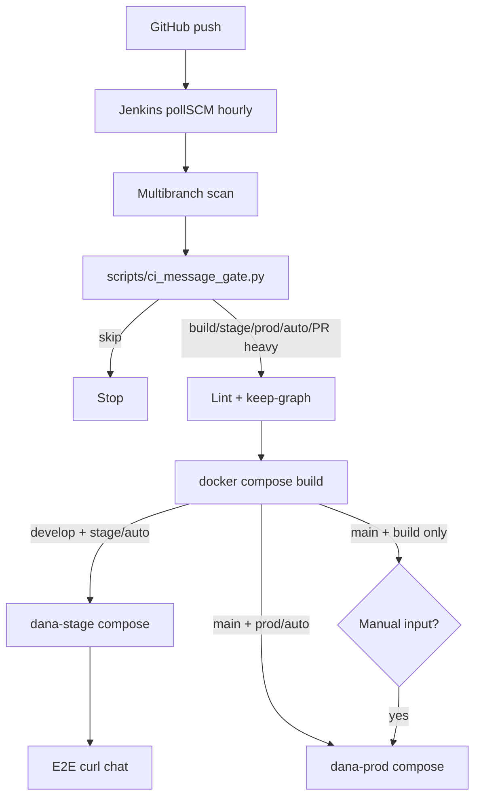

# Jenkins CI/CD — Dana / Work Credit RAG

Laptop Jenkins (`:8085`) and the same pipeline on the H200 GPU server.  
**No paid webhook / Cloudflare** — Jenkins uses **hourly `pollSCM`** against GitHub.

Detailed operator guide. Parent overview: repo root `README.md` → section **CI/CD & Jenkins**.

---

## Environments

| Space | Branch | Compose | LLM |
|---|---|---|---|
| **dev** | `feature/*` / PR | build only (optional) | — |
| **stage** | `develop` | `compose.base` + `local` + `stage` | OpenRouter via LiteLLM (`LLM_UPSTREAM_MODE=openrouter`) |
| **prod** (laptop sim) | `main` | `base` + `local` + `prod-sim` | OpenRouter |
| **prod** (GPU server) | `main` | `base` + `gpu` (or `deploy/vast` / `deploy/docker`) | Self-hosted Gemma / Manager / TRT |

Flags in env files:

- Laptop/test: `DANA_ENV=test`, `LLM_UPSTREAM_MODE=openrouter`, `DANA_HOST=laptop`
- GPU/prod: `DANA_ENV=prod`, `LLM_UPSTREAM_MODE=self_hosted`, `DANA_HOST=gpu`

---

## Commit-message triggers (find these fast)

GitHub-rendered (bold + red):

- $\textcolor{red}{\textbf{[ci skip]}}$ / $\textcolor{red}{\textbf{[skip ci]}}$ — do nothing useful
- $\textcolor{red}{\textbf{[ci build]}}$ — build images
- $\textcolor{red}{\textbf{[ci stage]}}$ — build + **stage** deploy (`develop`) — **no approval**
- $\textcolor{red}{\textbf{[ci prod]}}$ — build + **prod** deploy (`main`) — **no approval**
- $\textcolor{red}{\textbf{[ci auto]}}$ — unattended: stage on `develop`, prod on `main`

Also: **heavy path** changes under `components/`, `deploy/`, `Jenkinsfile`, `Dockerfile*` can enable builds on PRs / interactive prod path.

Hourly poll discovers new commits; **stage/prod deploy still require** $\textcolor{red}{\textbf{[ci stage]}}$, $\textcolor{red}{\textbf{[ci prod]}}$, or $\textcolor{red}{\textbf{[ci auto]}}$ (unless you click Deploy on an untagged `main` build).

### Examples

```bash
git commit -m "feat(kb): denser chunks [ci stage]"
git push origin develop          # → stage within ~1h (or Scan Multibranch now)

git commit -m "chore: release pins [ci prod]"
git push origin main             # → prod unattended within ~1h

git commit -m "docs: typo [ci skip]"
git push origin develop          # → skipped
```

---

## CI flow diagram



---

## First-time laptop setup

```bash
docker compose -f deploy/jenkins/docker-compose.yml up -d
open http://127.0.0.1:8085
# initialAdminPassword: docker exec dana-jenkins cat /var/jenkins_home/secrets/initialAdminPassword
```

1. Install suggested plugins + **Pipeline**, **Git**, **GitHub Branch Source**, **Docker Pipeline**.
2. **Manage Credentials** → add:
   - GitHub PAT (read repo) — username/password or secret text
   - Secret text: `OPENROUTER_API_KEY`, `LITELLM_MASTER_KEY` (laptop only)
3. **New Item** → **Multibranch Pipeline** → name `dana-rag`
4. Branch source: GitHub → owner `AliNikkhah2001` → `Work_Credit-RAG_Phase1`
5. Behaviors: discover branches `develop`, `main`, `feature/*`; discover PRs if desired
6. Build configuration: by Jenkinsfile (root)
7. Scan triggers: leave empty (Jenkinsfile `pollSCM` handles hourly); or “Periodically if not otherwise run” every 1 hour as backup
8. Save → **Scan Multibranch Pipeline Now**

Ensure `deploy/compose/.env` exists on the Jenkins agent host (gitignored) with OpenRouter key for laptop builds.

---

## First-time GPU server (H200) setup

See also `components/server-setup/README.md` → **Jenkins / CI on H200**.

Summary:

1. Install Docker + NVIDIA Container Toolkit; clone umbrella with submodules.
2. Run `deploy/jenkins/docker-compose.yml` (or host Jenkins) with Docker socket.
3. Same Multibranch job; set agent env `DANA_HOST=gpu`.
4. Create `deploy/compose/.env.prod` with `LLM_UPSTREAM_MODE=self_hosted` (no OpenRouter).
5. Ensure Gemma/Manager/TRT already healthy (`deploy/vast` or manager `:9000`).
6. Prod deploys use `compose.gpu.yml` when `DANA_HOST=gpu`.

---

## Manual “run now” without waiting for the hour

In Jenkins → `dana-rag` → branch → **Build Now**, or **Scan Multibranch Pipeline Now** after a tagged push.

---

## Local gate self-test

```bash
python3 scripts/ci_message_gate.py --self-test
echo 'feat: x [ci stage]' | python3 scripts/ci_message_gate.py --msg-stdin
```
