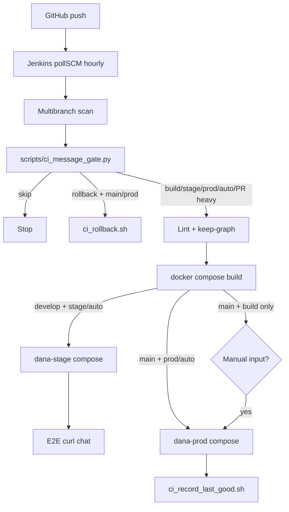

# Jenkins CI/CD — Dana / Work Credit RAG

Laptop Jenkins (`:8085`) and the same pipeline on the H200 GPU server.  
**No paid webhook / Cloudflare** — Jenkins uses **hourly `pollSCM`** against GitHub.

Detailed operator guide. Parent overview: repo root `README.md` → section **CI/CD & Jenkins**.

---

## Environments & controllers (Sprint A)

| Controller | Compose | Env | Multibranch job | Branches | May deploy |
|---|---|---|---|---|---|
| **Laptop STAGE** | `docker-compose.yml` | `DANA_ROLE=stage`, `DANA_HOST=laptop` | `dana-rag-stage` (or existing `dana-rag`) | `develop`, `feature/*` | `dana-stage` only (`[ci stage]` / `[ci auto]`) |
| **GPU PROD** | `docker-compose.yml` + `docker-compose.gpu.yml` | `DANA_ROLE=prod`, `DANA_HOST=gpu` | `dana-rag-prod` | **`main` only** | prod / `compose.gpu` only (`[ci prod]` / `[ci auto]`) |

| Space | Branch | Compose stack | LLM |
|---|---|---|---|
| **dev** | `feature/*` / PR | build only (optional) | — |
| **stage** | `develop` | `compose.base` + `local` + `stage` | OpenRouter via LiteLLM (`LLM_UPSTREAM_MODE=openrouter`) |
| **prod** (GPU) | `main` | `base` + `gpu` | Self-hosted Gemma / Manager / TRT |

Laptop **must not** run Deploy prod (`CI_MAY_DEPLOY_PROD=0`). GPU **must not** run Deploy stage. Role resolution: `scripts/ci_controller_role.py`.

Flags in app env files:

- Laptop/test: `DANA_ENV=test`, `LLM_UPSTREAM_MODE=openrouter`, `DANA_HOST=laptop`
- GPU/prod: `DANA_ENV=prod`, `LLM_UPSTREAM_MODE=self_hosted`, `DANA_HOST=gpu`

---

## Commit-message triggers (find these fast)

GitHub-rendered (bold + red):

- $\textcolor{red}{\textbf{[ci skip]}}$ / $\textcolor{red}{\textbf{[skip ci]}}$ — do nothing useful
- $\textcolor{red}{\textbf{[ci build]}}$ — build images
- $\textcolor{red}{\textbf{[ci stage]}}$ — build + **stage** deploy (`develop`) — **no approval**
- $\textcolor{red}{\textbf{[ci prod]}}$ — build + **prod** deploy (`main`) — **no approval**
- $\textcolor{red}{\textbf{[ci auto]}}$ — unattended: stage on `develop`, prod on `main`
- $\textcolor{red}{\textbf{[ci all]}}$ — force full image set (ignore path filter)
- $\textcolor{red}{\textbf{[ci rollback]}}$ — prod controller only: restore apps from `deploy/compose/.last_good_sha(.prev)` (Sprint C #10; no model rollback)

**Path → services (Sprint B):** `components/knowledgebase`→`kb`, `guardrails`→`guardrails`, `orchestrator`→`orchestrator`, `tracing`→`tracing`, `webui`→`webui`. Changes under `deploy/compose/`, `Jenkinsfile`, or `.gitmodules` → `all`. Console shows `SERVICES=…` and `Building compose services: …`.

Also: **heavy path** changes under `components/`, `deploy/`, `Jenkinsfile`, `Dockerfile*` can enable builds on PRs / interactive prod path. Submodule sync: `scripts/ci_submodule_sync.sh` (retries; loud fail on missing SHA).

Hourly poll discovers new commits; **stage/prod deploy still require** $\textcolor{red}{\textbf{[ci stage]}}$, $\textcolor{red}{\textbf{[ci prod]}}$, or $\textcolor{red}{\textbf{[ci auto]}}$ (unless you click Deploy on an untagged `main` build).

### Examples

```bash
git commit -m "feat(kb): denser chunks [ci stage]"
git push origin develop          # → stage within ~1h (or Scan Multibranch now)

git commit -m "chore: release pins [ci prod]"
git push origin main             # → prod unattended within ~1h

git commit -m "docs: typo [ci skip]"
git push origin develop          # → skipped

# Sprint C — promote stage → main (dry-run first)
bash scripts/promote_stage_to_main.sh
# then PR develop→main with title containing [ci prod], or:
# bash scripts/promote_stage_to_main.sh --execute --push

# Break-glass rollback on prod (main + prod controller)
git commit --allow-empty -m "chore: break glass [ci rollback]"
git push origin main
# or locally: bash scripts/ci_rollback.sh --dry-run
```

---

## CI flow diagram



---

## First-time laptop setup

```bash
docker compose -f deploy/jenkins/docker-compose.yml up -d
open http://127.0.0.1:8085
# initialAdminPassword: docker exec dana-jenkins cat /var/jenkins_home/secrets/initialAdminPassword
```

1. Install suggested plugins + **Pipeline**, **Git**, **GitHub Branch Source**, **Docker Pipeline**.
2. **Manage Credentials** → add:
   - GitHub PAT (read repo) — username/password or secret text
   - Secret text: `OPENROUTER_API_KEY`, `LITELLM_MASTER_KEY` (laptop only)
3. **New Item** → **Multibranch Pipeline** → name `dana-rag`
4. Branch source: GitHub → owner `AliNikkhah2001` → `Work_Credit-RAG_Phase1`
5. Behaviors: discover branches `develop`, `main`, `feature/*`; discover PRs if desired
6. Build configuration: by Jenkinsfile (root)
7. Scan triggers: leave empty (Jenkinsfile `pollSCM` handles hourly); or “Periodically if not otherwise run” every 1 hour as backup
8. Save → **Scan Multibranch Pipeline Now**

Ensure `deploy/compose/.env` exists on the Jenkins agent host (gitignored) with OpenRouter key for laptop builds.

---

## First-time GPU server (H200) setup — first-boot checklist

See also parent `README.md` → **Server first-boot checklist** and `components/server-setup/README.md` → **Jenkins / CI on H200**.

### What transfers vs what you redo

| Artifact | Reuse on server? |
|---|---|
| `deploy/jenkins/Dockerfile` → `dana-jenkins:lts` | Yes — rebuild or `docker save` / `docker load` |
| `Jenkinsfile` + commit keys | Yes — from Git |
| Laptop `jenkins_home` (password, jobs, history) | **No** (unless you deliberately copy the volume) |
| OpenRouter / LiteLLM secrets | **No** — GPU is self-hosted only |
| GitHub PAT credential | Recreate on server (same PAT OK) |
| App images `rag-*` | Rebuild on server or pull from a registry (future) |

### Checklist

1. **Prereqs:** Docker + NVIDIA Container Toolkit; `nvidia-smi` OK; GitHub PAT.
2. **Clone:** `git clone --recurse-submodules …/Work_Credit-RAG_Phase1.git`
3. **LLMs up first:** Manager `:9000` / TRT / `deploy/vast/start.sh` — not started by Jenkins app deploy.
4. **`deploy/compose/.env.prod`:** `DANA_ENV=prod`, `DANA_HOST=gpu`, `LLM_UPSTREAM_MODE=self_hosted`, CUDA embed/rerank, upstream URL to Manager or Gemma. No OpenRouter.
5. **Edit `deploy/jenkins/docker-compose.yml`:** bind-mount the **server absolute path** to the same path inside the container (replace the Mac path). Set `DANA_HOST_REPO` accordingly.
6. **Start Jenkins:** `docker compose -f deploy/jenkins/docker-compose.yml up -d --build` → `:8085`
7. **Admin:** new password from `initialAdminPassword` (fresh volume).
8. **Credential** `github-pat` (username + PAT).
9. **Multibranch** `dana-rag` → discover `main` (prod). Optionally omit `develop` so this controller is prod-only; laptop keeps stage.
10. **Env:** `DANA_HOST=gpu` on the agent so prod uses `compose.gpu.yml`.
11. **Trigger:** push `main` with `[ci prod]` from laptop → Scan Now or wait for hourly poll.
12. **Verify:** orchestrator health + chat; confirm no LiteLLM dependency.

---


## CI/CD roadmap (gated sprints)

Parent `README.md` → **CI/CD roadmap checklist** is the source of truth (sprints A–G: separate jobs, path builds, submodule checkout, promote, rollback, registry, eval smoke, GitHub notifications, JCasC).

Process: one sprint → test → human approval → next. Do not start the next sprint until the previous row is marked done in the parent README.

---

## Manual “run now” without waiting for the hour

In Jenkins → `dana-rag` → branch → **Build Now**, or **Scan Multibranch Pipeline Now** after a tagged push.

---

## Local gate self-test

```bash
python3 scripts/ci_message_gate.py --self-test
echo 'feat: x [ci stage]' | python3 scripts/ci_message_gate.py --msg-stdin
```
