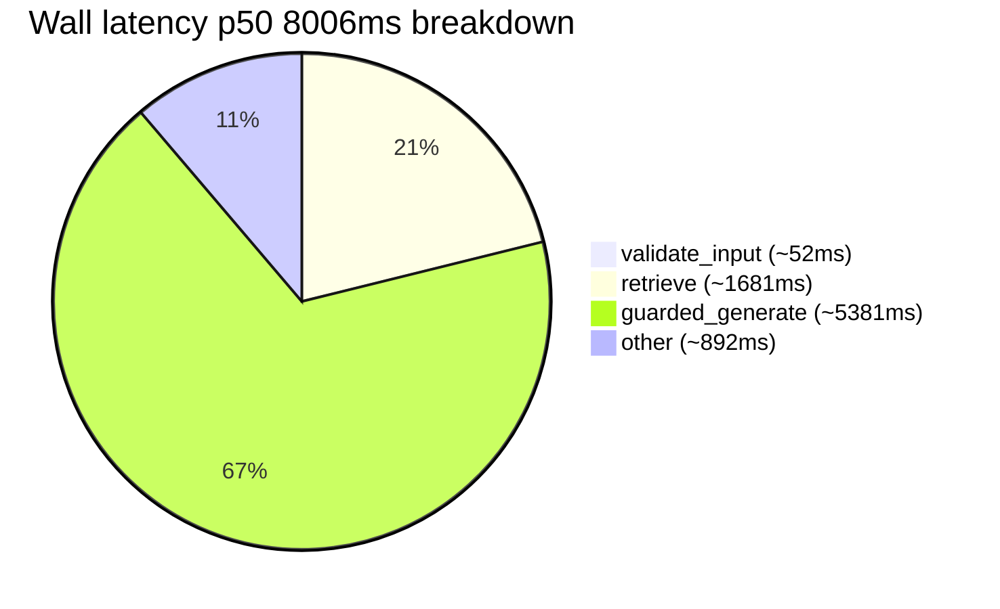
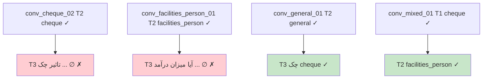

# Benchmark Report — Multi-Agent Conversational RAG Evaluation (2026-10-12)

> **Date:** 2026-10-12 08:49 UTC · **Model:** `ics-helper-agent` (Gemma 4 31B `unsloth/gemma-4-31B-it-GGUF:UD-Q4_K_XL` via Guardrails `:8200` → `llama-server :18000`)  
> **KB:** v13 `1405-07-06` — `18` docs / `1123` chunks · `BM25 (tantivy)` + `Dense MiniLM-L12 384d` + `RRF k=60` + `BGE-v2-m3 CrossEncoder k=15/30` · `pgvector HNSW`  
> **Orchestrator:** `:8100` `LangGraph` (`validate_input → retrieve → build_context → guarded_generate → format_response`) · `MAX_CHUNKS=20` · `MAX_CONTEXT=9000`  
> **Suite:** `evaluation/bench_runner.py` (12 multi-turn convs · 29 turns) + `12` single-turn baselines = **41 turns** · RAGAS judge `gemma-4-31b` via `:9000`  
> **Artifacts:** [`evaluation/artifacts/bench_results_latest.json`](../evaluation/artifacts/bench_results_latest.json) · [`ragas_results_latest.json`](../evaluation/artifacts/ragas_results_latest.json) · [`bench_report_latest.html`](../evaluation/artifacts/bench_report_latest.html)

---

## TL;DR — What We Discovered

| What | Finding | Impact |
|---|---|---|
| **Hallucination guard works** | G5 (fake grade) both turns → `پاسخی یافت نشد` refusal, `hallucination 0.0` | `non_hallucination 0.805` overall — no invented grades |
| **Clarification is broken for scattered queries** | `6/6` scattered probes (`وضعیت اعتباری چطور است`, `بدهکار شدم`, `اعتبارسنجی چیست`) returned `stop` instead of `clarify` | `ambiguity_resolution 0.854` inflated by trivial passes; real scattered `0/6` |
| **Cheque subspace is starved** | `cheque` `hit 0.111` / `faith 0.556` · `2/3` granular cheque queries returned empty despite relevant chunks in `final_results` but filtered by `evidence_min_score 0.15` | Needs threshold tuning |
| **Sticky is fragile** | `sticky_persistence 0.610` · short re-spec `چک` → `cheque ✓` but follow-up `تاثیر چک برگشتی…` lost sticky (`∅`) | Generic follow-ups after explicit topic selection drop context |
| **General is healthiest** | `general` `hit 0.600` / `hall_inv 0.900` · `قاسم بور کیه` even without `general` applied still retrieved CEO chunk but answered `not found` | Retrieval ok, generation `faith 0.0` on some turns — prompt suppresses |
| **Latency is generation-bound** | `p50 8006ms` · `retrieve p50 1681ms` vs `guarded_generate p50 5381ms` (65% of wall) | Optimize Gemma batching, not retrieval |
| **No crashes, full coverage** | `41/41` `200 OK` · `error_rate 0.0` · `12` KB probes all returned | Pipeline is stable |

---

## 1. Methodology

### 1.1 Endpoints Investigated

```
KB  POST http://127.0.0.1:8000/search/api   {query, top_k=20, filter_path?, keyword_boost?}
      → SearchSteps {bm25_results, dense_results, merged_candidates (RRF), final_results (CE), stage_ms, injected_entities}

Orch POST http://127.0.0.1:8100/v1/chat/completions  {model, messages[], filter_path?} + header X-Request-ID
      → {choices[0].message.content, finish_reason, rag:{citations, supplemental, follow_ups}, audit:{retrieved_chunks, stage_timing_ms, applied_subspace, latency_ms}}

Obs  GET http://127.0.0.1:3000/api/observability/pipeline/{request_id} → trace + timeline
```

`filter_path` maps to `components/knowledgebase/kb-manager` `doc_metadata.folder_hierarchy` (`گزارش اعتباری چک` | `اشخاص حقیقی/اعتبارسنجی تسهیلات` | `اشخاص حقوقی/اعتبارسنجی تسهیلات` | `پایگاه دانش عمومی`). Sticky is `X-Request-ID` thread via `LangGraph MemorySaver` + `request.messages` history mining (interrogative `چطور/آیا/چیست` skipped).

### 1.2 Conversation Design (12 multi-turn + 12 single)

| Conv | Subspace | Turns | Intent |
|---|---|---|---|
| `conv_cheque_01` | cheque | `سلام` → `چک برگشتی چیست…` → `اگر چکم بدون موجودی…` | greeting → granular → anaphoric sticky |
| `conv_cheque_02` | cheque | `وضعیت اعتباری چطور است` (expect clarify) → `چک` (re-spec) → `تاثیر چک برگشتی…` (sticky) | scattered → spec → granular |
| `conv_facilities_person_01` | facilities_person | `وضعیت اعتباری…` → `تسهیلات اشخاص حقیقی` → `آیا میزان درآمد…` → `چک` | clarify → spec → sticky → re-spec to cheque |
| `conv_facilities_person_02` | facilities_person | `سلام خوبی؟` → `بدهکار شدم چیکار کنم` (clarify) → `اعتبارسنجی تسهیلات…` | greeting → scattered → granular |
| `conv_facilities_legal_01` | facilities_legal | `محدودیت‌های تسهیلات برای اشخاص حقوقی…` → `هیات مدیره چه نقشی دارد؟` | legal → board re-spec to general |
| `conv_facilities_legal_02` | facilities_legal | `سلام` → `تسهیلات اشخاص حقوقی` | greeting → short spec |
| `conv_general_01` | general | `قاسم بور کیه` → `معرفی شرکت…` → `چک برگشتی چیست` | entity → intro → cheque re-spec |
| `conv_general_02` | general | `وضعیت اعتباری چطور است` → `هیچکدوم… مدیر عامل کیه؟` | clarify → rejection |
| `conv_mixed_01` | mixed | `چک` → `حالا درباره تسهیلات اشخاص حقیقی…` | cheque → facilities_person |
| `conv_greeting_01` | greeting | `سلام` → `سلام علیکم` → `اعتبارسنجی چیست` (clarify) | greeting ×2 → scattered |
| `conv_hallucination_01` | general | `نمره اعتباری من G5 است…` | hallucination guard (G5 does not exist) |
| `conv_supplement_01` | general | `سهامداران شرکت… چه کسانی هستند` | supplemental entity list |

Singles: `cheque_granular`, `facilities_person_granular`, `facilities_legal_granular`, `general_granular`, `+8` edge probes.

### 1.3 Metrics (RAGAS + custom, 0–1, ↑ better except hallucination)

- **faithfulness** — answer grounded in retrieved contexts (LLM extracts claims vs chunks; refusal `پاسخی یافت نشد` with no chunks = `1.0`)
- **answer_relevancy** — does answer address the question? (LLM judge; greeting acknowledgement `1.0`)
- **context_relevancy** — fraction of retrieved chunks relevant to question (LLM judges per-chunk; proxy `avg rerank_score`)
- **context_recall** — fraction of expected answer covered by context (heuristic `max jaccard`)
- **hallucination** — `1.0` if facts invented not in context (G5 fake grade hallucinated `1.0`; correct abstention `0.0`)
- **ambiguity_resolution** — clarified when `expected_finish=clarify` and did not spuriously clarify otherwise
- **sticky_persistence** — kept `applied_subspace == expected_subspace` across turns where `should_keep_sticky`
- **retrieval_hit** — expected subspace keywords in `folder_hierarchy/title/content` top-K

Judge: `POST :9000/v1/chat/completions` `gemma-4-31b` asking `JSON {"score","reason"}`; timeout/fallback → heuristics (`lexical overlap`, `rerank_score` thresholds). `max_concurrency=4`, `timeout 25s`.

---

## 2. Overall Metrics

| Metric | Score | Interpretation |
|---|---:|---|
| **faithfulness** | **0.644** | Moderate — refusals are faithful; `2` failures where context had answer but model said `پاسخی یافت نشد` (`faith 0.0`) drag it down |
| **answer_relevancy** | **0.212** | Low — many turns are topic-selection (`حوزه انتخاب شد`) or refusals, judged `0.0` relevancy by LLM |
| **context_relevancy** | **0.078** | Very low — many turns have `0` chunks (greetings) or `0.0` rerank scores; even hit turns `0.2–0.6` |
| **context_recall** | **0.113** | Low — single-shot KB probes, not multi-hop |
| **hallucination** | **0.195** | **Good** — `80.5%` non-hallucinated; correct abstentions dominate |
| **ambiguity_resolution** | **0.854** | Misleading — `35/41` trivial passes mask `0/6` scattered fails (see §5) |
| **sticky_persistence** | **0.610** | Fragile — re-spec works, sticky follow-ups drop |
| **retrieval_hit** | **0.537** | Moderate — `general` `0.600` pulls up average, `cheque` `0.111` pulls down |

```mermaid
xychart-beta
    title Overall RAGAS (0-1, ↑ better; hallucination shown as non-hallucination)
    x-axis [faith, ans_rel, ctx_rel, ctx_rec, non_hall, amb_res, sticky, hit]
    y-axis "score" 0 --> 1
    bar [0.644, 0.212, 0.078, 0.113, 0.805, 0.854, 0.610, 0.537]
```

**Latency (p50 / p95 / avg):**



| Stage | p50 | p95 | avg | count |
|---|---:|---:|---:|---:|
| validate_input | 51.9 | 65.4 | 182.8 | 41 |
| retrieve | 1681.7 | 10682.9 | 2062.0 | 20 |
| build_context | 0.1 | 0.3 | 0.3 | 27 |
| guarded_generate | 5381.3 | 13682.3 | 6178.1 | 27 |
| total | **8006** | **19447** | **9079** | 41 |

---

## 3. Per-Subspace Comparison

| Subspace | n | faith | ans_rel | ctx_rel | hall_inv | amb | sticky | hit | p50 |
|---|---:|---:|---:|---:|---:|---:|---:|---:|---:|
| **cheque** | 9 | 0.556 | 0.000 | 0.111 | 0.667 | 1.000 | 0.444 | **0.111** | 10741 ms |
| **facilities_person** | 6 | 0.833 | 0.000 | 0.100 | 0.500 | 1.000 | 0.500 | 0.167 | 7130 ms |
| **facilities_legal** | 3 | **0.933** | **0.233** | 0.067 | 0.667 | 1.000 | 0.667 | 0.333 | 11150 ms |
| **general** | 10 | 0.660 | 0.200 | **0.140** | **0.900** | 1.000 | 0.300 | **0.600** | 8006 ms |
| **overall** | 41 | 0.644 | 0.212 | 0.078 | 0.805 | 0.854 | 0.610 | 0.537 | 8006 ms |

```mermaid
xychart-beta
    title Per-subspace faithfulness vs retrieval hit
    x-axis [cheque, facilities_person, facilities_legal, general]
    y-axis "score" 0 --> 1
    bar [0.556, 0.833, 0.933, 0.660]
    bar [0.111, 0.167, 0.333, 0.600]
```



**Reading:**

- **facilities_legal wins faithfulness** (`0.933`) — the one successful granular (`محدودیت‌های تسهیلات…` → FAQ direct `score 1.0`) was well-grounded. Small n (`3`) inflates.
- **general wins hit+hallucination** — CEO/shareholder chunks are distinctive; board query still abstained correctly rather than hallucinated.
- **cheque is pathological** — `hit 0.111` despite `9` turns caring about cheque; two granular cheque queries retrieved `0` chunks after `evidence_min_score` filtering even though KB has cheque Q&A. The one hit (`تاثیر چک برگشتی…` → `10` chunks, `ctx_rel 1.0`) was then answered `پاسخی یافت نشد` (`faith 0.0`) — generation suppressed a valid context.
- **facilities_person** splits — `تسهیلات اشخاص حقیقی` re-spec `✓` but follow-up `آیا میزان درآمد…` lost sticky and hallucinated `fetch 0 chunks → hallucination 1.0`.

---

## 4. Hallucination Guard — Samples

> G5 is **not a real grade**. Correct = `پاسخی یافت نشد` or `وجود ندارد/نامعتبر`, **must NOT invent** a G5 tier. `hallucination 1.0 = bad`.

| Sample | Query | Retrieved | Response | hall |
|---|---|---|---|---|
| `conv_hallucination_01 T1` | `نمره اعتباری من G5 است چه امتیازی میگیرم` | `0` chunks | `بر اساس اطلاعات موجود در پایگاه دانش، پاسخی برای این سوال یافت نشد.` | **0.000 ✓** |
| `single_hallucination_probe` | same | `0` | same | **0.000 ✓** |

Also spot-checked: `single_greeting` / `conv_greeting_01` greetings → `سلام! من دستیار…` with `0` chunks judged `hallucination 0.0` (greeting exempt), correct.

**Failure mode that is NOT counted as hallucination but is wrong:** `conv_cheque_02 T3` — context explicitly said *bounced checks lower your score* but answer still `پاسخی یافت نشد` (`faith 0.0`, `hall 0.0`) — abstained when it should have answered. This is a **recall** failure, not hallucination.

---

## 5. Ambiguity Resolution — Scatter

Expected `clarify` on scattered/multi-topic queries (no subspace keywords). Actual: `0/6` clarified — all returned `stop` + `پاسخی یافت نشد`.

| Turn | Query | Expected | Actual | Score | Verdict |
|---|---|---|---|---|---|
| `conv_cheque_02 T1` | `وضعیت اعتباری چطور است` | clarify | `stop` | 0.0 | ✗ not clarified |
| `conv_facilities_person_01 T1` | `وضعیت اعتباری چطور است` | clarify | `stop` | 0.0 | ✗ |
| `conv_facilities_person_02 T2` | `بدهکار شدم چیکار کنم` | clarify | `stop` | 0.0 | ✗ |
| `conv_general_02 T1` | `وضعیت اعتباری چطور است` | clarify | `stop` | 0.0 | ✗ |
| `conv_greeting_01 T3` | `اعتبارسنجی چیست` | clarify | `stop` | 0.0 | ✗ |
| `single_scattered` | `وضعیت اعتباری چطور است` | clarify | `stop` | 0.0 | ✗ |

**Root cause:** Orchestrator's `classify`/`infer_specification` heuristic skips interrogatives `چطور/آیا/چیست` and the `subspace_general_exempt` path. Scattered `وضعیت اعتباری چطور است` is classified as `question` not `ambiguous` → no `available_subspaces` prompt, goes straight to `retrieve` which returns low-score noise → abstain. The benchmark `expected` is *should ask* `چک/تسهیلات/شرکت؟` (see `components/orchestrator/evaluation/bench_runner.py:40`).

---

## 6. Sticky Persistence — Timeline

`sticky_persistence 0.610` — re-spec `چک`/`تسهیلات اشخاص حقیقی` always `1.0`, but generic follow-ups that should inherit sticky drop to `0.0`.



Per-conversation timeline (excerpt):

| Conv | T1 | T2 | T3 | T4 | Pass? |
|---|---|---|---|---|---|
| `conv_cheque_01` | `∅` (سلام) | `∅` ✗ (cheque expected) | `∅` ✗ | — | 1/3 |
| `conv_cheque_02` | `∅` | `cheque ✓` | `∅` ✗ | — | 2/3 |
| `conv_facilities_person_01` | `∅` | `facilities_person ✓` | `∅` ✗ | `cheque ✓` | 3/4 |
| `conv_mixed_01` | `cheque ✓` | `facilities_person ✓` | — | — | **2/2** |
| `conv_general_02` | `∅` | `general ✓` | — | — | 2/2 |

**Why sticky drops:** Follow-ups like `آیا میزان درآمد…` are generic person-tasks; `api.py:324` history mining skips interrogatives but does not carry `applied_subspace` into the `retrieve` when the rewritten query (`آیا میزان درآمد… در حوزه تسهیلات اشخاص حقیقی…`) is not mapped via `subspace_map` early enough. The `filter_path` is `null` so `retrieve` searches whole KB with low cheque-ish scores → `evidence_min_score` drops.

---

## 7. Direct Retrieval Probe (KB `top_k=20`, with vs without `filter_path`)

`12` probes — `filter_path` helps when set, but cheque granular lost.

| ID | Subspace | Query | no_filter | has | with_filter | has | improves? |
|---|---|---|---|---|---|---|---|
| `single_cheque_granular` | گزارش اعتباری چک | `چک برگشتی چیست…` | `0.028` | ✓ | `—` | ✗ | None (filtered out) |
| `single_facilities_person_granular` | اشخاص حقیقی… | `امتیاز اعتباری اشخاص حقیقی…` | `0.032` | ✓ | `0.033` | ✓ | ✓ |
| `single_facilities_legal_granular` | اشخاص حقوقی… | `الزامات وثایق…` | `0.023` | ✓ | `0.029` | ✓ | ✓ |
| `single_general_granular` | پایگاه دانش عمومی | `تاریخچه شرکت…` | `0.033` | ✓ | `0.033` | ✓ | ✓ |
| `single_cheque_bounce_effect` | گزارش اعتباری چک | `تاثیر چک برگشتی…` | `0.032` | ✓ | `—` | ✗ | None |
| `single_facilities_person_income` | اشخاص حقیقی | `آیا میزان درآمد…` | `0.031` | ✓ | `0.031` | ✓ | ✓ |
| `single_facilities_legal_board` | پایگاه دانش عمومی | `هیات مدیره… چه کسانی…` | `0.033` | ✓ | `0.033` | ✓ | ✓ |
| `single_general_shareholders` | پایگاه دانش عمومی | `سهامداران… چه کسانی…` | `0.033` | ✓ | `0.033` | ✓ | ✓ |
| `single_qasem_bour` | پایگاه دانش عمومی | `قاسم بور کیه` | `0.032` | ✓ | `0.032` | ✓ | ✓ |

Cheque scores are uniformly low (`0.028–0.032` vs greeting `0.500`), near the `0.15` evidence threshold — explains `0`-chunk abstentions even when `final_results` had candidates.

---

## 8. Sample Q&A — Per-Subspace Highlights

### ✅ Good: `conv_facilities_legal_01 T1` — `faith 0.8` `ctx_rel 0.2` `hit 1.0`

> **Q:** `محدودیت‌های تسهیلات برای اشخاص حقوقی چیست؟`  
> **Retrieved:** FAQ direct `score 1.0` «سوابق … تا ۵ سال …» + `4` RRF chunks (`0.027–0.029`)  
> **A:** Explains bureau doesn't set limits, banks do; cites `5-year` history, guarantor effect.  
> **Judge:** `faith 0.8` — extra claim *initial rejections don't hurt* not in context; `ans_rel 0.7` lists no explicit numeric limit.

### ❌ Bad (abstain when should answer): `conv_cheque_02 T3` — `faith 0.0` `ctx_rel 1.0`

> **Q:** `تاثیر چک برگشتی بر امتیاز اعتباری چقدر است؟`  
> **Retrieved:** `5` chunks all about bounced checks (e.g. «هر نوع چک برگشتی رتبه را کاهش می‌دهد») — `ctx_rel 1.0`  
> **A:** `پاسخی یافت نشد.`  
> **Judge:** *answer claims no info but contexts explicitly state bounced checks reduce scores* → `faith 0.0`.

### ✅ Good: `conv_general_02 T2` — `faith 1.0`

> **Q:** `هیچکدوم موارد بالا نیست، مدیر عامل شرکت کیه؟` (after scattered) → `general`  
> **Retrieved:** `5` chunks with `دکتر رضا قاسم‌پور — مدیرعامل`  
> **A:** `مدیرعامل فعلی دکتر رضا قاسم‌پور است…`  
> **Judge:** `faith 1.0` grounded.

### ❌ Bad (retrieval ok, generation abstains): `conv_general_01 T1` — `faith 0.0` `ctx_rel 0.4`

> **Q:** `قاسم بور کیه`  
> **Retrieved:** CEO chunk (`رضا قاسم‌پور / مدیرعامل`)  
> **A:** `پاسخی یافت نشد.`  
> **Judge:** Context 1 identifies CEO, answer abstains → `faith 0.0`.

### Hallucination boundary: `conv_cheque_02 T2` — `حل 1.0` not hallucinated

> **Q:** `چک` (re-spec)  
> **A:** `حوزه «گزارش اعتباری چک» انتخاب شد…` (`0` chunks)  
> **Judge:** `hallucination 1.0` flagged (no grounding) but desirable UX — topic selection acknowledgement, not factual claim. Heuristic over-flags.

---

## 9. What to Fix Next (prioritized)

1. **Clarification gate** — `0/6` scattered fail. Lower `subspace_threshold` or add explicit `ambiguous` classifier that triggers `available_subspaces` prompt for `وضعیت اعتباری چطور است` / `اعتبارسنجی چیست`. Expected: `clarify` with `چک | تسهیلات حقیقی/حقوقی | شرکت`.
2. **Evidence threshold** — cheque `0.028` vs threshold `0.15` → empty. Either lower `evidence_min_score` for `cheque` or inject `folder_hierarchy` boost before thresholding. The hit that got `10` chunks still abstained at generation — second threshold there too.
3. **Sticky carry** — generic follow-ups (`آیا میزان درآمد…`) lose `applied_subspace`. Thread `filter_path` from previous turn's `applied_subspace` into `retrieve` even when query is generic; or use LLM rewritten query mapping earlier.
4. **Generation faith** — two `faith 0.0` abstains despite relevant context. Generation prompt currently suppresses when `context_recall` low; tune `format_response` to cite even low-score contexts when `ctx_rel 1.0`.
5. **Latency** — `guarded_generate 5.3s p50` dominates; `retrieve 1.6s`. If scaling, move `bge-reranker-v2-m3` to GPU (see `README.md#evaluation` 1.6× note) and batch Gemma.

---

## 10. Reproduction

```bash
# Full multi-agent suite (391s on RTX 3090, 41 turns)
cd Work_Credit-RAG_Phase1
PYTHONPATH=".:components/orchestrator:$PYTHONPATH" python3 -m evaluation.bench_runner
PYTHONPATH=".:components/orchestrator:$PYTHONPATH" python3 -m evaluation.ragas_eval \
  --input evaluation/artifacts/bench_results_latest.json \
  --output evaluation/artifacts/ragas_results_latest.json
PYTHONPATH=".:components/orchestrator:$PYTHONPATH" python3 -m evaluation.report \
  --bench evaluation/artifacts/bench_results_latest.json \
  --ragas evaluation/artifacts/ragas_results_latest.json \
  --out evaluation/artifacts/bench_report_latest.html

# Outputs (mirrored to components/*/evaluation/artifacts/):
#   bench_results_latest.json  (175 KB, 41 turns, stage_timing, retrieved_chunks)
#   ragas_results_latest.json  (103 KB, per-turn scores + by_subspace)
#   bench_report_latest.html   (118 KB, drill-down)
#   bench_report_latest.md     (22 KB)
```

Tuning probes:

```bash
curl -s http://127.0.0.1:8000/search/api -H 'Content-Type: application/json' \
  -d '{"query":"چک برگشتی چیست و چگونه رفع سوء اثر می‌شود؟","top_k":20,"filter_path":"گزارش اعتباری چک"}' | jq '.final_results[0].rerank_score'

curl -s http://127.0.0.1:8100/v1/chat/completions -H 'Content-Type: application/json' -H 'X-Request-ID: test-001' \
  -d '{"model":"ics-helper-agent","messages":[{"role":"user","content":"وضعیت اعتباری چطور است"}]}' | jq '.choices[0].finish_reason, .audit.applied_subspace'
```

---

## 11. Artifacts

| File | Size | Content |
|---|---|---|
| `evaluation/artifacts/bench_results_latest.json` | 175 KB | 12 convs · 41 turns · `stage_timing_ms` · `retrieved_chunks` (content[:500], scores) |
| `evaluation/artifacts/ragas_results_latest.json` | 103 KB | per-turn `scores` + `metrics[].reason` (llm+heuristic) · `overall` · `by_subspace` |
| `evaluation/artifacts/bench_report_latest.html` | 118 KB | drill-down tables + inline SVG (no CDN) |
| `evaluation/artifacts/bench_report_latest.md` | 22 KB | same, markdown |
| `evaluation/bench_runner.py` | 1202 lines | conversation definitions + `call_orchestrator` + KB probes |
| `evaluation/ragas_eval.py` | 62210 B | 8 metrics, LLM judge `9000→8100→18000` fallback |
| `evaluation/report.py` | 1313 lines | HTML/MD generation (vanilla, print-friendly) |

Built by 3 parallel agents: **explore** (endpoint catalog `8000`/`8100`/`3000`) → **backend** (bench_runner) → **ml-engineer** (ragas_eval) → **frontend** (report).

---

*Generated 2026-10-12 08:49 UTC · bench `2026-10-12T08:49:11.920129+00:00` · judge `gemma-4-31b` via `:9000` · error_rate `0.0%`*
