# Work Credit RAG — Technical Documentation Report

Iranian Credit Scoring Company (ICS) — 2026-11-10

# Work Credit RAG — Technical Documentation Report

**Organization:** Iranian Credit Scoring Company (ICS)  
**Platform:** Work Credit RAG Phase 1 (Dana Agent Framework)  
**Document date:** 2026-11-10  
**Language:** English (technical)  
**Repository:** `AliNikkhah2001/Work_Credit-RAG_Phase1` (umbrella) with submodules Work_RAG-KB, Work_RAG-Orchestrator, Work_RAG-Guardrails, Work_RAG-Server-Setup, and ICS_ChatBot_agent-state

## Document purpose

This report explains how the self-hosted Persian conversational RAG platform is structured, how a chat request becomes a grounded answer, and how each module contributes to retrieval, orchestration, model serving, safety, and observability. The prose is written for this document from the GitHub Pages technical notes and the pinned component repositories. It is an engineering narrative, not a copy of those HTML pages.

## Audience

Platform engineers, MLOps operators, and technical reviewers who need an end-to-end map before changing a submodule or deploying on the H200 lab host.

## Scope

Production behavior lives in the submodules. The parent repository owns the gitlink pins, `deploy/`, contracts, and end-to-end evaluation. `components/tracing` is parent-owned and serves the fallback collector on `:3000`. `agent-state/` holds agent working memory and stays off the request path. The deployment described in this report is the self-hosted H200 lab server.

## Submodule pins recorded on GitHub Pages

The short SHAs below are the pins printed on the parent GitHub Pages when this chapter was refreshed (2026-11-10). Treat the table as the Pages record, then run `git submodule status --recursive` and read the live gitlinks before you deploy.

| Path | Repository | Branch | Pages pin | Owns |
|---|---|---|---|---|
| `components/server-setup` | Work_RAG-Server-Setup | `main` | `ff8c5a8` | Hardware, LLM manager `:9000`, embedding servers `:8001`–`:8003` |
| `components/knowledgebase` | Work_RAG-KB | `master` | `92503e5` | Ingest, `folder_hierarchy`, `filter_path`, supplement, retrieval `:8000` |
| `components/guardrails` | Work_RAG-Guardrails | `main` | `1002ea8` | Persian safety rails and guarded Gemma `:8200` |
| `components/orchestrator` | Work_RAG-Orchestrator | `main` | `75cf970` | LangGraph API `:8100`, sticky `MemorySaver`, evidence guard |
| `components/tracing` | parent (not a submodule) | — | — | Fallback collector `:3000`, `observability.db` |
| `agent-state` | ICS_ChatBot_agent-state | `main` | `a0d454e` | Agent context only (not on the production request path) |

---

# Executive summary and module overview

## Section summary

Work Credit RAG is a Persian-first, self-hosted conversational system that answers credit-reporting questions from a versioned ICS knowledge base. A LangGraph orchestrator retrieves evidence, and a fail-closed guardrails gateway stands in front of Gemma. Production code lives in Git submodules. The umbrella repository owns pins, contracts, evaluation, and host startup scripts.

The current knowledge-base release, `v13_1405-07-06`, holds **18 documents** and **1,123 chunks**. Guardrails suppresses credit-domain HurtLex false positives with an allowlist of **28** lemmas. Subspace ambiguity is computed on every eligible turn; by default `subspace_ambiguity_enabled` is **true** and `subspace_ambiguity_route` is **false**, so the score is recorded for audit while graph routing continues to use the established clarify and retrieve edges.

## Hosts in production practice

Production runs on the **H200** lab host. The LLM Inference Manager on `:9000` fronts an 11-model registry whose champion is `gemma-4-31b`. Embedding servers and the Gemma pool are host processes. Redis, pgvector, and Open WebUI sit on a Docker data plane. The orchestrator’s published upstream model name on this host is `gemma-4-31b-triton-trt`.

The MVP path is a fixed hop list. Open WebUI (`:13000`) calls the orchestrator’s OpenAI-compatible API (`:8100`). The orchestrator validates input through guardrails (`:8200`), retrieves from the knowledge base (`:8000`), builds a bounded prompt, and generates through the same guardrails service. Gemma is reached from guardrails via the LLM manager on `:9000`. Citations return to WebUI. Traces land in Langfuse (`:3001`) or the JSONL fallback collector (`:3000`).

### H200 port overview

| Port | Service |
|---|---|
| 13000 | Open WebUI (ICS Helper) |
| 8100 | Orchestrator (LangGraph chat API) |
| 8000 | Knowledge base |
| 8200 | Guardrails |
| 8001 | multilingual-e5-small embeddings (384-d) |
| 8002 | bge-m3 embeddings (1024-d) |
| 8003 | MiniLM embeddings (384-d); orchestrator ambiguity client |
| 8010 | TensorRT-LLM Gemma-4-31B champion |
| 8080–8084 | Five llama.cpp Gemma-4-31B backends |
| 9000 | LLM Inference Manager |
| 9001 | DeepSeek-V4-Flash wrapper (standalone; outside `MODEL_REGISTRY`) |
| 3000 / 3001 / 2024 | Trace collector, Langfuse, LangGraph Studio |

Docker publishes the data plane beside those host ports: pgvector on **15432**, Redis on **16379**, Grafana on **13001**, and Prometheus on **19090**. Chapter 6 expands the Squid proxy rule, the container cutover, and the GPU placement behind `:8010` and `:8080`–`:8084`.

## Module ownership

| Module | Port | Responsibility |
|---|---|---|
| Knowledge base | 8000 | Ingest, hybrid search, EntityList supplements, KB UI |
| Orchestrator | 8100 | LangGraph RAG graph, chat API, sticky subspaces |
| Guardrails | 8200 | Input/output rails, guarded generate |
| Server setup | 9000 (+ backends) | Model lifecycle, embeds, H200 infra |
| Tracing | 3000 | Fallback collector, observability DB/UI |
| Parent ops | — | Startup, E2E, schemas, thin entry wrappers |

Thin wrappers under `api/` only adjust `PYTHONPATH` and re-export factory apps. Implementation changes belong in the owning submodule, then the parent gitlink advances.

---

# System architecture and request-to-response

## Section summary

Retrieval, policy, orchestration, and generation are separate processes with stable ports. The high-level figures show the boxes a new engineer needs. The detailed figures map those boxes onto LangGraph nodes, KB routes, and the Gemma gateway. The walkthrough below follows one chat completion from WebUI to citations, with the published budgets for sticky memory, context, evidence, and ambiguity.

## Request path

A production turn uses one hop list. The browser talks only to Open WebUI on `:13000`. WebUI posts an OpenAI-shaped chat completion to the orchestrator on `:8100`. The orchestrator calls guardrails on `:8200` for the input rail (`POST /v1/rails/check`), then the knowledge base on `:8000` (`POST /search/api` with `top_k=20`, and `POST /search/supplement` at threshold **0.4**). `build_context` packs at most **`MAX_CHUNKS` = 20** chunks inside a context budget of **`MAX_CONTEXT` = 9000**. Generation returns through guardrails `POST /v1/chat/completions`. Guardrails is the only service that calls Gemma, through the H200 LLM Inference Manager on `:9000`. Citations and `finish_reason` go back through the orchestrator to WebUI. Traces go to Langfuse on `:3001` or the JSONL collector on `:3000`. LangGraph Studio listens on `:2024` and requires `request_id` on every run input.

Sticky subspace memory is checkpointed with `MemorySaver`. `STICKY_DECAY_TURNS` defaults to **3**: after three consecutive generic follow-ups the sticky subspace is dropped. If the best evidence score is below **0.15**, the turn abstains. Per-subspace floors can be lower than that global `EVIDENCE_MIN_SCORE`; chapter 5 lists them.

`AmbiguityResult` is computed in `subspaces.py` with three defaults that define the current product behavior. `subspace_ambiguity_enabled` is **true** (compute the score and keep it for audit). `subspace_ambiguity_route` is **false** (instrument only: the score does not route and does not by itself clarify). `subspace_ambiguity_margin` is **0.08**. The scattered-query check can still open a clarification, and an entity supplement still short-circuits that branch. The remaining thresholds (minimum top-1, entropy cap, softmax temperature) are in chapter 5.

## High-level system overview

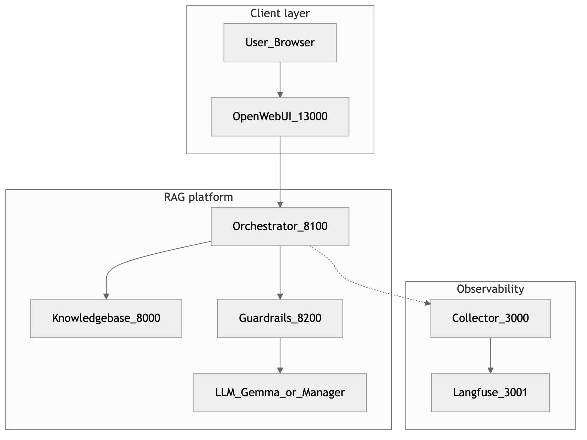

**Figure 1. High-level system overview.** The browser reaches Open WebUI on `:13000`, which forwards OpenAI-shaped chat calls to the orchestrator on `:8100`. The orchestrator coordinates the knowledge base (`:8000`) for evidence and guardrails (`:8200`) for both input adjudication and generation. Observability collectors sit beside the path rather than inside the user loop. This view hides LangGraph node names so a reader can see ownership boundaries before opening Python modules.

## Detailed system overview

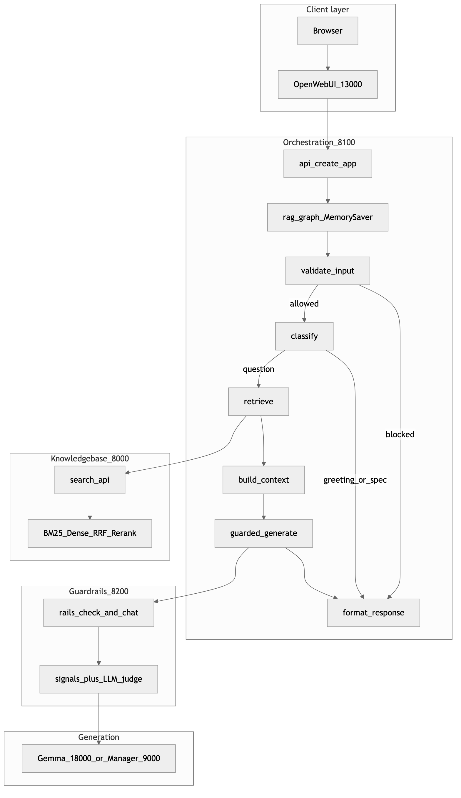

**Figure 2. Detailed system overview.** Expanding the orchestrator box shows `validate_input`, `classify`, `retrieve`, `build_context`, `guarded_generate`, and `format_response` as wired in `components/orchestrator/src/work_rag_orchestrator/graph.py`. The knowledge base exposes `POST /search/api` (BM25, dense retrieval, RRF, cross-encoder rerank) and `POST /search/supplement` for EntityList rows. Guardrails exposes `POST /v1/rails/check` and `POST /v1/chat/completions`, proxying Gemma through the manager on `:9000` only when generation is allowed. Embedding traffic for the ambiguity head targets MiniLM on `:8003`. This diagram recreates the parent technical-page “Variant A” overview for the report template.

## Request flow (high level)

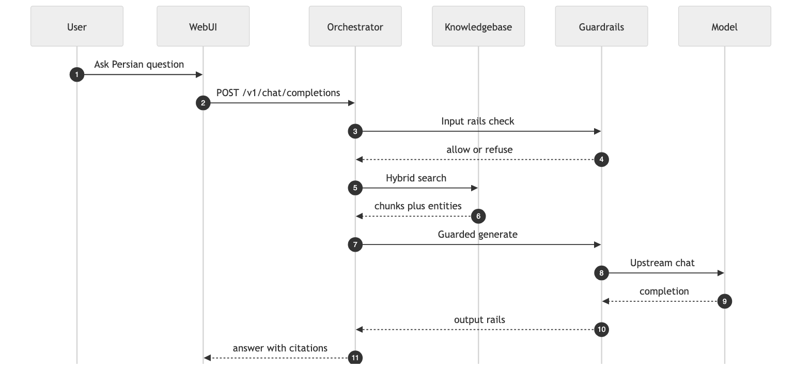

**Figure 3. Sticky filtered RAG — high-level sequence.** A user question becomes a chat completion. Input rails may refuse before any retrieval. Otherwise hybrid search returns chunks and, when entity lists match, supplemental rows. Guarded generation calls the model through guardrails and returns through output rails. Citations are assembled before the answer reaches WebUI. Sticky decay (three generic turns), the 0.15 evidence floor, and the 20-chunk / 9000 context budget are omitted from this black-box picture and appear in the detailed sequence.

## Request flow (detailed)

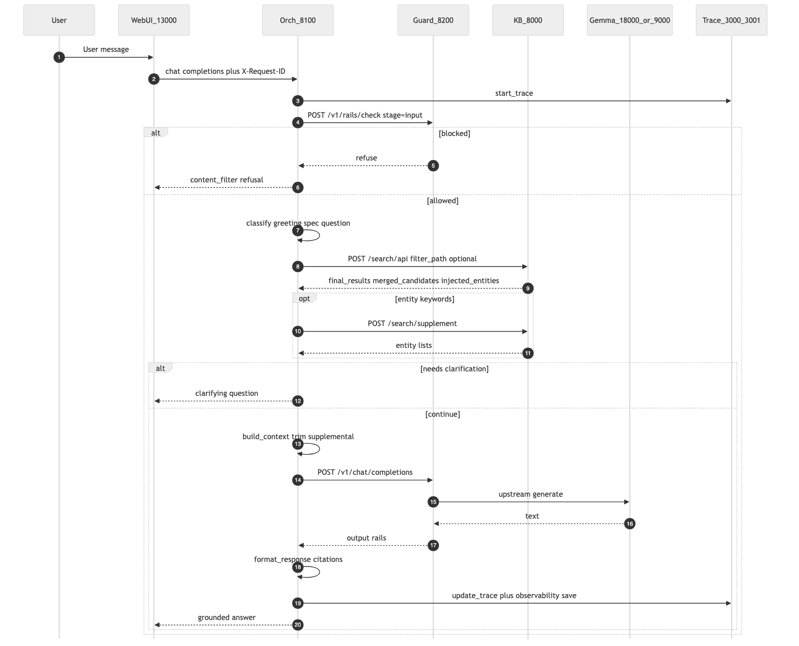

**Figure 4. Sticky filtered RAG — detailed sequence.** After `start_trace`, the orchestrator calls the guardrails input check. Classification routes greetings and specifications away from retrieval. Questions call `KnowledgebaseClient.retrieve` (`clients/knowledgebase.py`), which posts to `/search/api` with optional `filter_path` and a per-subspace `keyword_boost`. When entity keywords match, `supplementary_search` posts to `/search/supplement` at threshold 0.4. `should_clarify` in `graph.py` skips clarification when `supplemental` or `injected_entities` are present. Continuing turns run `build_context` under `MAX_CHUNKS=20` and `MAX_CONTEXT=9000`, abstain when evidence is below 0.15, then call guarded generate and `format_response`. Sticky `applied_subspace` is restored from the `MemorySaver` checkpoint and decays after three generic turns.

## End-to-end walkthrough

1. **Ingress.** WebUI sets `OPENAI_API_BASE_URL=http://127.0.0.1:8100/v1`. Sticky threads use `X-Request-ID` / `request_id`. Studio runs must include `request_id`. When WebUI sends no request id, the API mines sticky scope from user-only chat history: interrogatives are skipped and declarations set scope.
2. **Validate.** `nodes/validate_input.py` calls Guardrails `POST /v1/rails/check` with `stage=input`. A block sets `blocked` and routes to `format_refusal`.
3. **Classify.** `nodes/classify.py` labels greeting, specification, or question. Specifications lock subspace language that later becomes `filter_path`. Optional `hybrid_classify` stays off unless `HYBRID_CLASSIFIER_ENABLED` is set.
4. **Retrieve.** `nodes/retrieve.py` may rewrite coreference, apply sticky subspace with decay 3, search the KB, merge the RRF and cross-encoder pools (`RETRIEVAL_TOP_K=20`), fire the entity supplement, and score evidence. A filtered miss can retry once over the whole KB.
5. **Clarify or build.** `should_clarify` asks a question via `generate_clarification` for scattered ambiguity when no subspace is applied. The ambiguity *score* is recorded (`enabled=true`) and does not drive this edge while `subspace_ambiguity_route` remains false and the margin stays 0.08. Entity hits skip clarification. Otherwise `build_context.py` assembles the Persian system prompt, at most 20 chunks, history, and trimmed entity JSON inside the 9000 context budget.
6. **Generate.** `guarded_generate` posts to Guardrails. It never opens a socket to Gemma. Upstream cleanup strips leaked special tokens (`enable_thinking` stays false on the server).
7. **Format.** Citations and finish reasons match the OpenAI response schema. Audit fields and timings attach on non-streaming responses.

## Orchestrator graph figures

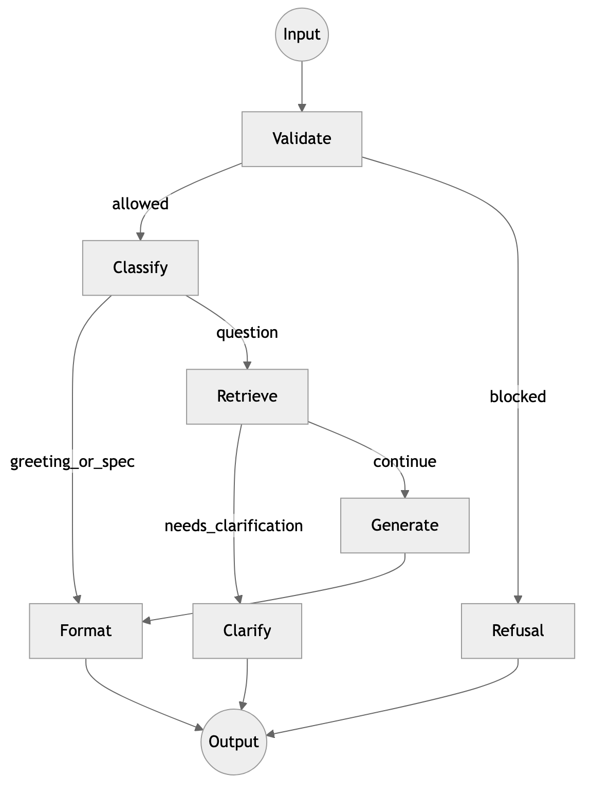

**Figure 5. Orchestrator graph — high level.** Validate, classify, retrieve, optional clarify, generate, and format form one directed path with refusal and clarification exits. Operators can read latency off this picture: once the KB is warm, most wall time sits in retrieve-plus-generate, not in classify. Sticky bookkeeping and the instrument-only ambiguity score are state on the edges, not extra nodes.

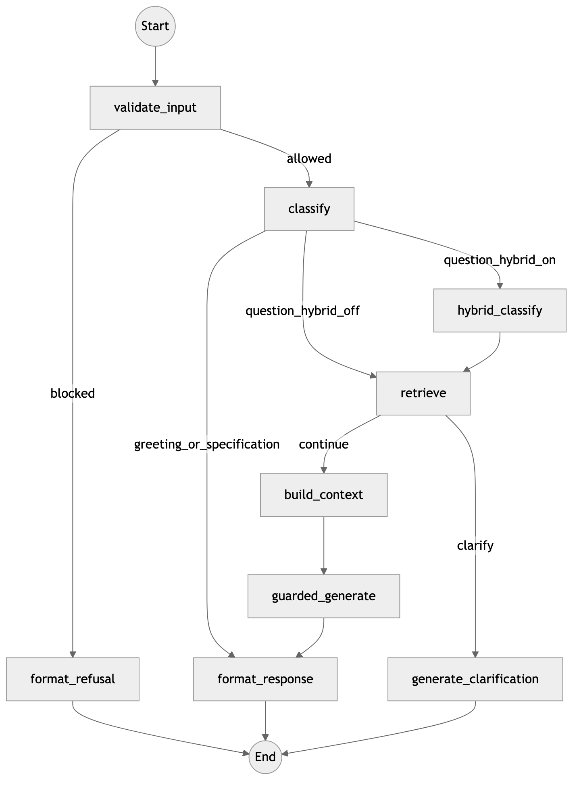

**Figure 6. Orchestrator graph — detailed.** Node names match `create_graph()` in `graph.py`. The conditional edges are `should_continue_after_validation` (`graph.py:24`), `should_route_after_classify` (`graph.py:31`), and `should_clarify` (`graph.py:45`). `should_clarify` short-circuits when an entity supplement is present, consults `subspace_ambiguity_route` together with `ambiguity_ambiguous` (a no-op for routing while the route flag is false), and falls back to the scattered-query check. File and line anchors for every node are tabulated in chapter 5.

---

# Knowledge base

## Section summary

The knowledge base (`components/knowledgebase`, kb-manager) is the retrieval substrate for Persian credit-scoring questions. It turns source files into versioned chunks and entity supplements, then answers hybrid search with named stage timings. Release `v13_1405-07-06` is **RAM-first**: tantivy BM25 and the pgvector HNSW index stay resident, MiniLM and BGE-m3 run on GPU, and a warm hybrid query averages about **55 ms**. This chapter walks ingest, the published parameter table, the v1–v13 changelog, and EntityList thresholds (0.6 in search, 0.4 on the supplement tool).

## Purpose in the platform

The KB is the retrieval service beside the chat model and the policy layer. Its contract is: given a Persian or mixed query and an optional subspace hint, return ranked chunk evidence with timings and citation metadata. The orchestrator (`:8100`) calls `POST /search/api` after input rails. `build_context` then packs the hits. The service listens on **`:8000`**, persists through SQLAlchemy into Postgres with pgvector (SQLite is the fallback), and exposes FastAPI routes for search, the ingest pipeline, and metrics. Quality is reported with Hit@*k*, MRR, and nDCG, plus `stage_ms`, so each release carries both a quality figure and a named-stage latency.

The KB owns documents, ingest, indexing, retrieval, reranking, and KB evaluation. It does not own model lifecycle, safety policy, orchestration, or the WebUI.

## Corpus at v13

The current release label is **`v13_1405-07-06`**: **18 documents / 1,123 chunks**, from kb-source folder `1405-07-06` (earlier folders `1405-05-31` and `1405-06-23` remain in the submodule). KB Pages date the full RAM-first rebuild to **2026-10-07**. A latency page measured **1,110** chunks at `top_k=5`; that count is the same rebuild family as 1,123, not a second corpus.

Chunk types in the v13 tree are `qa_pair` **776**, `reason_detail` **198**, `body` **71**, `article` **46**, `kv_pair` **19**, plus **13** parent chunks. Four hierarchy roots organize the folders: حقیقی تسهیلات, حقیقی چک, حقوقی تسهیلات, and عمومی. There is no third sheet under those roots.

The frozen evaluation set is **120** queries in six formats. The published **v11 Hit@5 is 0.9306**. The KB tree’s cited `pytest` run records **116 passed**.

Entity supplements sit beside chunks. XLSX list sheets (shareholders, lenders, loan titles, and similar annexes) land in the `entity_lists` table. Search step 8 embeds the query with MiniLM and keeps lists whose cosine against `description_embedding` is **≥ 0.6**, returned as `injected_entities`. The orchestrator also calls the supplement tool at threshold **0.4** (`POST /search/supplement`) and surfaces the payload as `rag.supplemental`. Those two thresholds are different gates. The 0.6 step is inside `/search/api`. The 0.4 route ranks `EntityList` rows over list name and description and returns them on the tool path.

## Ingest pipeline

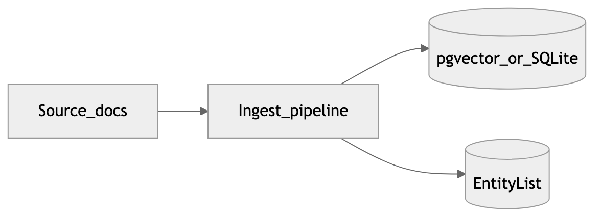

**Figure — High-level ingest.** Source trees under `kb-source` enter one pipeline that writes two durable stores: document and chunk tables with dense embeddings, and a parallel `EntityList` table for structured supplements that must stay out of ordinary prose chunks. Ingest is a write path. Hybrid search reads the snapshot that a full or incremental rebuild leaves behind. The v13 snapshot behind this figure is the 18-document, 1,123-chunk tree described above.

Coordination lives in `components/knowledgebase/kb-manager/kb_manager/pipeline/orchestrator.py`. `PipelineOrchestrator` selects a parser by extension, runs Persian hygiene (digit and character normalization, punctuation cleanup), then chunks and embeds. Folder hierarchy under `kb-source` becomes the metadata that `filter_path` and sticky subspaces later consume.

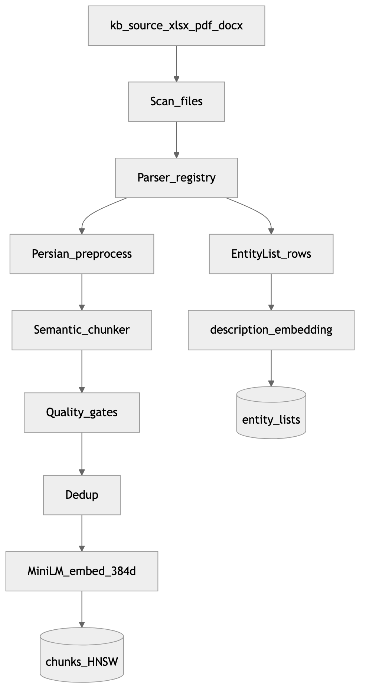

**Figure — Ingest detail.** The per-file loop is parse, preprocess, content-hash skip or update, semantic chunk, embed, and store, with an early branch for supplementary Excel lists. Annex and list paths bypass normal chunking into `EntityList` rows. Synonym and glossary annexes feed the BM25 synonym map (93 colloquial-to-formal entries from v12) and stay out of the prose chunk corpus. Embeddings on the list branch fill `description_embedding`, which the 0.6 cosine inject ranks.

`SemanticChunker` (`kb_manager/chunker/semantic.py`) prefers meaning-preserving units. Tabular schemas become row-aware chunks with Persian field labels. Narrative documents split on structure and on normalized question text. Near-duplicate normalized questions are removed so BM25 is not rewarded for FAQ clones. The published chunk policy is semantic chunks with a **512**-token maximum, parent chunks up to **1536**, scoped to the sheet.

### EntityList model

Structured supplements are first-class rows in `kb_manager/models/database.py`:

- `list_name` — the human title used as the retrieval surface
- `description` and `description_embedding` — a short Persian description plus the JSON embedding used for cosine matching
- `content_json` — the sheet payload kept intact for injection into context

Bank-name tables, code maps, and similar annexes stay queryable as units. Flattening those cells into MiniLM space is a poor fit for short keys, which is why the 0.6 / 0.4 gates exist beside the chunk index.

## Retrieval pipeline

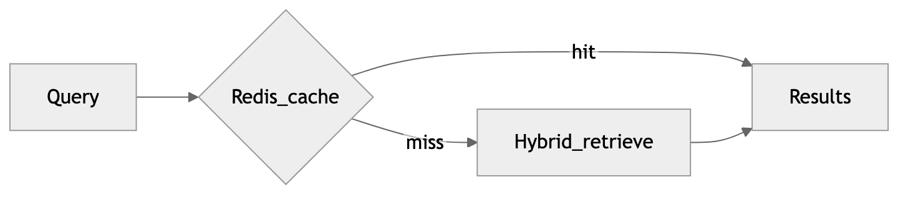

**Figure — High-level retrieval.** A request hits Redis first. The cache key is the SHA-256 of the normalized query, `top_k`, keyword boost, and `filter_path`, so a subspace answer cannot leak into another domain. Hits return in **2–7 ms** and skip the ranker. Misses run the hybrid path and write back with a **600 s** TTL. Pages describe that Redis hit as about **150×** faster than a cold search. `KB_FAST_CACHE` defaults to true and skips a fingerprint scan of about **2.7 s** on every search. Errors are never cached.

The implementation behind the figure is `kb_manager/web/routes/search.py`. `search_knowledge_base` builds or reuses in-memory indexes and runs the stages below. `filter_path` resolves to `allowed_ids` from `folder_hierarchy` *before* BM25 and dense search, which is how sticky product subspaces scope a query without re-embedding the corpus.

1. **Normalize.** Arabic characters fold to Persian, ZWNJ is handled, and digits are normalized. Tokens are words plus Persian character **3-grams**.
2. **Expand.** The synonym beam defaults to **`KB_SYNONYM_BEAM` = 5**. Setting the beam to 1 cuts BM25 work by about 5×. HyDE (`KB_HYDE_ENABLED`) defaults to **false**.
3. **Retrieve in parallel.** Tantivy BM25 (content and keyword legs) runs beside dense MiniLM over pgvector HNSW.
4. **Fuse and rerank.** Reciprocal rank fusion uses **k = 60**. The BGE cross-encoder then fuses with RRF at **α = 0.7**, with pin protection for a strong keyword hit.
5. **Gate.** A final top-*k* and `min_relevance` cut, then EntityList inject at cosine **≥ 0.6**.
6. **Respond.** `POST /search/api` returns `SearchSteps` and `final_results`, plus `injected_entities` when step 8 fires.

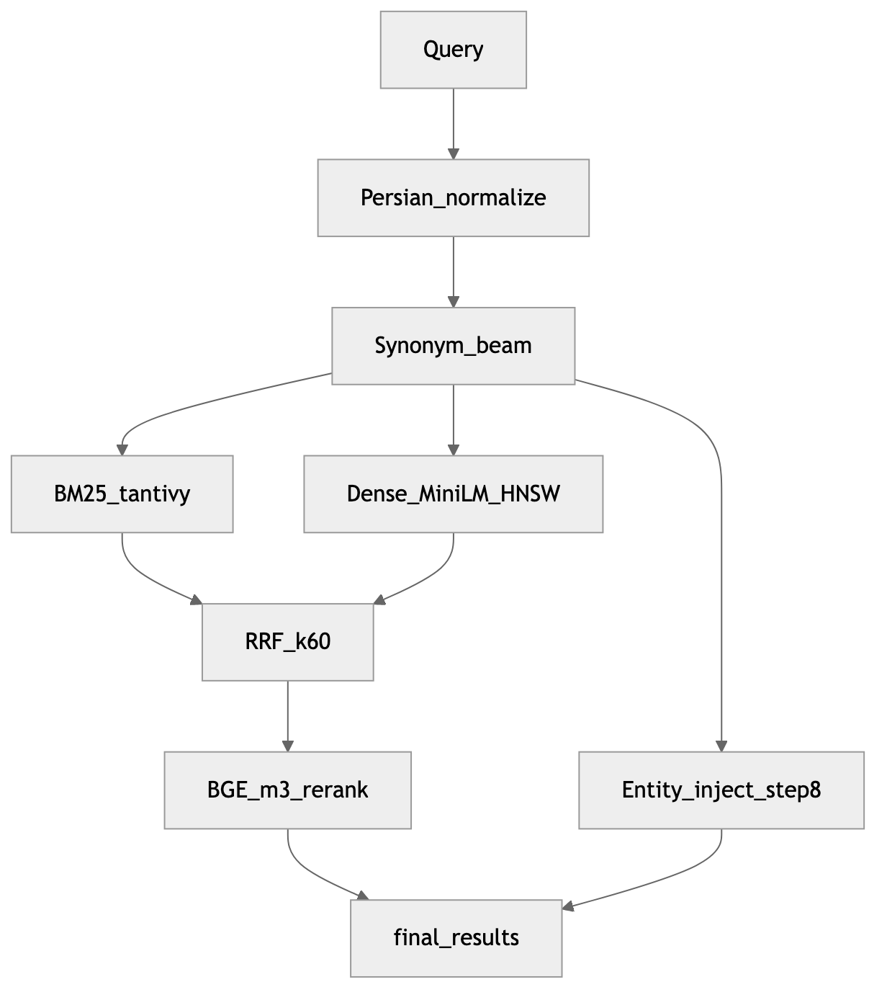

**Figure — Retrieval detail.** Stages that fill `SearchSteps.stage_ms` are `bm25`, `dense`, `hyde`, `rrf`, `rerank`, and `total`. The same timings feed metrics, so rerank time and a BM25 rebuild each show up under their own name. HNSW distance itself is computed on the Postgres CPU. The GPU is used to embed the query and to run the cross-encoder. On the measured ~1,110-chunk relation the HNSW index is about **4.8 MB**, the chunks table about **1.2 MB**, and `pg_total_relation_size` about **203 MB**, held hot with `pg_prewarm`.

### RAM-first parameters

The stack on the KB Pages is FastAPI, SQLAlchemy async, SQLite or pgvector (HNSW, 384-d, RAM-pinned), Rust tantivy BM25 in a RAM directory, MiniLM-L12 on GPU, BGE-v2-m3 on GPU, hazm/shekar normalization, and a Redis result cache. The latency host cited for the table is **1.0 TiB** of RAM and **2× H200** (143 GB HBM each). Dense weights occupy about **3 GB** of HBM.

| Stage | Parameter | Value | Notes |
|---|---|---|---|
| Postgres | `shared_buffers` / `effective_cache_size` | **16 GB / 800 GB** plus `pg_prewarm` | Vectors and HNSW stay resident |
| BM25 engine | tantivy | **0.26.2**, `RAMDirectory`, heap **50 MB** | `KB_USE_TANTIVY=true` |
| BM25 | *k*1 / *b* | **1.5 / 0.75** | Content leg and keyword leg |
| BM25 | Keyword boost / n-grams | **×3** / character **3**-grams | `KB_KEYWORD_BOOST=3.0` |
| Synonym beam | `KB_SYNONYM_BEAM` | **5** | 93-entry map; set `1` to shrink BM25 about 5× |
| Dense | Model / dim / batch / device | MiniLM-L12-v2 / **384** / **64** / **cuda** | `paraphrase-multilingual-MiniLM-L12-v2` |
| Dense index | pgvector HNSW | `vector_cosine_ops`, **m = 16**, **ef = 64** | Plus an npz cache |
| RRF | *k* | **60** | |
| Fusion | RRF ↔ rerank α | **0.7** | `KB_RERANK_FUSION_ALPHA` |
| Rerank | Model / pool | `BAAI/bge-reranker-v2-m3` / `min(50, top_k×3)` | GPU; pin-protect top-3 at rank ≥ 10 |
| Redis | TTL / hit latency | **600 s**, **2–7 ms** | About **150×** versus a cold search |
| Fast cache | `KB_FAST_CACHE` | **true** | Skips the ~2.7 s fingerprint scan |
| Chunk | Strategy / max tokens | semantic / **512** | Parent max 1536, scope is the sheet |
| HyDE | `KB_HYDE_ENABLED` | **false** | Off unless explicitly enabled |
| EntityList | In-search cosine / supplement tool | **≥ 0.6** / **0.4** | Step 8 versus `POST /search/supplement` |

### Latency on the measured rebuild

Measured **2026-10-07** on the `1405-07-06` corpus (`top_k=5`, warm after the GPU load). The headline warm total is **51–66 ms**, average about **55 ms**.

| Stage | Before (Python BM25 / CPU) | After (tantivy + GPU) | Share after |
|---|---:|---:|---:|
| BM25 lexical (content + keyword, beam 5) | ~3000 ms | **3.8–5.9 ms** | ~7% |
| Dense cosine (pgvector HNSW) | 16–50 ms warm (CPU path ~3000 ms) | **22–27 ms** | ~44% |
| RRF *k* = 60 | 0.1–0.2 ms | 0.1–0.2 ms | <1% |
| Cross-encoder BGE-v2-m3 | 20–23 ms warm (CPU ~5400 ms) | **21–25 ms** | ~44% |
| Total warm | ~3100 ms (cold ~12 s) | **51–66 ms (avg ~55 ms)** | 100% |
| Redis hit | 2–7 ms | 2–7 ms | **~150×** vs cold |

The first query after restart is a one-time cold start: dense about **4246 ms**, rerank about **5396 ms**, BM25 about **5 ms**, together near **12 s**. Later queries sit near the 55 ms average. RRF is cheap. The cross-encoder and the HNSW probe dominate the warm budget, in roughly equal shares.

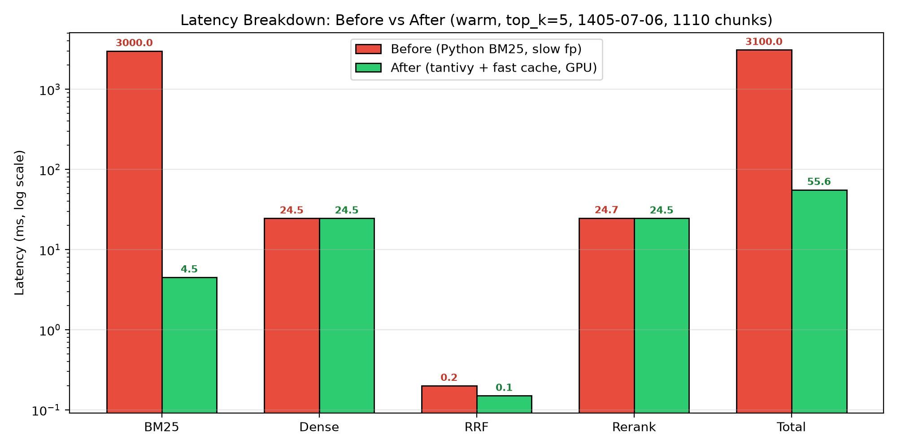

**Figure — Stage latency after the RAM-first and tantivy work.** The chart is a log-scale before/after on the warm path (`top_k=5`, folder `1405-07-06`, 1,110 chunks). Python BM25 at about 3000 ms falls to a tantivy bar of 4.5 ms. Dense stays near 24.5 ms and rerank near 24.5 ms, so the warm total moves from about 3100 ms to **55.6 ms**. RRF is a sliver on this scale (0.2 ms to 0.1 ms). The picture is the steady warm state. The separate ~12 s figure in the table is the first query after restart, which this chart does not draw.

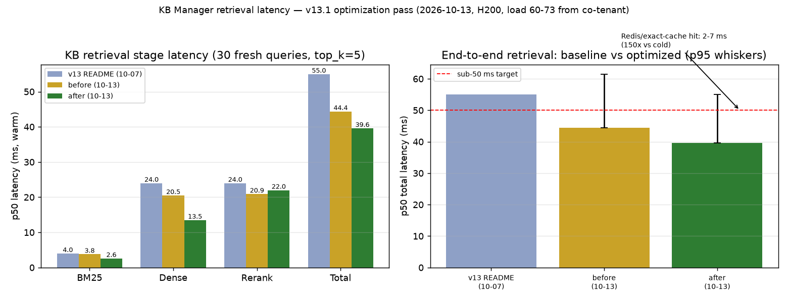

**Figure — Latency on the v13.1 pass.** The left panel is p50 stage latency for 30 fresh queries at `top_k=5`: the 2026-10-07 README profile totals **55.0 ms**, a 13 October “before” totals 44.4 ms, and the same-day “after” totals **39.6 ms** (BM25 2.6, dense 13.5, rerank 22.0). The right panel repeats those end-to-end p50s with p95 whiskers against a 50 ms reference line, and notes Redis hits at 2–7 ms (about 150× versus cold). Read 55 ms as the Pages warm headline and 39.6 ms as the later same-corpus tune under co-tenant GPU load, not as a new document set.

## Version highlights (v1–v13)

Each row is a corpus change or a retrieval change that later rows assume. “v13-RAM” is the code and host tuning on top of the v13 corpus, not a fourteenth document set.

| Version | Corpus | What changed | Published benchmark |
|---|---|---|---|
| v1 | ~160 files (31 Tir 1405) | Baseline ingest and BM25 | — |
| v2 | 355 docs / 6,208 chunks | BM25 + TF-IDF, RRF *k* = 60 | Hit@5 90%, MRR 0.736 |
| v3 | same | Dense MiniLM-L12 added | Hit@5 89.2%, MRR 0.787 |
| v4 | same | Character 3-grams and a cross-encoder | Hit@5 90%, MRR 0.775 |
| v5 | same | Frozen dataset, BM25 ×3 | Hit@5 84.2%, MRR 0.751 |
| v6 | 69 docs / 3,626 chunks | Synonym beam 5, MinHash dedup | 10-query smoke, Hit@5 100% |
| v7 | 34 docs / 2,074 chunks | Fresh `1405-05-31`, colloquial expansion, IVA-15 | Doc Hit@5 73.3% |
| v8 | 103 docs / 6,593 chunks | pgvector HNSW-384, keyword ×3.0 | HNSW GPU load note 18.4 s |
| v9 | 21+32 docs / ~1,084 chunks | Type-aware chunks, transparency/zip | IVA 11/15 |
| v10 | 35 docs / 2,282 chunks | `1405-06-23`, kv and single-column schemas, stage bench | Hit@5 **0.9244** |
| v11 | 35 docs / 2,227 chunks | Chunk rebuild, dense `use_context=False` | Hit@5 **0.9306**, MRR **0.8281** |
| v12 | same KB corpus as v11 | Typo fixes, exclusive-term beam, Redis cache | Synonym map **93** entries |
| **v13** | **18 docs / 1,123 chunks** | `1405-07-06` RAM-first: tantivy RAM BM25, 16 GB buffers, prewarm, GPU dense and rerank on H200 | Latency **~55 ms** |

The v11 manifest path cited on the KB pages is `kb-manager/versions/v11_1405-06-23/manifest.json`. Published v11 quality on that line is Hit@5 **0.9306** and MRR **0.8281**. Pin protection keeps a strong keyword hit in the fused list, and the keyword boost raises short codes and fixed phrases beside the cross-encoder.

## Tooling

| Name | Role | GitHub | Logo |
|---|---|---|---|
| FastAPI | HTTP API for search, pipeline, and metrics | https://github.com/fastapi/fastapi |  |
| SQLAlchemy | ORM and async sessions over Postgres or SQLite | https://github.com/sqlalchemy/sqlalchemy |  |
| pgvector | Vector column type and HNSW for dense nearest neighbors | https://github.com/pgvector/pgvector |  |
| tantivy-py | Python bindings for the Rust BM25 index | https://github.com/quickwit-oss/tantivy-py |  |
| sentence-transformers | MiniLM runtime for `DenseSemanticIndex` | https://github.com/UKPLab/sentence-transformers |  |
| BGE (FlagEmbedding) | `bge-reranker-v2-m3` cross-encoder | https://github.com/FlagOpen/FlagEmbedding |  |
| Redis | Shared result cache, TTL 600 s | https://github.com/redis/redis |  |

---

# Orchestrator

## Section summary

The orchestrator is the public OpenAI-compatible face of the platform (`:8100`). It does not embed the corpus and it does not serve Gemma. A compiled LangGraph validates and classifies each turn, retrieves from the knowledge base with sticky subspace memory, optionally clarifies a scattered credit question, packs a bounded prompt, and always generates through guardrails. This chapter anchors every graph node to a file, lists keyword boosts and the evidence floors, and records the `AmbiguityResult` defaults: enabled, instrument-only, margin 0.08. Query embeddings for that score come from MiniLM on `:8003`, fetched with `trust_env=False`.

## Role in the request path

Open WebUI, or any OpenAI client, posts to `create_app` in `components/orchestrator/src/work_rag_orchestrator/api.py`. The API allocates a `request_id`, restores `sticky_subspace` from the LangGraph checkpointer when the conversation continues, and invokes the compiled graph. Downstream dependencies are the knowledge base (`KB_BASE_URL`, default `http://127.0.0.1:8000`) and guardrails (`GUARDRAILS_BASE_URL`, default `http://127.0.0.1:8200`). Thresholds, keyword boosts, and the context budget live in `config.py`. The typed carry bag for every node is `RAGState` in `state.py`.

The user-facing path has one hard invariant: **the orchestrator never opens an HTTP session to Gemma.** `guarded_generate` posts `prompt_messages` to guardrails `POST /v1/chat/completions`. Guardrails alone dials the H200 LLM Inference Manager on `:9000`. Input rails run in `validate_input` via `/v1/rails/check`. The published upstream model name is `UPSTREAM_LLM_MODEL=gemma-4-31b-triton-trt`. `HYBRID_CLASSIFIER_ENABLED` defaults to **false**.

The graph is compiled with `MemorySaver` and exports `rag_graph`. Studio loads the same object as `graph` (`langgraph.json` → `studio_graph.py:graph`). Studio run inputs must include `request_id`.

## Graph node file anchors

Pages technical notes anchor the production nodes as follows. Line numbers are the anchors published with those notes.

| Node | File / line | External call |
|---|---|---|
| `validate_input` | `nodes/validate_input.py:13` | Guardrails `POST /v1/rails/check` (`clients/guardrails.py:91`) |
| `classify` | `nodes/classify.py:67` | Guardrails `/v1/chat/completions` (`clients/guardrails.py:135`) |
| `hybrid_classify` | `nodes/hybrid_classify.py:67` | Guardrails `/v1/chat/completions` (SVM, then Gemma if the SVM is unsure) |
| `retrieve` | `nodes/retrieve.py:851` | KB `POST /search/api` (`clients/knowledgebase.py:61`) |
| `generate_clarification` | `nodes/generate_clarification.py:24` | Guardrails `/v1/chat/completions` |
| `build_context` | `nodes/build_context.py:53` | None (numbered sources and the system prompt) |
| `guarded_generate` | `nodes/guarded_generate.py:16` | Guardrails `/v1/chat/completions`, which calls Gemma |
| `format_response` | `nodes/format_response.py:492` | None (citations and `finish_reason`) |
| `format_refusal` | `graph.py:109` | Alias of `format_response` |

Conditional edges sit in `graph.py`: `should_continue_after_validation` at line 24, `should_route_after_classify` at line 31, and `should_clarify` at line 45. An entity supplement short-circuits clarify. `should_clarify` also reads `subspace_ambiguity_route` and `ambiguity_ambiguous`, then falls back to the scattered-query check `is_scattered_ambiguous`. While the route flag stays false, the ambiguity score is present on the state and does not flip that edge by itself.

The node order operators should memorize:

1. **`validate_input`** extracts the latest user query and calls input rails. If `blocked`, the graph goes to `format_refusal` and ends.
2. **`classify`** buckets the turn as `greeting`, `specification`, or `question`. Greetings and product-spec answers go straight to `format_response` and skip retrieval.
3. **`hybrid_classify`** runs only when the hybrid classifier is enabled. The default is off, so the edge goes from classify to retrieve.
4. **`retrieve`** rewrites coreference when needed, calls KB hybrid search and the entity supplement, applies sticky or inferred `filter_path`, and scores evidence.
5. **`should_clarify`** continues when supplemental or injected entities exist. Otherwise a scattered ambiguous query with no `applied_subspace` branches to **`generate_clarification`** and ends.
6. **`build_context`** numbers sources and enforces `MAX_CHUNKS` and `MAX_CONTEXT`.
7. **`guarded_generate`** asks guardrails for the answer, or receives a content-filter refusal.
8. **`format_response`** shapes the OpenAI payload, RAG citations, and audit fields.

**Figure — High-level orchestrator graph.** Validation and classify sit on the left, retrieval in the center, and a clarify-versus-generate fork reunites at formatting. The picture maps to the node names registered in `graph.py` and leaves out sticky-decay bookkeeping, the whole-KB retry inside `retrieve`, and Langfuse span wiring so the branching contract stays readable. Most of the 4.9 s median bench time accumulates on the generate side of this fork, which is why the clarify exit matters: a scattered question should not pay for a full Gemma decode.

**Figure — Detailed orchestrator graph.** The expanded view shows the refusal path when input rails block, the greeting and specification bypass that skips the KB, the optional `hybrid_classify` hop, the entity short-circuit around clarification, and the chain `build_context` → `guarded_generate` → `format_response`. Conditional helpers are the three functions in the anchor table. Retrieval and trim logic live in `nodes/retrieve.py`; prompt assembly lives in `nodes/build_context.py`; KB HTTP lives in `clients/knowledgebase.py`. Studio runs this same compiled object. Every Studio input includes `request_id` so the checkpoint matches the conversation.

## Keyword boosts and evidence floors

`SUBSPACE_KEYWORD_BOOST` is a per-subspace BM25 bias applied on scoped KB calls. Cheque questions, which lean on short codes and fixed phrases, get the strongest boost.

| Subspace | Keyword boost |
|---|---:|
| `cheque` | 3.5 |
| `facilities_person` | 3.0 |
| `facilities_legal` | 3.0 |
| `general` | 2.5 |

Per-subspace evidence thresholds (the T3 floors in `config.get_evidence_threshold`) sit under the global abstain:

| Subspace | Evidence floor |
|---|---:|
| `cheque` | 0.05 |
| `facilities_person` | 0.10 |
| `facilities_legal` | 0.15 |
| `general` | 0.15 |
| Global `EVIDENCE_MIN_SCORE` | **0.15** |

`filter_path` on the request is authoritative. When it is present, `retrieve` scopes `KnowledgebaseClient.retrieve(..., filter_path=...)` and maps the path back to a subspace label for badges and for the floor above. `sticky_subspace` persists across turns in checkpointed state and is kept distinct from `applied_subspace` in `state.py`, so the scorer can keep or switch. The API re-injects sticky scope for generic follow-ups (pronouns, short confirmations). **`STICKY_DECAY_TURNS` defaults to 3**: after three consecutive generic turns the sticky subspace is dropped. When Open WebUI sends no `X-Request-ID`, sticky scope is mined from user-only history; interrogatives are skipped and declarations set scope. T4 injection applies the sticky `filter_path` on those generic follow-ups.

A filtered retrieval that misses the floor can retry once with `filter_path=None`. That retry is audited as `fallback_used`. `RETRIEVAL_TOP_K` is **20**, formed as a union of 10 RRF hits and 10 cross-encoder hits.

Entity dictionaries (reason codes, shareholders, loan titles) arrive as `injected_entities` or `supplemental`. `trim_supplemental` keeps at most the top three lists and about 4 KB of serialized JSON each, ranks rows by query-token overlap, and doubles the weight of code-like tokens (Latin letters or digits such as `sbd1`) so an exact code outranks a row that only shares the word «کد». That trim holds a reason-code sheet inside the 9000 context budget and the 8192-token Gemma window.

## AmbiguityResult defaults

The frozen interface is `AmbiguityResult` in `src/work_rag_orchestrator/subspaces.py`. The four subspaces are `cheque`, `facilities_person`, `facilities_legal`, and `general`.

| Setting | Default |
|---|---|
| `subspace_ambiguity_enabled` | **True** (compute the score and keep it for audit) |
| `subspace_ambiguity_route` | **False** (instrument only; the score does not route or clarify) |
| `subspace_ambiguity_margin` | **0.08** |
| `subspace_ambiguity_min_top1` | **0.30** |
| `subspace_ambiguity_entropy_max` | **0.85** |
| `subspace_softmax_temp` | 0.05 |
| `subspace_score_cache_size` | 512 |
| `subspace_protos_path` | `data/subspace_protos.npz` |
| `subspace_clf_path` | `data/subspace_clf.joblib` |

A turn is marked ambiguous when the top class is below `min_top1`, or the margin between the top two classes is below **0.08**, or the entropy of the distribution exceeds `entropy_max`. The score lies in [0, 1]; a higher score means a more ambiguous subspace assignment. The `source` field records where the score came from: `protos`, `classifier`, `fallback`, or `disabled`. Because `subspace_ambiguity_route` is false, `should_clarify` does not treat that boolean as a routing order. The scattered-query fallback and the entity short-circuit still apply. Turning the route flag on is a product change, not the default this report describes.

The head was trained as an SVM-RBF on a **1,000-sample** set (parent changelog, orchestrator v13, 2026-10-24). The same release landed conditional clarify, sticky `MemorySaver` keyed by `X-Request-ID`, `MAX_CHUNKS=20`, context budget **9000**, the **0.15** evidence guard, grounded follow-ups, and a dead-letter path.

## Embeddings on :8003

`embed_base_url` defaults to **`http://127.0.0.1:8003`**. `embed_model` is `paraphrase-multilingual-MiniLM-L12-v2` (384 dimensions), the same family the KB uses for dense search. The orchestrator uses an injected embedder when one is provided. Otherwise it posts to `{embed_base_url}/v1/embeddings` with httpx and **`trust_env=False`**. When the embed server is unreachable, the result is `source="fallback"` and `ambiguous=False`, so the turn continues on the scattered-query check.

Both the knowledge-base client and the guardrails client construct `httpx.AsyncClient(trust_env=False)`. On the H200 host the shell exports a corporate Squid proxy. Inheriting `HTTP_PROXY` would send `127.0.0.1:8000`, `:8003`, and `:8200` to the proxy, and the turn would hang. The flag is what keeps those localhost calls on the loopback interface. The same pattern is required in the LLM manager; chapter 6 covers the proxy address.

## Context packing

`build_context.py` caps retrieval evidence at **`MAX_CHUNKS` = 20** and the packed context at **`MAX_CONTEXT` = 9000**. Lexical matches are preferred when the list must be truncated. Twenty chunks inside that budget, plus the trimmed entity JSON, are what the 8192-token Gemma window is sized to accept together with the answer. History compaction stays available when the running transcript would crowd that budget: older turns collapse to a rolling summary and recent turns stay verbatim, and earlier refusals that reported no evidence are stripped so a later retrieval stands on its own.

## Tooling

| Component | Role in the orchestrator | Source | Logo |
|---|---|---|---|
| LangGraph | Stateful graph, conditional edges, `MemorySaver` checkpoint | https://github.com/langchain-ai/langgraph |  |
| FastAPI | OpenAI-shaped HTTP API, health and ready, Studio entry | https://github.com/fastapi/fastapi |  |
| httpx | Async clients to KB, guardrails, and `:8003` (`trust_env=False`) | https://github.com/encode/httpx |  |
| Langfuse | Trace export; JSONL collector on `:3000` is the fallback | https://github.com/langfuse/langfuse |  |

## Bench note

The 41-turn multi-agent bench dated **2026-10-14** (after the 2026-10-12 baseline) reports retrieval hit **0.780** (was 0.537), ambiguity resolution **1.000** (was 0.854), sticky persistence **0.683** (was 0.610), and p50 latency **4872 ms** (was 8006 ms, about 39% lower). Generation through guardrails accounts for most of the wall time. On that after-cut, cheque p50 is about 10.3 s with hit 0.667. These figures are observed artifacts from `bench_report_latest`. They are the comparison point when changing sticky decay, the chunk cap, or the ambiguity route flag.

## Code map

| Concern | Path |
|---|---|
| Graph wiring and edges | `components/orchestrator/src/work_rag_orchestrator/graph.py` |
| `RAGState`, sticky versus applied | `.../state.py` |
| Thresholds, boosts, budget | `.../config.py` |
| `AmbiguityResult` | `.../subspaces.py` |
| Retrieve, sticky decay, trim, fallback | `.../nodes/retrieve.py` |
| Prompt pack | `.../nodes/build_context.py` |
| KB `POST /search/api` client | `.../clients/knowledgebase.py` |
| Guardrails client | `.../clients/guardrails.py` |
| Chat API and sticky inject | `.../api.py` |

---

# 6. Deep Dive: Server Setup & Model Serving

## Section summary

Work Credit RAG runs on the self-hosted H200 lab server (`ai-gpu1`, 2× H200 NVL, about 281 GiB of VRAM) under `/splunk-data/v1/Work_RAG-Server-Setup`. The LLM Inference Manager on `:9000` fronts a multi-backend fleet—llama.cpp Gemma replicas on `8080–8084`, TensorRT-LLM champion traffic on `:8010`, embedding workers on `8001–8003`, and a standalone DeepSeek-V4-Flash wrapper on `:9001` that stays outside `MODEL_REGISTRY`. Redis, vector stores, and Open WebUI ride a Docker publish surface (`13000`, `15432`, `16379`, and the monitoring ports beside them). Corporate egress goes through Squid at `192.168.203.2:3128`, which makes `httpx` `trust_env=False` on localhost calls a hard correctness requirement. Containerization follows a five-phase cutover: phases 1–3 leave production listeners alone, phase 4 swaps each service onto its live port, and phase 5 retires host virtualenvs after a day of stability. Capacity planning follows `docs/plans/million-user-scale-plan.md`. Measured generation throughput on the H200 (history `013`) shows TensorRT-LLM BF16 continuous batching reaching ~3874 aggregate tok/s at concurrency 128 versus a flat ~58 tok/s llama.cpp Q4 single-slot path—about **67×** aggregate under the same Persian decode workload.

## H200 lab server

Docker serves the data plane, Jenkins can act as root, and the two GPUs run concurrent backends. Model control plane is the manager on `:9000`. Chat backends include five llama.cpp Gemma-4-31B instances (`gemma_supervisor.sh`: GPU0 on `8080`/`8082`/`8084`, GPU1 on `8081`/`8083`), optional Qwen2.5-7B on `:8090`, a dynamic llama.cpp band on `8085–8100` filled by `POST /admin/models/load`, and the TensorRT-LLM champion on GPU1 `:8010`. Embedding microservices stay off the decode CUDA contexts: multilingual-e5-small (384-d) on `:8001`, bge-m3 (1024-d) on `:8002`, and MiniLM (384-d, OpenAI `/v1/embeddings`) on `:8003`. DeepSeek-V4-Flash is a standalone wrapper on `:9001` and stays outside the manager registry, so promoting Gemma keeps chat on the Gemma fleet. Orchestrator and guardrails speak OpenAI JSON; production generation is Manager → champion, with automatic fallback into the llama.cpp pool when `:8010` is unavailable. Both `HF_HOME` and `HF_HUB_CACHE` point at the same cache directory. Figure 13 captures that high-level split—clients to manager to model backends, with Docker handling Redis/Qdrant/pgvector/WebUI—while Figure 14 expands the port map and the orchestrator/guardrails/KB adjacency.

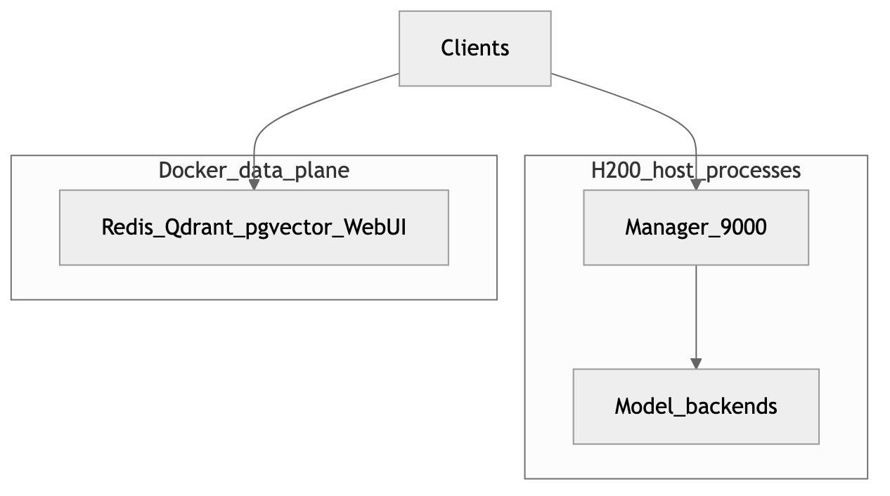

*Figure 13 — High-level topology. The left/host plane is process-owned inference (manager + GPUs). The Docker plane is stateful infrastructure and the browser UI. Application services (orchestrator, guardrails, KB) sit beside that split. The diagram emphasizes the durable control-plane split.*

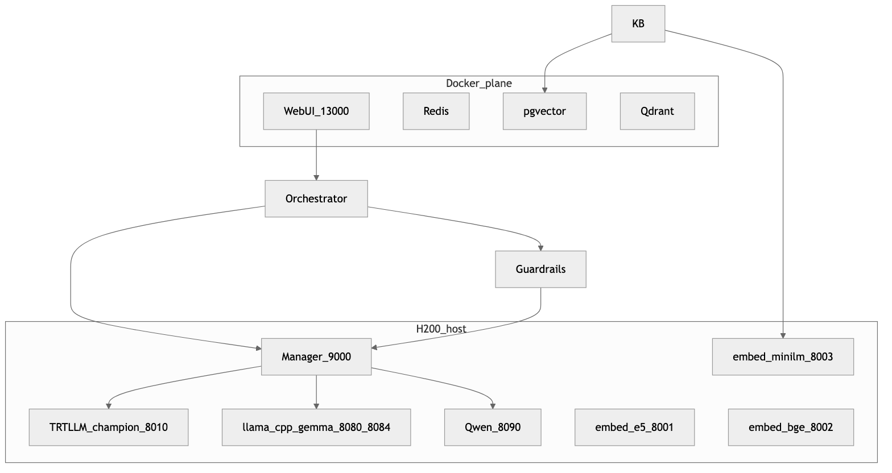

*Figure 14 — Detailed port topology. Champion traffic is TRT-LLM on GPU1 `:8010`; the Gemma pool remains the resilience path. Embedding ports stay separate so retrieval does not share CUDA contexts with decode. WebUI stays on `:13000` and never talks to Gemma ports directly.*

### Docker publish surface

Application ports on the host process plane (`8000`, `8100`, `8200`, `9000`, `8001–8003`, `8080–8084`) are not the same map as the containers Docker publishes. The data-plane and monitoring surface, from the server-setup pages, is:

| Published | Service | Host → container |
|---|---|---|
| 13000 | Open WebUI | 13000 → 8080 |
| 15432 | pgvector | 15432 → 5432 |
| 16333 / 16334 | Qdrant REST / gRPC | 16333 → 6333, 16334 → 6334 |
| 16379 | Redis | 16379 → 6379 |
| 19530 | Milvus | 19530 → 19530 |
| 13001 / 19090 | Grafana / Prometheus | 13001 → 3000, 19090 → 9090 |
| 14317 / 14318 / 19092 | OTel gRPC / HTTP / exporter prom | 14317 → 4317, 14318 → 4318, 19092 → 9091 |
| 9101 | GPU metrics exporter | host process |
| 8088 | nginx gateway | `/vllm/`, `/llama/`, `/embeddings/`, `/webui/` |

The pages technical map above is the inventory to operate against. Postgres inside the container is `5432`; callers on the H200 host use the published `15432` unless they are on the Docker network.

## Manager OpenAI gateway and Squid discipline

`components/server-setup/llm_inference_manager/app.py` exposes `/v1/chat/completions`, `/v1/completions`, `/v1/models`, `/health`, plus admin load/unload and Triton/TRT promote endpoints. Round-robin counters distribute load across replica URLs; SQLite (`manager.db`) records history and metrics. `MODEL_REGISTRY` carries `gemma-4-31b` and `gemma-4-31b-triton-trt`. Promotion is an admin action (`POST /admin/triton/promote?backend=trt&url=http://127.0.0.1:8010`) that flips the gateway mapping without changing orchestrator environment variables. When `:8010` is unavailable, the manager uses the llama.cpp pool.

Corporate egress is Squid at `http://192.168.203.2:3128`, persisted by `proxy_setup.sh` into the shell, apt, git, and the Docker daemon. The shell exports `http_proxy` / `https_proxy` and sets `no_proxy` / `NO_PROXY` to `localhost,127.0.0.1`. Localhost backends in the manager use their own client: every outbound call constructs `httpx.AsyncClient(timeout=120, trust_env=False)` (`llm_inference_manager/app.py` `proxy_chat`: line 301 for the promoted backend, line 333 for the llama.cpp pool). That flag keeps loopback requests to `:8010` and `:8080` on the host. Manual probes use `curl --noproxy '*'` (including the nginx gateway on `:8088`). The same `trust_env=False` rule belongs on guardrails and observability clients.

The champion itself is TensorRT-LLM **1.3.0rc29** (`trtllm-serve`, PyTorch backend, `tp_size=1`), BF16, `max_batch_size=128`, GPU1 `:8010`, launched from an isolated `offline-prep/venv-trtllm` so the shared live virtualenv’s torch, numpy, and transformers stay untouched. `scripts/serve_trtllm.sh` launches through `mpirun -n 1 trtllm-llmapi-launch` and sets `attn_backend: FLASHINFER` for Gemma-4 `global_head_dim=512`. The five GGUF replicas use bartowski `google_gemma-4-31B-it` Q4_K_M with `n_ctx` 4096 under an auto-reviving supervisor.

## Containerization and cutover

The H200 data plane runs from container images. Parent `deploy/docker/` holds compose variants (`docker-compose.yml`, GPU and Qdrant overlays, nginx) for the NVIDIA runtime. `components/server-setup/docs/migration/containerization-report.md` records a five-phase, side-by-side cutover:

| Phase | What changes for live traffic |
|---|---|
| **1** | Build images and validate each service on alternate ports only: KB `8100`, guardrails `8201`, orchestrator `8101`, tracing `3001`, manager `9001`, Gemma `8085–8089`, embeds `8004–8006`. Production listeners stay up. |
| **2** | End-to-end on those alternates: Open WebUI → orchestrator `:8101` → guardrails `:8201` → KB `:8100` → Gemma `:8085`. |
| **3** | Jenkins pipeline (checkout → lint → test → build → push → deploy-dev → e2e). Still no production port swap. |
| **4** | Per-service cutover onto the **same** production ports, in order: tracing → embeds → KB → guardrails → orchestrator → manager → Gemma ×5. Rollback is restarting the host virtualenv. |
| **5** | After 24 hours of stability, decommission the host virtualenvs. |

Phases 1–3 leave production traffic on its current listeners; phase 4 is the step that changes them. Production ports in the map are `8000`, `8001–8003`, `8080–8084`, `8100`, `8200`, `9000`, `13000`, `16379`, postgres `5432`, and tracing `3000`. Two alternate numbers in the phase-1 map already name live services: KB’s alternate `8100` is the orchestrator port, and the alternate manager `9001` is the DeepSeek wrapper. Confirm the host is free before binding those alternates.

## Scaling: million-user plan and measured decode throughput

`docs/plans/million-user-scale-plan.md` separates **scale-out** from **scale-up**. Scale-out places stateless FastAPI/orchestrator pods behind Kubernetes Ingress with HPA on CPU, GPU inference behind Triton/TensorRT replicas scaled by queue depth (KEDA), and a dedicated vector cluster (Qdrant) with read replicas—trading operational complexity for elastic concurrency (Figure 17). Scale-up keeps a single 2×H200 machine saturated: large in-RAM indexes, many Triton instance groups per GPU, and Gunicorn worker counts near core count, minimizing cross-node latency at the cost of vertical coupling (Figure 18). For Work Credit RAG’s Persian chat path, generation—not retrieval—dominates wall time, so inference batching efficiency dominates capacity math.

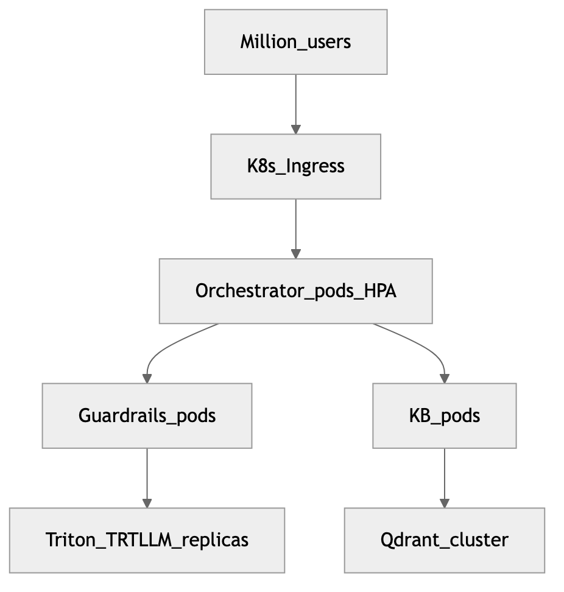

*Figure 17 — Cloud-native scale-out. CPU tiers (orchestrator, guardrails, KB) scale independently of GPU inference tiers behind Ingress and HPA/KEDA. Semantic cache and hybrid vector search sit beside autoscaled Triton/TRT replicas so decode GPUs are not wasted on duplicate retrieval work. This is the elasticity path when concurrent Persian chat outgrows a single chassis.*

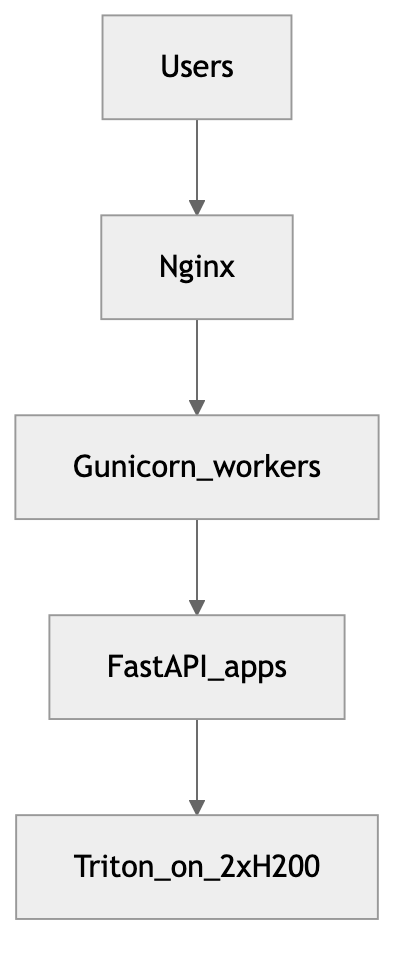

*Figure 18 — Bare-metal scale-up. One chassis, two H200s, shared-memory friendly batching. Prefer this when the model footprint fits and operational ownership stays on `ai-gpu1`.*

History `013` (`components/server-setup/docs/history/013_2026-10-13_trtllm_champion_concurrency.md`) recorded a like-for-like Persian prompt (`max_tokens=256`) across concurrency. llama.cpp Q4 on the single-slot placeholder stayed ~58–59 aggregate tok/s at every concurrency (no continuous batching). TensorRT-LLM BF16 on `:8010` scaled roughly linearly with in-flight requests: ~50 tok/s at conc 1, ~386 at 8, ~1385 at 32, and **3874.2** aggregate tok/s at conc 128 (~**67.3×** versus the flat Q4 baseline). Single-stream favors Q4 slightly (memory traffic); multi-user traffic favors TRT. An FP8 KV-cache experiment (`TRTLLM_KV_DTYPE=fp8`) landed near 0.95× at low concurrency and about +15% at concurrency 128. Operators should size on sustained ~2.9k tok/s under power capping, not the first-burst 3.8k peak, and keep CUDA-graph batch sizes dense up to 128 so intermediate concurrencies do not fall off the graph cliff into eager decode.

## Tooling

| Tool | Role in this stack | Upstream | Logo |
|------|--------------------|----------|------|
| llama.cpp | GGUF Gemma/Qwen servers; H200 pool `8080–8084` | [github.com/ggml-org/llama.cpp](https://github.com/ggml-org/llama.cpp) |  |
| TensorRT-LLM | Champion BF16 continuous batching on `:8010` | [github.com/NVIDIA/TensorRT-LLM](https://github.com/NVIDIA/TensorRT-LLM) |  |
| LiteLLM | Optional embed/chat adapter path from the manager | [github.com/BerriAI/litellm](https://github.com/BerriAI/litellm) |  |
| Docker | H200 data plane and image cutover | [github.com/moby/moby](https://github.com/moby/moby) |  |
| vLLM | Alternate OpenAI-compatible serving on H200 offline prep | [github.com/vllm-project/vllm](https://github.com/vllm-project/vllm) |  |
| PyTorch | TRT export/serve stack, embeds, offline CUDA wheels | [github.com/pytorch/pytorch](https://github.com/pytorch/pytorch) |  |

Together these pieces keep a single OpenAI-shaped contract from WebUI through orchestrator and guardrails, with generation served by the H200 champion and the llama.cpp pool behind the manager on `:9000`.

---

# Deep Dive: Guardrails & Security

## Section summary

Guardrails (`Work_RAG-Guardrails`, port `:8200`) is the mandatory safety boundary between the LangGraph orchestrator and the Gemma inference plane. Every user turn is checked on the *input* stage before retrieval context is answered; every completed assistant reply is checked again on the *output* stage before it returns to WebUI. The path is deterministic evidence signals, then an adjudicating judge (`gemma`, `mizan`, or `hybrid`), then a direct-LLM yes/no self-check. Policy text ships as versioned YAML; the credit pin is `policies/ics-credit-v1.0.0.yaml`. HurtLex hate checks consult an exact-word allowlist of **28** lemmas. Iranian PII on allowed answers is masked after mod-11 (national ID) and mod-97 (Sheba / IR-IBAN) checks; secret markers hard-block. Ghadeer mmBERT operating points published with the stack are toxicity **0.80**, hate **0.80**, PII **0.90**, and injection **0.85**. Judge timeout, empty verdict, or transport error fails *closed*.

## Position in the request path

Figure 11 places Guardrails between Orchestrator `:8100` and Gemma on the H200 LLM Inference Manager (`:9000`). The orchestrator never calls the LLM directly: it posts `rails/check` for input and output stages, then `chat/completions` for guarded generation. The reply that reaches the user is either a masked safe completion or a category-scoped refusal.

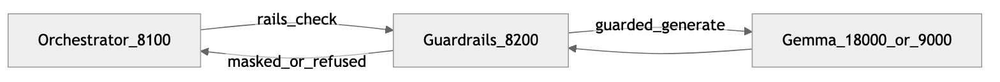

*Figure 11 — High-level placement. The orchestrator never dials Gemma directly: it posts `rails/check` for input and output stages, then `chat/completions` for guarded generation. Guardrails alone proxies to the H200 Manager on `:9000` and returns either a PII-masked safe completion or a category-scoped Persian refusal. The diagram is the safety contract for the rest of this section.*

The component docs keep a three-file SVG inventory, also copied into this report’s diagram folder: `assets/diagrams/architecture-platform.svg` (orchestrator → guardrails → Gemma), `assets/diagrams/internal-pipeline.svg` (signals → judge → self-check → output rails), and `assets/diagrams/code-hierarchy.svg` (the `src/`, `config/`, `kb/`, `policies/`, `tests/`, and `images/` tree). The live dashboard at `GET /dashboard` draws its own SVG plots—per-category and per-detector bars, a 24-hour block timeline, and a stage donut—from masked JSONL rather than from those static files.

## Signals, judge, and fail-closed

The runtime lives in `components/guardrails/src/work_rag_guardrails/`:

| Module | Role |
|--------|------|
| `service.py` | FastAPI app, `/v1/rails/check`, `/v1/chat/completions`, premade refusals, upstream proxy, history trim |
| `signals.py` | Deterministic detectors → evidence list (injection, jailbreak, HurtLex hate, profanity, scope, PII-IR) |
| `judge.py` | `adjudicate()` — secret hard-block, policy judge backends, direct-LLM self-check, fail-closed |
| `events.py` | JSONL decision log with PII/secret masking (`/tmp/guard_events.jsonl`) |
| `dashboard.py` | Zero-dependency RTL dashboard on the same `:8200` process |

`collect_signals` normalizes Persian text and runs pattern/list detectors. Those hits are *helpers for the judge*, and `secret` (`sk-`, `api_key`, `database_url`, `Bearer`) is the detector `adjudicate` short-circuits to refuse. Domain keywords from the active policy feed a fast out-of-domain pre-check. An absent policy file or an empty keyword list routes to review.

The HurtLex detector reads `kb/hurtlex_allowlist.json`: **28** lemmas matched as exact words on both input and output, chosen so credit and social vocabulary (حذف، تأمین مالی، اشتغال، مردم، and the rest of that list) stays in domain. Profanity, PII, and secret checks stay outside that allowlist.

Output-stage **PII-IR** is checksum-aware, not a bare digit hunt. A national ID must satisfy the Iranian mod-11 check; a Sheba / IR-IBAN must satisfy mod-97; mobile and landline patterns are matched alongside those validators. A valid PII hit on an otherwise allowed answer is **mask-and-continue** (`[masked-pii]`). A secret marker is a hard block. The events log stores only the masked form.

Judge backend is selected with `GUARD_JUDGE_BACKEND`:

- **`gemma`** (default) — pinned-policy categories judged by Gemma; parse `VERDICT` / `CATEGORY`; empty or unparseable → refuse.
- **`mizan`** — Mizan System-1 via Manager (`/systemone`) with calibrated safety / scope / severity questions.
- **`hybrid`** — Mizan first; escalate to Gemma when confidence is low, severity is high, or hard signals fire (injection, jailbreak, secret, PII, hate, offense).

`GUARD_JUDGE_MODE=on-signal` (default) skips the LLM judge when the text is clean; `always` forces adjudication. A second-opinion direct-LLM yes/no self-check is fail-closed on error. `GUARD_NEMO_SELFCHECK` (`on` / `shadow` / `off`) selects that self-check.

Published Ghadeer mmBERT score floors, from the parent models table, sit next to those detectors: toxicity **0.80**, hate **0.80**, PII **0.90**, injection **0.85**. They are operating points for the classifier signals, not a second policy language. The category taxonomy the judge actually returns is `prompt_injection`, `jailbreak`, `hate`, `offense` (profanity), `pii`, `out_of_scope`, `secret`, `policy`, and `engine_error`.

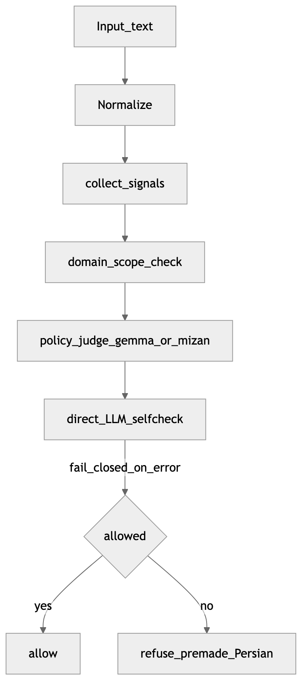

*Figure 12 — Normalize → collect signals → domain scope → policy judge (Gemma / Mizan / hybrid) → direct-LLM self-check → allow or premade Persian refuse. Errors route to fail-closed refusal.*

## Policy pin

Versioned prompts live under `policies/` as `policies/<domain>-v<semver>.yaml`. `policies/active.yaml` is the pin. The current credit file is `policies/ics-credit-v1.0.0.yaml`: company and people mentions count as in-domain, and ungrounded advice is its own refusal category. Each file carries `id`, `version`, `stage`, and `categories` whose `prompt` interpolates `{{text}}` and `{{signals}}`, plus `refusal`, `examples`, and `domain_keywords` for the no-LLM scope pre-check. Released versions are immutable; a change is a new file and a moved pin. The reported default `POLICY_VERSION` when nothing is pinned is `mvp-1`.

## Endpoints and user-facing policy

**`POST /v1/rails/check`** accepts `{stage, text, request_id}` for `input` or `output`. The response carries `allowed`, `action`, category ids, and a `reason` string. In production mode (`GUARD_RESPONSE_MODE`), `reason` is a premade Persian message keyed by category—prompt injection, jailbreak, hate, offense, out-of-scope, PII, secret, policy—without exposing regex matches or judge traces. Output-stage hate/profanity refusals blame the *answer* (“پاسخ حاوی محتوای نامناسب است…”) rather than the user.

**`POST /v1/chat/completions`** is the OpenAI-compatible guarded gateway used by the orchestrator’s `guarded_generate` node. Flow:

1. Extract the question slice from an augmented user message (`Question:` / `سوال:`), cap to the rails text limit.
2. Input rails → refuse with `finish_reason="content_filter"` if blocked.
3. Trim chat history to a Persian-aware char budget so upstream context (8192 tokens) is not overflowed.
4. Call Gemma with `chat_template_kwargs: {"enable_thinking": false}` and strip leaked control tokens.
5. Output rails → refuse or continue.
6. If PII-IR validators (national-id mod-11, Sheba mod-97, phone patterns) still match an *allowed* answer, `events.mask_text` replaces those digit runs—and API-key-like spans—before return.

Health and readiness expose upstream reachability and policy version; the interactive dashboard aggregates masked JSONL events (block rate, categories, 24h timeline, sample viewer).

## Upstream contract details

All outbound `httpx.AsyncClient` calls to the manager on `:9000` set **`trust_env=False`**. That flag keeps loopback traffic off the host Squid proxy at `192.168.203.2:3128`. See the server-setup section for the same rule on the manager.

The gateway maps timeout and context-window paths to **`finish_reason="length"`** with a short Persian retry hint. Successful rails refusals use `content_filter`; clean answers use `stop`. The allowed set is `stop`, `length`, and `content_filter`.

Buffered completions run input rails, call the manager, run output rails, and write a masked JSONL event. The dashboard reads that log.

## Tooling

| Tool | Role in Guardrails | Link / asset |
|------|--------------------|--------------|
| FastAPI | HTTP API factory (`create_app`), rails + chat routes, dashboard | [github.com/fastapi/fastapi](https://github.com/fastapi/fastapi) · `assets/logos/fastapi.svg` |
| httpx | Async upstream / Mizan / health clients (`trust_env=False`) | [github.com/encode/httpx](https://github.com/encode/httpx) · `assets/logos/httpx.svg` |
| HurtLex | Persian hate lexicon evidence for the judge; **28**-lemma credit allowlist in `kb/hurtlex_allowlist.json` | [github.com/valeriobasile/hurtlex](https://github.com/valeriobasile/hurtlex) |
| Pydantic | Request/response models including `finish_reason` literals | [github.com/pydantic/pydantic](https://github.com/pydantic/pydantic) |
| uvicorn | ASGI server for the `:8200` factory app | [github.com/encode/uvicorn](https://github.com/encode/uvicorn) |

Together these pieces keep Guardrails a thin, fail-closed Persian safety shell: deterministic evidence in, adjudicated allow/refuse out, secrets never returned, and Gemma reachable only through a controlled proxy that refuses when unsure.

---

## 8. Logging, Telemetry, Documentation & Latency

**Section summary.** Work Credit RAG treats observability as a *layered* contract: KB returns per-stage `stage_ms` (also Redis-cached); the orchestrator rolls node timings into `stage_timing_ms` and an optional `AuditTrail`; Langfuse v2 (or host JSONL) records spans; `components/tracing` persists SQLite + JSONL pipeline cards; guardrails and the inference manager keep their own stores. Operators read that stack at three ports: Langfuse v2 on **:3001**, the parent fallback collector on **:3000**, and LangGraph Studio on **:2024**. Studio run inputs must include `request_id`; without it, sticky memory and trace envelopes have nothing to join on. E2E latency is dominated by **generation**, not retrieval—warm KB search is tens of milliseconds while chat turns sit near five seconds—so optimizations favor RAM-first retrieval, context trim, and TRT-LLM serving over further BM25 micro-cuts.

### 8.1 Multi-layer telemetry map

| Layer | What is recorded | Primary sink |
|---|---|---|
| KB search | `bm25` / `dense` / `rrf` / `rerank` / `total` (+ `hyde`, `build_context`) | Response JSON + Redis TTL 600s |
| Orchestrator | Node wall times → `stage_timing_ms` | `AuditTrail` on non-streaming chat |
| Distributed traces | Trace + span envelopes (Langfuse v2 HTTP) | Langfuse UI `:3001` or collector `:3000` |
| Pipeline store | Enriched request/response cards | `/tmp/observability.db` + `/tmp/pipeline_traces.jsonl` |
| Guardrails | Decision events (PII-masked) | `/tmp/guard_events.jsonl` + dashboard `:8200` |
| Manager | Session / latency / backend metrics | `manager.db` (SQLite) |
| Retrieval DLQ | Empty filtered retrieval | `/tmp/dlq_retrieval.jsonl` |

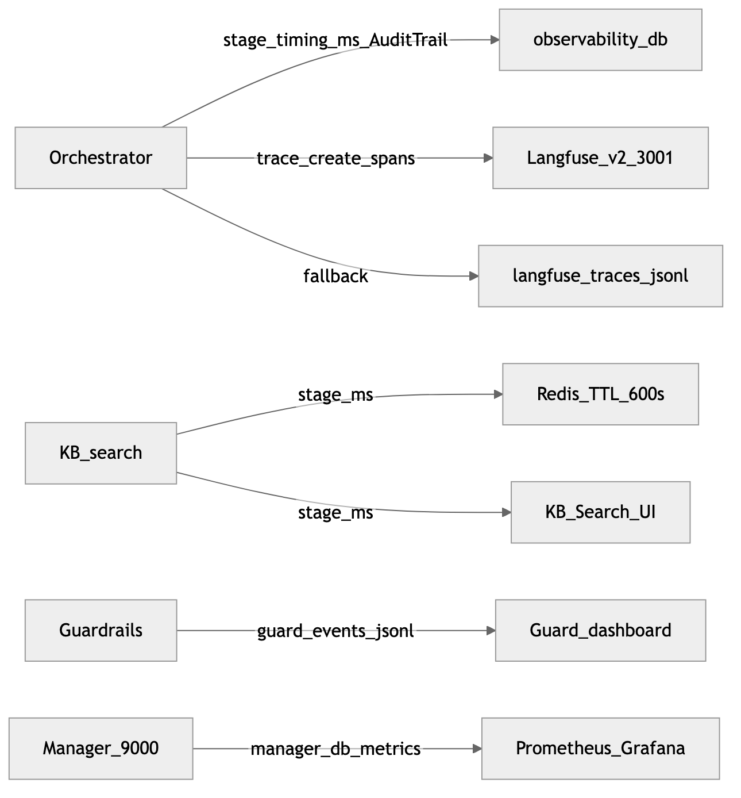

*Figure 15. Observability wiring for the production stack. The orchestrator emits `stage_timing_ms` into AuditTrail and posts Langfuse v2 `trace-create` / `span-create` envelopes (fire-and-forget HTTP also feeds `/tmp/langfuse_traces.jsonl` when the collector on `:3000` is the active sink). KB returns `stage_ms` to callers and Redis (TTL 600s) so Search UI can replay timing. Guardrails append masked decisions to `guard_events.jsonl` for the `:8200` dashboard; the manager plane keeps `manager.db` metrics for Prometheus/Grafana. “Where did the time go?” requires joining these stores, not a single APM.*

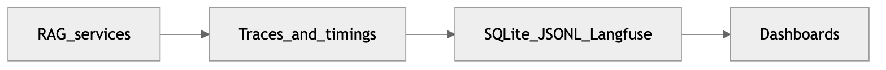

*Figure 16. High-level view: RAG services emit traces and timings into SQLite, JSONL, and Langfuse; operators read them via `:3000` observe/observability, `:8200` guard, Langfuse `:3001`, and manager/Prometheus. Collapses detail so incidents start from *Stores → Dashboards* rather than code paths.*

### 8.2 Knowledge-base `stage_ms` and Redis

Every successful `POST /search/api` response includes a `stage_ms` object written in `kb_manager/web/routes/search.py` as each leg finishes: BM25 (tantivy RAM index), dense MiniLM encode + HNSW/pgvector lookup, Reciprocal Rank Fusion (`k=60`), BGE-m3 cross-encoder rerank, and `total`. The same object is stored with the cached SearchSteps payload under Redis (`KB_REDIS_TTL`, default **600s**) or an in-memory fallback when Redis is down; exact-cache hits typically return in **2–7 ms** and never cache error responses. Operators can therefore diagnose “dense vs rerank” without attaching a profiler—`jq '.stage_ms'` on a warm curl is the day-to-day tool.

### 8.3 Orchestrator timings, AuditTrail, and `ORCH_DEBUG`

Graph nodes call `record_timing(state, stage, elapsed_ms)` (`state.py`) so retrieve, clarify, `build_context`, `guarded_generate`, format, and retry/broaden paths accumulate into `state["stage_timing_ms"]`. On the buffered OpenAI chat path, `api.py` builds a Pydantic `AuditTrail` that copies those timings together with retrieved chunks, guard signals, context preview, subspace ambiguity fields, and wall `latency_ms`. Setting `ORCH_DEBUG=1` turns on app-level INFO logging and enables opt-in context diagnostics inside `build_context` so engineers can see what reached Gemma.

The buffered path stores that `AuditTrail`. The SSE path streams tokens from Guardrails, finalizes citations and metadata, and keeps traces updating.

### 8.4 Langfuse v2 HTTP and host fallbacks

`work_rag_orchestrator/tracing.py` posts direct HTTP to Langfuse v2 on **:3001**: envelopes carry top-level `id` + ISO `timestamp`, and updates re-`trace-create` the same id (v2 uses `trace-create` for updates). Posts are submitted on a small thread pool with short timeouts so tracing stays off the request loop. The same path can target the parent `components/tracing` collector on **:3000**, which appends to `/tmp/langfuse_traces.jsonl` and exposes a Langfuse-compatible ingestion surface plus the `/observe` timeline. LangGraph Studio is the third pane, on **:2024** (panel `https://smith.langchain.com/studio/?baseUrl=http://127.0.0.1:2024`). A Studio run carries `request_id` alongside `messages`—the same id sticky MemorySaver, Langfuse, and the collector use—so the graph thread joins the chat trace.

Separately, `eval_store.py` persists enriched pipeline cards to **`/tmp/observability.db`** (WAL SQLite, `EVAL_DB_PATH`) and mirrors them to **`/tmp/pipeline_traces.jsonl`** (`TRACE_JSONL`). The observability dashboard router under `/api/observability` is how Studio/WebUI-side tooling can push ratings and stage cards into that store.

### 8.5 Guard events, manager metrics, and retrieval DLQ

Guardrails write terminated/allowed decisions to `/tmp/guard_events.jsonl` (`GUARD_EVENTS_FILE`) with digit-run PII masking, and serve aggregates on the Persian dashboard at `http://127.0.0.1:8200/dashboard`. On the model plane, `llm_inference_manager` keeps session, message, and latency rows in `manager.db` and surfaces KB `stage_ms` breakdowns when a manager-side search probe is used. When filtered retrieval returns empty, orchestrator `retrieve.py` appends a record to `/tmp/dlq_retrieval.jsonl` so those turns stay greppable.

### 8.6 Latency evidence

Warm KB retrieval (v13.1 optimization pass, 30 fresh queries, `top_k=5`) sits well under a tenth of a second:

| Config | BM25 | Dense | Rerank | Total (p50) |
|---|---:|---:|---:|---:|
| v13 README (2026-10-07) | 4.0 | 24.0 | 24.0 | **55.0 ms** |
| Pre-opt (2026-10-13) | 3.8 | 20.5 | 20.9 | 44.4 ms |
| Post-opt (2026-10-13) | 2.6 | 13.5 | 22.0 | **39.6 ms** |

End-to-end chat from `bench_report_latest` (41 turns, model `ics-helper-agent`, 2026-10-14) reports **p50 4872 ms** and **average 4938 ms** at 0% transport error rate. After GPU MiniLM/BGE and RAM-first indexes, **`guarded_generate` accounts for most of the wall time**—classify/retrieve/build_context are tens to low hundreds of milliseconds, while Gemma decode at context 8192 accounts for the multi-second remainder. Greeting and specification shortcuts that skip the LLM land near ~0.8–1.1 s, so generation is the large slice of an end-to-end turn and hybrid search is the small one.

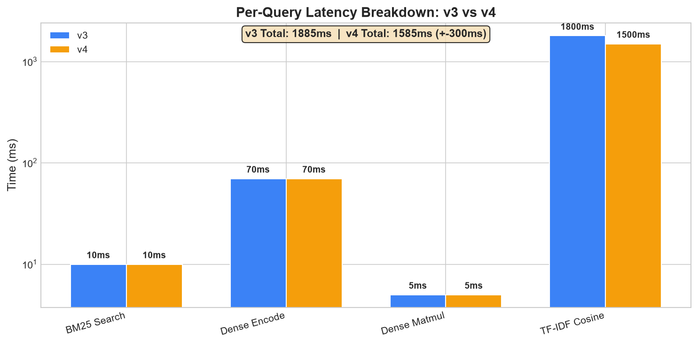

*Figure — Latency breakdown (bars). Stacked/grouped stage bars contrast historical CPU-bound dense encode (~2.3 s) against the post-GPU, RAM-first profile where BM25, dense, RRF, and rerank together fit inside a ~40–70 ms envelope. Redis hits and warm indexes set the retrieval timing; end-to-end chat p50 follows generation.*

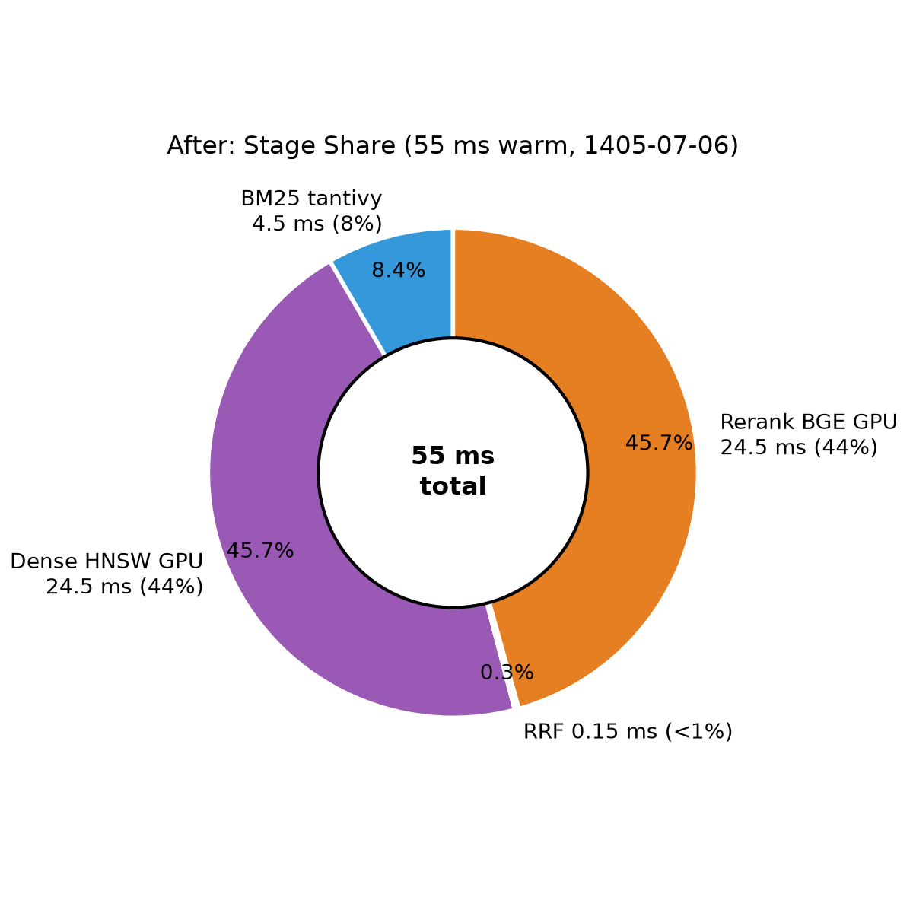

*Figure — Latency breakdown pie (after optimizations). The post-optimization pie makes the same point compositionally: once dense leaves the CPU, rerank and residual orchestration slices are visible and remain small beside the generate slice on full RAG turns. The figure pairs with the TRT champion and the context budget as the levers on that generate slice.*

### 8.7 Optimizations that moved the numbers

- **RAM-first tantivy + HNSW.** Rust tantivy BM25 (≈50 MB heap, RAMDirectory) and RAM-pinned dense/pgvector HNSW remove cold disk seeks from the hot path; startup pre-warm loads indexes and CUDA kernels before the first user query.
- **RRF then selective rerank.** Fusion at `k=60` keeps candidate quality high while the cross-encoder scores a bounded pool (GPU, pool 30)—cheap legs stay cheap.
- **Entity / context trim.** Orchestrator supplemental injection is capped (top-3 × ~4 KB) and `prompt_char_budget≈20k` / `MAX_CHUNKS=20` hold the Gemma **8192** context window. Upstream overflow is surfaced as `finish_reason=length`.
- **TRT champion serving.** On the H200, TensorRT-LLM Gemma is the throughput champion versus llama.cpp Q4 for concurrent decode. Latency planning treats generate cost as a function of tokens and concurrency, read beside KB `stage_ms`.

### 8.8 Tooling

| Tool | Role in telemetry / docs | GitHub | Logo |
|---|---|---|---|
| Langfuse | v2 trace/span UI (`:3001`); orchestrator posts envelopes via direct HTTP | https://github.com/langfuse/langfuse |  |
| Prometheus | Manager/infra metrics scrape target referenced beside `manager.db` | https://github.com/prometheus/prometheus |  |
| FastAPI | Tracing collector + observability dashboard routers | https://github.com/fastapi/fastapi |  |
| httpx | Fire-and-forget Langfuse/collector posts from `tracing.py` | https://github.com/encode/httpx |  |

### 8.9 Documentation tooling note

Human-facing docs stay discoverable via the **docs-toc** generator: `scripts/gen_readme_toc.py` (vendored in the parent and every submodule) rebuilds the README `<!-- docs-toc:start -->` … `<!-- docs-toc:end -->` block from tracked `*.md` files using `scripts/docs_manifest.json`. Idempotent `--dry-run` / `--check` modes plus the `docs-toc` CI workflow keep indexes current without hand-editing TOC sections—telemetry for *documentation drift* rather than request latency.

---

*Primary code pointers:* `components/knowledgebase/kb-manager/kb_manager/web/routes/search.py`, `.../metrics.py`; `components/orchestrator/src/work_rag_orchestrator/{api.py,tracing.py,schemas.py,state.py,nodes/retrieve.py}`; `components/tracing/{app.py,eval_store.py,dashboard_api.py}`; `components/guardrails/src/work_rag_guardrails/{events.py,dashboard.py}`; `scripts/gen_readme_toc.py`.

---

# Benchmarks and latency appendix

## Section summary

Observed numbers frame how the stack performs. The headline comparison is the 41-turn multi-agent bench (12 October 2026 → 14 October 2026): finish-reason mismatches fell from 6/41 to 0/41, retrieval hit rose from 0.537 to 0.780, and p50 latency fell 39% from 8006 ms to 4872 ms. Published knowledge-base quality on the frozen v11 export is **Hit@5 0.9306**. The current corpus is v13 (`1405-07-06`), and warm hybrid search stays near **55 ms**. End-to-end chat latency is led by guarded generation on Gemma.

## Knowledge-base IR quality

**Sources:** KB pages corpus table; `components/knowledgebase/kb-manager/artifacts/retrieval_training/report_metrics.json` (`hit5_rate` 0.9306, `mrr` 0.8281, `N` 663). The pages also describe a frozen 120-query, six-format set that carries the same v11 Hit@5. The checked-in rate is the 663-query export. v13 (`1405-07-06`, 18 documents / 1,123 chunks) is the RAM-first corpus whose warm latency is reported below.

| Snapshot | Corpus | Hit@5 | MRR |
|---|---|---:|---:|
| v11 | 35 docs / 2,227 chunks; `dense use_context=False` | **0.9306** | 0.8281 |

## Knowledge-base stage latency (ms)

**Source:** `artifacts/retrieval_training/latency_v13_1.json`

| Stage | README v13 (10-07) | Before tune (10-13) | After tune (10-13) |
|---|---:|---:|---:|
| BM25 | 4.0 | 3.8 | 2.6 |
| Dense | 24.0 | 20.5 | 13.5 |
| Rerank | 24.0 | 20.9 | 22.0 |
| **Total** | **55.0** | **44.4** | **39.6** |

The v13 README figure of **55.0 ms** is the warm-search number to quote for the RAM-first stack (~55 ms). The 13 October tune later measured 39.6 ms p50 on 30 fresh queries; both describe retrieval, not chat. Cold starts remain multi-second when models and indexes load. Redis cache hits for identical queries fall to the low single-digit milliseconds once warm.

**Figure B1. KB latency breakdown (RAM / tantivy era).** The plot visualizes how lexical and dense legs plus rerank compose wall time after memory-resident indexes replaced slower disk-bound paths. Read it with the table above: the README warm total is about 55 ms, and the 13 October tune sits under 50 ms. Either figure is retrieval time, not chat generation.

## End-to-end orchestrator bench (41 turns)

**Source:** parent pages `docs/papers/benchmarks.html` (before 2026-10-12 → after 2026-10-14). Reproduce with `evaluation.bench_runner` → `evaluation.ragas_eval` → `evaluation.report`, which writes `bench_report_latest`. The after column’s overall p50 (4872 ms) matches that artifact’s headline; the before column and the per-metric deltas below are the published comparison, not a re-fit.

| Metric | Before (2026-10-12) | After (2026-10-14) | Δ |
|---|---:|---:|---|
| Finish mismatches | 6/41 | 0/41 | −6 |
| Retrieval hit | 0.537 | 0.780 | +0.243 |
| Cheque hit | 0.111 | 0.667 | +0.556 |
| Context recall | 0.113 | 0.340 | +0.227 |
| Answer relevancy | 0.212 | 0.568 | +0.356 |
| Ambiguity resolution | 0.854 | 1.000 | +0.146 |
| Sticky persistence | 0.610 | 0.683 | +0.073 |
| p50 latency | 8006 ms | 4872 ms | **−39%** |

The same after cut, by subspace:

| Subspace | n | Hit | Faith | Sticky | p50 |
|---|---:|---:|---:|---:|---:|
| Cheque | 9 | 0.667 | 0.422 | 0.444 | 10301 ms |
| Facilities person | 6 | 0.500 | 0.967 | 0.667 | 10718 ms |
| Facilities legal | 3 | 0.667 | 0.917 | 0.333 | 10498 ms |
| General | 10 | 0.800 | 0.655 | 0.600 | 6981 ms |

`bench_report_latest` (41 turns, 12 conversations, model `ics-helper-agent`, 2026-10-14) adds figures the delta table does not carry: average latency **4938 ms**, transport error rate **0%**, faithfulness **0.461**, context relevancy **0.283**, hallucination inverted **0.746**. Where a per-subspace p50 in an earlier export disagrees with the table above, the benchmarks page is the comparison this report uses.

Generation through guardrails accounts for most of the multi-second p50; warm KB search (~55 ms, and 39.6 ms after the 13 October tune) is two orders of magnitude smaller. The −39% p50 move (8006 → 4872) places chat near five seconds. Throughput work centers on TRT-LLM on the H200, prompt and entity trimming, and the clarify path, beside the warm BM25 leg.

## Model serving concurrency (H200)

**Source:** `components/server-setup/docs/history/013_2026-10-13_trtllm_champion_concurrency.md` (as summarized in ops notes)

| Backend | Approx. aggregate throughput | Notes |
|---|---|---|
| llama.cpp Q4 Gemma pool | ~58 tok/s class | Multi-process supervisor |
| TRT-LLM BF16 champion | ~3874 tok/s @ concurrency 128 | Large aggregate gain vs llama.cpp |

Exact reproduction depends on engine build and GPU partitioning. The ratio (~67× aggregate in that experiment) is the published evidence that **scale-up on the H200 prefers TRT-LLM for generation**, with the llama.cpp pool on `8080–8084` as the resilience path.

---

# Appendix

## Section summary

This appendix indexes libraries with repository links, lists primary source files, and records the published defaults for the H200 lab server.

## Library and tooling index

| Library | Role | GitHub | Logo asset |
|---|---|---|---|
| FastAPI | HTTP services | https://github.com/fastapi/fastapi | `assets/logos/fastapi.svg` |
| LangGraph | Orchestrator graph | https://github.com/langchain-ai/langgraph | `assets/logos/langgraph.svg` |
| SQLAlchemy | Async ORM | https://github.com/sqlalchemy/sqlalchemy | `assets/logos/sqlalchemy.svg` |
| pgvector | Vector storage/index | https://github.com/pgvector/pgvector | `assets/logos/pgvector.svg` |
| tantivy | BM25 engine | https://github.com/quickwit-oss/tantivy | `assets/logos/tantivy.svg` |
| sentence-transformers | Embeddings | https://github.com/UKPLab/sentence-transformers | `assets/logos/sentence_transformers.svg` |
| FlagEmbedding / BGE | Reranker family | https://github.com/FlagOpen/FlagEmbedding | `assets/logos/bge.svg` |
| Redis | Result cache | https://github.com/redis/redis | `assets/logos/redis.svg` |
| httpx | Async HTTP client | https://github.com/encode/httpx | `assets/logos/httpx.svg` |
| Langfuse | Tracing UI/API | https://github.com/langfuse/langfuse | `assets/logos/langfuse.svg` |
| llama.cpp | GGUF serving | https://github.com/ggml-org/llama.cpp | `assets/logos/llamacpp.svg` |
| TensorRT-LLM | High-throughput serve | https://github.com/NVIDIA/TensorRT-LLM | `assets/logos/trtllm.svg` |
| LiteLLM | Optional gateway | https://github.com/BerriAI/litellm | `assets/logos/litellm.svg` |
| Docker | Containers | https://github.com/moby/moby | `assets/logos/docker.svg` |
| PyTorch | Training/inference deps | https://github.com/pytorch/pytorch | `assets/logos/pytorch.svg` |
| Prometheus | Metrics | https://github.com/prometheus/prometheus | `assets/logos/prometheus.svg` |

## Primary source map

| Concern | Path |
|---|---|
| Graph wiring | `components/orchestrator/src/work_rag_orchestrator/graph.py` |
| Retrieve + trim | `.../nodes/retrieve.py` |
| Context budgets | `.../nodes/build_context.py` |
| Orch settings | `.../config.py` |
| KB search | `components/knowledgebase/kb-manager/kb_manager/web/routes/search.py` |
| Dense index | `.../dense.py` |
| EntityList model | `.../models/database.py` |
| Guard service | `components/guardrails/src/work_rag_guardrails/service.py` |
| Judge | `.../judge.py` |
| Signals | `.../signals.py` |
| Manager | `components/server-setup/llm_inference_manager/app.py` |
| Docker compose | `deploy/docker/` |
| Trace collector | `components/tracing/app.py` |
| Eval store | `components/tracing/eval_store.py` |
| Orch tracing | `components/orchestrator/src/work_rag_orchestrator/tracing.py` |

## Glossary

| Term | Meaning in this stack |
|---|---|
| Hit@5 | Fraction of eval queries whose relevant chunk appears in the top 5. Published v11 value is **0.9306**. |
| Warm search | Hybrid retrieve after indexes and CUDA kernels are resident. Quote **~55 ms** (v13 README total); a later tune measured 39.6 ms p50. |
| Sticky subspace | Orchestrator memory that keeps cheque / facilities / general across follow-up turns, keyed by `request_id`, with decay. |
| `request_id` | Required on Studio run inputs and on rails checks. Joins sticky memory, Langfuse `:3001`, and the collector `:3000`. |
| AuditTrail | Pydantic record of timings, chunks, and guard signals on the buffered chat path. |
| PII-IR | Output-rail validators: national ID mod-11, Sheba / IR-IBAN mod-97, plus phone patterns. Valid hits mask; secrets hard-block. |
| HurtLex allowlist | **28** exact lemmas in `kb/hurtlex_allowlist.json` that must not fire hate. Profanity, PII, and secrets are not on it. |
| Champion | TensorRT-LLM Gemma on `:8010`. The llama.cpp pool `8080–8084` is the fallback. DeepSeek `:9001` is outside `MODEL_REGISTRY`. |
| `trust_env=False` | httpx flag that stops localhost calls from inheriting Squid `http://192.168.203.2:3128`. |
| Finish mismatch | Bench turn whose `finish_reason` disagreed with the expected stop / length / content_filter outcome. 6/41 before, 0/41 after. |

## Environment variables

Values below are the published defaults for the H200 lab server from the parent configuration table, plus the guard and cache flags the pages call out. Secrets are omitted on purpose.

| Variable | Typical value | Why it matters |
|---|---|---|
| `ORCHESTRATOR_PORT` | 8100 | Public chat API |
| `KB_BASE_URL` | `http://127.0.0.1:8000` | Search URL is `{KB}/search/api` |
| `GUARDRAILS_BASE_URL` | `http://127.0.0.1:8200` | Rails check and guarded generate |
| `retrieval_top_k` | 20 | Raised from the early MVP of 5 |
| `subspace_threshold` | 0.8 | Clarify gate |
| `evidence_min_score` | 0.15 | Global hallucination floor; cheque 0.05, facilities_person 0.10, facilities_legal and general 0.15 |
| `MAX_CHUNKS` / `MAX_CONTEXT` | 20 / 9000 | Context budget (was 5 / 6000) |
| `LANGFUSE_HOST` | `http://127.0.0.1:3001` | Langfuse v2; collector fallback is `:3000` |
| `KB_DB_URL` | `postgresql+asyncpg://…:5432/kb_manager` | pgvector HNSW. Set explicitly so the vector index is the store in use |
| `KB_EMBED_MODEL` | `paraphrase-multilingual-MiniLM-L12-v2` | 384-d dense leg |
| `KB_RERANKER_MODEL` | `BAAI/bge-reranker-v2-m3` | MiniLM mmarco is the lightweight fallback |
| `KB_RERANK_POOL` | 15 CPU / 30 GPU | Cross-encoder candidate cap |
| `UPSTREAM_LLM_BASE_URL` | `http://127.0.0.1:9000/v1` | Guardrails dials Gemma through the H200 manager |
| `UPSTREAM_LLM_MODEL` | `gemma-4-31b` or the unsloth UD-Q4_K_XL id | Match the process actually listening |
| `CTX_SIZE` | 8192 | Gemma context window |
| `GUARD_JUDGE_BACKEND` | `gemma` (default), `mizan`, or `hybrid` | Adjudicator |
| `GUARD_JUDGE_MODE` | `on-signal` (default) or `always` | Skip the LLM judge on clean text when on-signal |
| `GUARD_NEMO_SELFCHECK` | `on` / `shadow` / `off` | Selects the direct-LLM yes/no self-check |
| `HF_HOME` and `HF_HUB_CACHE` | both set, same cache directory | Hub 1.x reads `$HF_HOME/hub`. Setting only one misses weights |
| `WEBUI_AUTH` | `false` on the ICS Helper MVP | `true` when per-user ids are required |
| Studio run field `request_id` | required on every Studio input | Joins the `:2024` thread to traces |

`httpx` clients that call localhost also set `trust_env=False` in code. Exporting `no_proxy=localhost,127.0.0.1` does not replace that flag while Squid is at `192.168.203.2:3128`.

## Pages extract sources

Prose in sections 6–10 is synthesized from these extracts (original wording; not an HTML dump):

| Extract | What this report took from it |
|---|---|
| `docs/technical-report/sources/pages_extracts/server_setup.md` | H200 ports, Docker publish surface, Squid / `trust_env`, containerization phases 1–5, TRT champion |
| `docs/technical-report/sources/pages_extracts/guardrails.md` | Signals, judge, self-check, HurtLex **28**, PII-IR mod-11/mod-97, `policies/ics-credit-v1.0.0.yaml`, judge backends, SVG inventory |
| `docs/technical-report/sources/pages_extracts/parent.md` | 41-turn before/after bench, Ghadeer thresholds (0.80 / 0.80 / 0.90 / 0.85), Langfuse `:3001`, collector `:3000`, Studio `:2024`, env table |
| `docs/technical-report/sources/pages_extracts/agent_state.md` | Both HF cache vars, Studio `request_id`, `trust_env=False` |
| `docs/technical-report/sources/pages_extracts/kb.md` | v11 Hit@5 **0.9306**, warm search **~55 ms** |

Upstream HTML those extracts name: server-setup `docs/{index,technical,high-level}.html`, `guides/03-services-and-endpoints.md`, `gemma_endpoints.md`, `migration/containerization-report.md`; guardrails `docs/{index,technical,high-level}.html`; parent `docs/{index,technical,high-level}.html` and `docs/papers/benchmarks.html`; agent-state `docs/{index,high-level,technical}.html`; KB `docs/{index,technical,high-level}.html`.

## Build notes

Render diagrams: `bash docs/technical-report/scripts/render_diagrams.sh`  
Assemble: `bash docs/technical-report/scripts/build_pdf.sh`  
Sync HTML: `bash docs/technical-report/scripts/build_html.sh`

---

# Security and Networking

Work Credit RAG separates safety into three planes that stay distinct in design reviews. **Content safety** decides whether a Persian turn may be answered. **Application security** decides how services validate, store, and render request data. **Network exposure** decides which sockets a packet can reach. Guardrails on `:8200` is the content-safety boundary. Host bind addresses, Docker publish rules, and the corporate Squid proxy form the network plane. This chapter states each plane, the H200 black-box port map, the attack-class taxonomy used in reviews, and the guardrails signal and policy architecture.

## Threat model

**Content safety** is the product promise to credit-domain users. Every user turn is checked before retrieval is allowed to drive an answer, and every completed assistant reply is checked again before it returns to WebUI. The detectors look for prompt injection and jailbreak phrasing, HurtLex hate, Persian profanity, out-of-domain text, Iranian PII, and secret markers. A secret marker is a hard stop. Other signals are evidence for a judge. Timeout, an empty verdict, a missing policy, or a transport error fails closed: the caller receives a premade Persian refusal rather than the upstream text. Iranian PII that survives an allow decision is masked.

**Application security** is the integrity of the processes behind those HTTP ports. Reviews cover upload filename handling, admin and ingest authentication, archive expansion quotas, template escaping for ingested office content, CORS origin and credential pairing, process-launch argument validation on the model manager, server-side request targets, Iranian PII and secret checks on the generation path, and stream-state isolation in the orchestrator.

**Network exposure** is which sockets exist outside the host. On the self-hosted **H200** lab server (`ai-gpu1`) inference and embeddings listen on the internal port range, Docker publishes a data plane, and corporate egress is forced through Squid. Localhost clients construct `httpx.AsyncClient(..., trust_env=False)` so proxy variables do not redirect loopback health checks. The three planes meet at one rule: a browser that can open WebUI must still be unable to open raw model backends, Postgres, or Redis as public services.

## Black-box service and network view

From outside the process boundary the platform is a set of listeners on the H200 lab server plus one proxy hop. The LLM Inference Manager is the OpenAI-shaped front door; llama.cpp and TensorRT-LLM are backends; Docker owns the data plane for WebUI, databases, and monitoring.

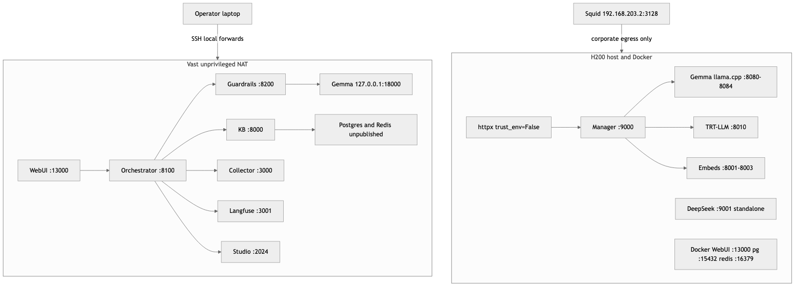

*H200 lab networking. Manager, DeepSeek, embeddings, the Gemma pool, and TRT-LLM run on the host network. Docker publishes WebUI, pgvector, and Redis on high ports. Squid at `http://192.168.203.2:3128` is egress for package and model downloads. `httpx` clients that talk to localhost set `trust_env=False` so that proxy variable cannot hairpin a loopback health check.*

### H200 listeners

The project runs on the self-hosted H200 lab server. The manager on `:9000` is the gateway (`/v1/chat/completions`, admin load, Triton promote). DeepSeek-V4-Flash on `:9001` is a standalone wrapper and is not in `MODEL_REGISTRY`. Embedding workers are multilingual-e5-small `:8001` (384-d), bge-m3 `:8002` (1024-d), and MiniLM `:8003` (384-d, OpenAI `/v1/embeddings`). Five llama.cpp Gemma replicas occupy `:8080`–`:8084`. TensorRT-LLM champion traffic is `:8010`. Dynamic extra llama.cpp ports `:8085`–`:8100` and Qwen on `:8090` exist on the host map and are treated as the same internal tier as the Gemma pool.

Application listeners on the same host include Open WebUI `:13000`, orchestrator `:8100`, knowledge base `:8000`, guardrails `:8200`, the fallback trace collector `:3000`, Langfuse `:3001`, and LangGraph Studio `:2024`. Studio run input carries `request_id`.

Docker on the same host publishes the data plane and the browser UI. The runbook inventory includes Open WebUI `13000→8080`, pgvector `15432→5432`, Redis `16379→6379`, Qdrant `16333` (gRPC `16334`), Milvus `19530`, Grafana `13001`, Prometheus `19090`, and the OpenTelemetry collector `14317`. Those published container ports are reachable on the host network. Postgres and Redis remain internal services for the data plane rather than public internet endpoints.

### Squid and `trust_env`

Corporate egress on `ai-gpu1` is Squid at `http://192.168.203.2:3128`, exported as `HTTP_PROXY` and `HTTPS_PROXY` for apt, pip, git, and Hugging Face. Manager, guardrails, and the orchestrator’s localhost clients construct `httpx.AsyncClient(..., trust_env=False)`. With the flag off, a health check to `:8010`, `:8080`, or `:9000` stays on the loopback interface. Manual probes use `curl --noproxy '*'`.

### Compose MVP surface

`compose.mvp.yml` is the privileged-host packaging of the MVP on hosts that run Docker. The file is explicit about the public surface: Open WebUI is published as `0.0.0.0:13000:8080`, and the Langfuse container is published as `0.0.0.0:3000:3000`. Knowledge base `:8000`, guardrails `:8200`, orchestrator `:8100`, Postgres `:5432`, and Redis `:6379` are `expose`d onto the Docker network so containers resolve each other by name. Guardrails reaches the model plane through the manager on the host network.

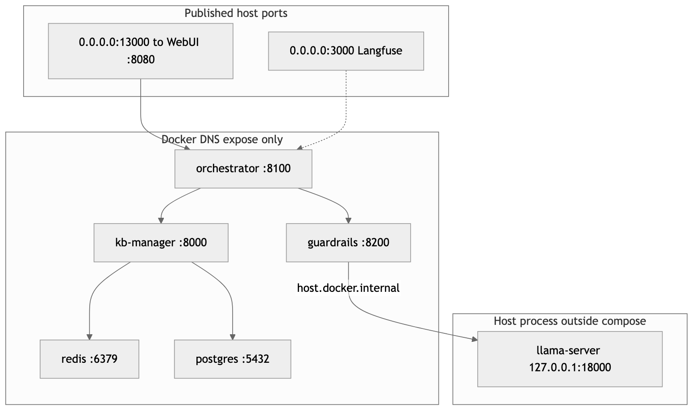

*Compose MVP surface. WebUI on `:13000` and Langfuse on `:3000` attach to host interfaces. Orchestrator, KB, guardrails, Postgres, and Redis stay on the Docker DNS network for service discovery.*

## Attack taxonomy

The table below summarizes the production-relevant attack classes used when reviewing the stack. Each row names the class, the severity band used in reviews, and what the class covers in this architecture.

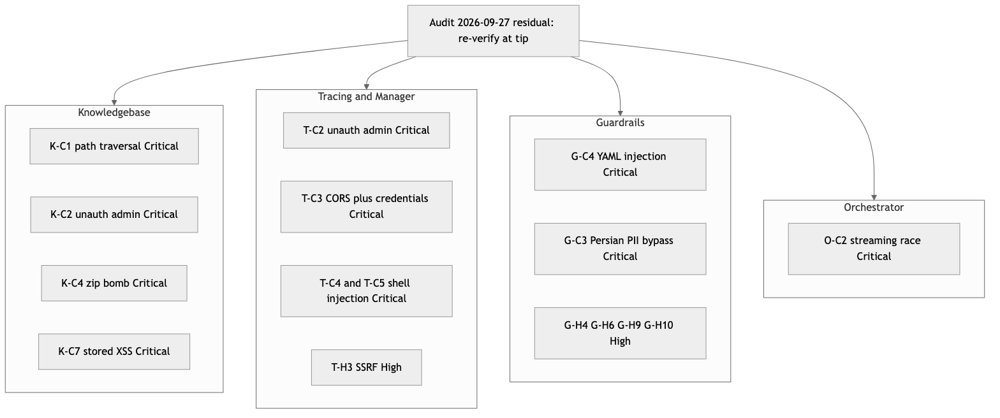

*Attack-class map across knowledge base, manager and tracing, guardrails, and the orchestrator stream path. Reviews walk each class against the owning component on the H200 deployment.*

| Class | Severity | What the class covers |
|-------|----------|------------------------|
| Injection | Critical | Judge and policy document assembly; Persian instruction-override phrasing handled as the `prompt_injection` / jailbreak content-safety category; ingestion log injection on collector endpoints. |
| Path traversal | Critical | Upload filename sanitization into the upload directory; restricted roots for `from-path` / export-path style reads. |
| Unauthenticated admin | Critical | Token checks on KB admin and ingest routers (`X-Admin-Token` / `KB_ADMIN_TOKEN` intent); authenticated manager and tracing dashboard and ingestion endpoints. |
| Zip bomb and unbounded disk | Critical | Archive expansion quotas, compression-ratio checks, byte caps, and stage-directory retention on ingest. |
| CORS with credentials | Critical | Explicit CORS origin lists paired correctly with credential flags on the manager and related dashboards. |
| Shell and argument injection | Critical | Process launches without `shell=True`; validated `port` / `n_ctx` ranges and model-registry allowlists on admin load. |
| SSRF | High | Allowlisted server-side request targets for Studio and related collector callbacks. |
| Stored and DOM XSS | Critical / High | Escaped rendering of ingested chunk text in KB templates; safe DOM assignment in observability pages. |
| PII and secret bypass | Critical / High | Persian-digit and spaced-Sheba aware PII-IR; secret markers as hard blocks; output rails on streamed completions. |
| Streaming races | Critical | Per-request stream state isolation in the orchestrator so concurrent turns do not share mutable initial state. |

## Guardrails signal and policy architecture

Guardrails is a sealed HTTP box on `:8200`. Orchestrator `:8100` posts `POST /v1/rails/check` with `{stage, text, request_id}` for input and again for output, then `POST /v1/chat/completions` for guarded generation. Guardrails is the component that dials the H200 LLM manager on `:9000`. WebUI never receives upstream model URLs.

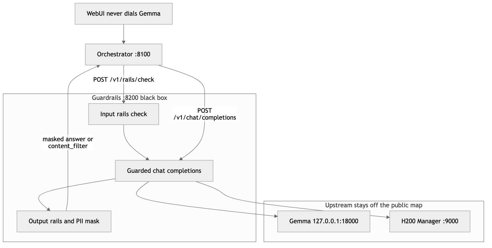

*Guardrails black box. Callers see two routes and one outcome: a PII-masked completion with `finish_reason=stop`, a length-mapped upstream condition with `finish_reason=length`, or a category refusal with `finish_reason=content_filter`. Inside the box, input rails run before the upstream call and output rails run on the completed text. The upstream arrow terminates at the H200 manager. A judge error, an empty verdict, or a timeout refuses the turn.*

Inside the box the order is deterministic signals, then a policy judge, then a direct-LLM yes/no self-check. `collect_signals` normalizes Persian text and emits evidence: injection, jailbreak, HurtLex hate, profanity, scope, and PII. Those hits do not themselves block, except `secret` (`sk-` prefixes, `api_key`, `database_url`, `Bearer`), which `adjudicate` refuses immediately. `GUARD_JUDGE_BACKEND` selects `gemma` (pinned policy, parse `VERDICT` / `CATEGORY`), `mizan` (Manager `/systemone`), or `hybrid` (Mizan first, Gemma when confidence is low or a hard signal fired). `GUARD_JUDGE_MODE=on-signal` skips the LLM judge when the text is clean; `always` forces it. The self-check is selected by `GUARD_NEMO_SELFCHECK` (`on`, `shadow`, or `off`). An error in that check fails closed.

Datasets and policy files that feed the box:

| Asset | Role |
|-------|------|
| `kb/hurtlex_fa.json` (HurtLex FA 1.2) | Hate and insult lemmas, on the order of 2464 entries across 17 categories, used by `check_hurtlex`. |
| `kb/hurtlex_allowlist.json` | Exact-word credit and social exceptions: **28 lemmas**. Profanity, PII, and secrets are not allowlisted. |
| `kb/prompt_injection_fa.json` | About 26 Persian injection and jailbreak patterns for `check_prompt_injection_fa`. |
| `kb/persian_swear.json` | About 322 profanity entries for `check_profanity_fa`. Strict. |
| `policies/ics-credit-v1.0.0.yaml` | Versioned ICS policy, pinned by `policies/active.yaml`. Categories include `out-of-domain` (company and people questions stay in domain) and `ungrounded-advice`. `domain_keywords` drive the fast pre-check. New policy ships as a new file plus a pin move. Released versions stay immutable. |
| `eval/samples/` | Offline expectations: `prompt_injection.json`, `pii.json`, `hate_toxicity.json`, `financial_false_positive.json`, `benign_credit.json`. |

**PII-IR** is the output-stage Iranian identifier check: national ID with a mod-11 test, Sheba / IR-IBAN with mod-97, and mobile or landline shapes. A validator hit on an otherwise allowed answer is mask-and-continue (`[masked-pii]`). A secret marker is a hard block, not a mask. Event logs store the masked form.

Production refusals are premade Persian strings keyed by category (`prompt_injection`, `jailbreak`, `hate`, offense, `out_of_scope`, `pii`, `secret`, `policy`, `engine_error`). The `reason` field in production mode does not echo the regex or the judge trace. Output-stage hate and profanity refusals attribute the problem to the answer. Upstream context overflow is mapped to `finish_reason=length` with a short Persian retry hint.