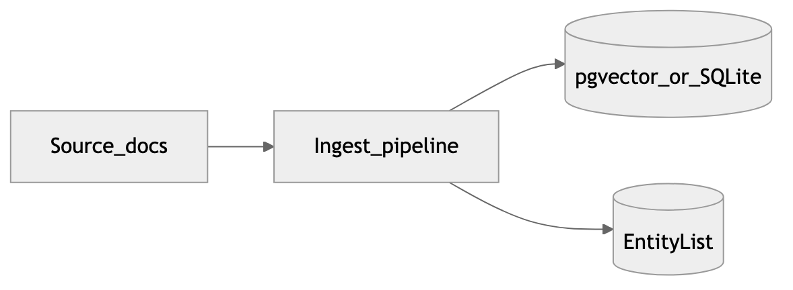
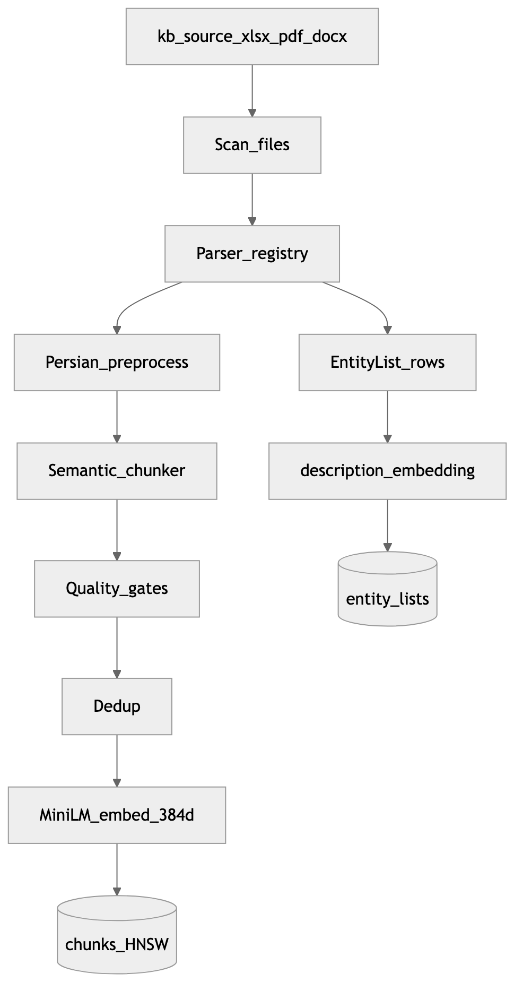
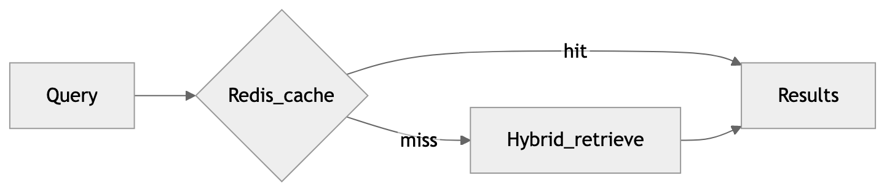
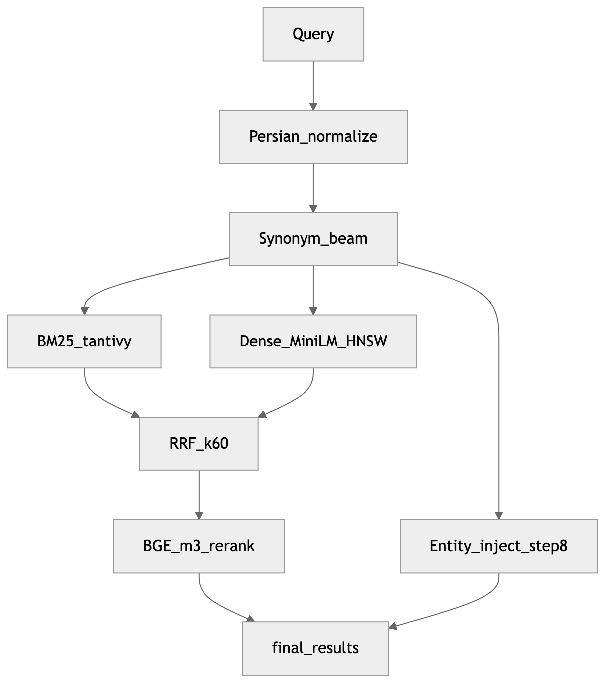
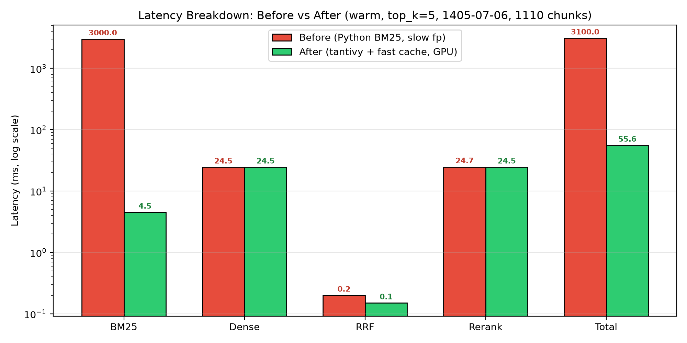
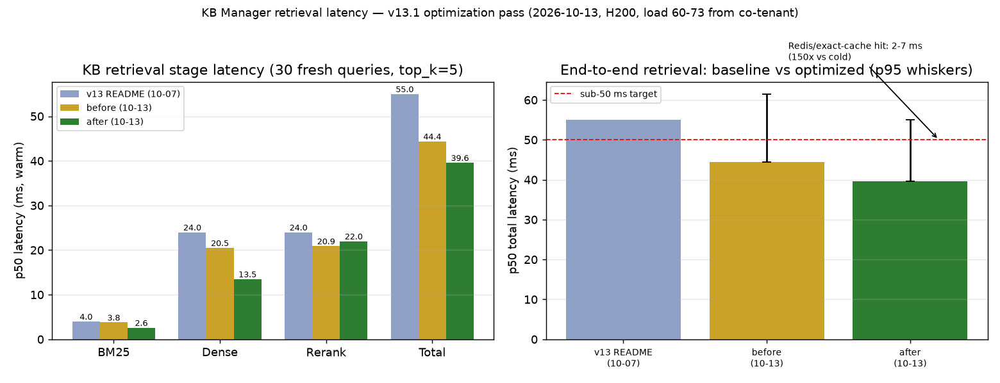

# Knowledge base

## Section summary

The knowledge base (`components/knowledgebase`, kb-manager) is the retrieval substrate for Persian credit-scoring questions. It turns source files into versioned chunks and entity supplements, then answers hybrid search with named stage timings. Release `v13_1405-07-06` is **RAM-first**: tantivy BM25 and the pgvector HNSW index stay resident, MiniLM and BGE-m3 run on GPU, and a warm hybrid query averages about **55 ms**. This chapter walks ingest, the published parameter table, the v1–v13 changelog, and EntityList thresholds (0.6 in search, 0.4 on the supplement tool).

## Purpose in the platform

The KB is the retrieval service beside the chat model and the policy layer. Its contract is: given a Persian or mixed query and an optional subspace hint, return ranked chunk evidence with timings and citation metadata. The orchestrator (`:8100`) calls `POST /search/api` after input rails. `build_context` then packs the hits. The service listens on **`:8000`**, persists through SQLAlchemy into Postgres with pgvector (SQLite is the fallback), and exposes FastAPI routes for search, the ingest pipeline, and metrics. Quality is reported with Hit@*k*, MRR, and nDCG, plus `stage_ms`, so each release carries both a quality figure and a named-stage latency.

The KB owns documents, ingest, indexing, retrieval, reranking, and KB evaluation. It does not own model lifecycle, safety policy, orchestration, or the WebUI.

## Corpus at v13

The current release label is **`v13_1405-07-06`**: **18 documents / 1,123 chunks**, from kb-source folder `1405-07-06` (earlier folders `1405-05-31` and `1405-06-23` remain in the submodule). KB Pages date the full RAM-first rebuild to **2026-10-07**. A latency page measured **1,110** chunks at `top_k=5`; that count is the same rebuild family as 1,123, not a second corpus.

Chunk types in the v13 tree are `qa_pair` **776**, `reason_detail` **198**, `body` **71**, `article` **46**, `kv_pair` **19**, plus **13** parent chunks. Four hierarchy roots organize the folders: حقیقی تسهیلات, حقیقی چک, حقوقی تسهیلات, and عمومی. There is no third sheet under those roots.

The frozen evaluation set is **120** queries in six formats. The published **v11 Hit@5 is 0.9306**. The KB tree’s cited `pytest` run records **116 passed**.

Entity supplements sit beside chunks. XLSX annexes under `ضمیمه پایگاه دانش` are built by `kb_manager/entity_lists.py` into structured `content_json` with `_meta.kind` and `subspace_ids`: three `score_table` lists (person / legal / cheque, 15 grades A1–E3 with color groups), plus `loan_catalog`, `shareholders`, `data_providers`, and `report_consumers`. Search step 8 embeds the query with MiniLM and keeps lists whose cosine against `description_embedding` is **≥ 0.6**, returned as `injected_entities`, and force-injects the score table whose `subspace_ids` match the active subspace so models do not cross-bleed. The orchestrator also calls the supplement tool at threshold **0.4** (`POST /search/supplement`, subspace/filter_path aware) and surfaces the payload as `rag.supplemental`. Glossary sheets update the synonym map; welcome / offtopic / limitations are not EntityLists.

## Ingest pipeline

**Figure — High-level ingest.** Source trees under `kb-source` enter one pipeline that writes two durable stores: document and chunk tables with dense embeddings, and a parallel `EntityList` table for structured supplements that must stay out of ordinary prose chunks. Ingest is a write path. Hybrid search reads the snapshot that a full or incremental rebuild leaves behind. The v13 snapshot behind this figure is the 18-document, 1,123-chunk tree described above.

Coordination lives in `components/knowledgebase/kb-manager/kb_manager/pipeline/orchestrator.py`. `PipelineOrchestrator` selects a parser by extension, runs Persian hygiene (digit and character normalization, punctuation cleanup), then chunks and embeds. Folder hierarchy under `kb-source` becomes the metadata that `filter_path` and sticky subspaces later consume.

**Figure — Ingest detail.** The per-file loop is parse, preprocess, content-hash skip or update, semantic chunk, embed, and store, with an early branch for supplementary Excel lists. Annex and list paths bypass normal chunking into `EntityList` rows via `entity_lists.py` builders (score bands/color groups; catalog records/groups). Synonym and glossary annexes feed the BM25 synonym map (93 colloquial-to-formal entries) and stay out of the prose chunk corpus. Embeddings on the list branch fill `description_embedding`, which the 0.6 cosine inject ranks; score tables also carry `subspace_ids` for force-inject.

`SemanticChunker` (`kb_manager/chunker/semantic.py`) prefers meaning-preserving units. Tabular schemas become row-aware chunks with Persian field labels. Narrative documents split on structure and on normalized question text. Near-duplicate normalized questions are removed so BM25 is not rewarded for FAQ clones. The published chunk policy is semantic chunks with a **512**-token maximum, parent chunks up to **1536**, scoped to the sheet.

### EntityList model

Structured supplements are first-class rows in `kb_manager/models/database.py`:

- `list_name` — the human title used as the retrieval surface
- `description` and `description_embedding` — a short Persian description plus the JSON embedding used for cosine matching
- `content_json` — structured payload from `entity_lists.py` (`bands`/`color_groups` for score tables; `records`/`groups`/`full_list_text` for catalogs; `_meta.kind` + `subspace_ids`)

Score tables and catalog annexes stay queryable as units. Flattening those cells into MiniLM space is a poor fit for short keys, which is why the 0.6 / 0.4 gates exist beside the chunk index, and why score-table force-inject is keyed by subspace rather than cosine alone.

## Retrieval pipeline

**Figure — High-level retrieval.** A request hits Redis first. The cache key is the SHA-256 of the normalized query, `top_k`, keyword boost, and `filter_path`, so a subspace answer cannot leak into another domain. Hits return in **2–7 ms** and skip the ranker. Misses run the hybrid path and write back with a **600 s** TTL. Pages describe that Redis hit as about **150×** faster than a cold search. `KB_FAST_CACHE` defaults to true and skips a fingerprint scan of about **2.7 s** on every search. Errors are never cached.

The implementation behind the figure is `kb_manager/web/routes/search.py`. `search_knowledge_base` builds or reuses in-memory indexes and runs the stages below. `filter_path` resolves to `allowed_ids` from `folder_hierarchy` *before* BM25 and dense search, which is how sticky product subspaces scope a query without re-embedding the corpus.

1. **Normalize.** Arabic characters fold to Persian, ZWNJ is handled, and digits are normalized. Tokens are words plus Persian character **3-grams**.
2. **Expand.** The synonym beam defaults to **`KB_SYNONYM_BEAM` = 5**. Setting the beam to 1 cuts BM25 work by about 5×. HyDE (`KB_HYDE_ENABLED`) defaults to **false**.
3. **Retrieve in parallel.** Tantivy BM25 (content and keyword legs) runs beside dense MiniLM over pgvector HNSW.
4. **Fuse and rerank.** Reciprocal rank fusion uses **k = 60**. The BGE cross-encoder then fuses with RRF at **α = 0.7**, with pin protection for a strong keyword hit.
5. **Gate.** A final top-*k* and `min_relevance` cut, then EntityList inject at cosine **≥ 0.6**.
6. **Respond.** `POST /search/api` returns `SearchSteps` and `final_results`, plus `injected_entities` when step 8 fires.

**Figure — Retrieval detail.** Stages that fill `SearchSteps.stage_ms` are `bm25`, `dense`, `hyde`, `rrf`, `rerank`, and `total`. The same timings feed metrics, so rerank time and a BM25 rebuild each show up under their own name. HNSW distance itself is computed on the Postgres CPU. The GPU is used to embed the query and to run the cross-encoder. On the measured ~1,110-chunk relation the HNSW index is about **4.8 MB**, the chunks table about **1.2 MB**, and `pg_total_relation_size` about **203 MB**, held hot with `pg_prewarm`.

### RAM-first parameters

The stack on the KB Pages is FastAPI, SQLAlchemy async, SQLite or pgvector (HNSW, 384-d, RAM-pinned), Rust tantivy BM25 in a RAM directory, MiniLM-L12 on GPU, BGE-v2-m3 on GPU, hazm/shekar normalization, and a Redis result cache. The latency host cited for the table is **1.0 TiB** of RAM and **2× H200** (143 GB HBM each). Dense weights occupy about **3 GB** of HBM.

| Stage | Parameter | Value | Notes |
|---|---|---|---|
| Postgres | `shared_buffers` / `effective_cache_size` | **16 GB / 800 GB** plus `pg_prewarm` | Vectors and HNSW stay resident |
| BM25 engine | tantivy | **0.26.2**, `RAMDirectory`, heap **50 MB** | `KB_USE_TANTIVY=true` |
| BM25 | *k*1 / *b* | **1.5 / 0.75** | Content leg and keyword leg |
| BM25 | Keyword boost / n-grams | **×3** / character **3**-grams | `KB_KEYWORD_BOOST=3.0` |
| Synonym beam | `KB_SYNONYM_BEAM` | **5** | 93-entry map; set `1` to shrink BM25 about 5× |
| Dense | Model / dim / batch / device | MiniLM-L12-v2 / **384** / **64** / **cuda** | `paraphrase-multilingual-MiniLM-L12-v2` |
| Dense index | pgvector HNSW | `vector_cosine_ops`, **m = 16**, **ef = 64** | Plus an npz cache |
| RRF | *k* | **60** | |
| Fusion | RRF ↔ rerank α | **0.7** | `KB_RERANK_FUSION_ALPHA` |
| Rerank | Model / pool | `BAAI/bge-reranker-v2-m3` / `min(50, top_k×3)` | GPU; pin-protect top-3 at rank ≥ 10 |
| Redis | TTL / hit latency | **600 s**, **2–7 ms** | About **150×** versus a cold search |
| Fast cache | `KB_FAST_CACHE` | **true** | Skips the ~2.7 s fingerprint scan |
| Chunk | Strategy / max tokens | semantic / **512** | Parent max 1536, scope is the sheet |
| HyDE | `KB_HYDE_ENABLED` | **false** | Off unless explicitly enabled |
| EntityList | In-search cosine / supplement tool | **≥ 0.6** / **0.4** | Step 8 versus `POST /search/supplement` |

### Latency on the measured rebuild

Measured **2026-10-07** on the `1405-07-06` corpus (`top_k=5`, warm after the GPU load). The headline warm total is **51–66 ms**, average about **55 ms**.

| Stage | Before (Python BM25 / CPU) | After (tantivy + GPU) | Share after |
|---|---:|---:|---:|
| BM25 lexical (content + keyword, beam 5) | ~3000 ms | **3.8–5.9 ms** | ~7% |
| Dense cosine (pgvector HNSW) | 16–50 ms warm (CPU path ~3000 ms) | **22–27 ms** | ~44% |
| RRF *k* = 60 | 0.1–0.2 ms | 0.1–0.2 ms | <1% |
| Cross-encoder BGE-v2-m3 | 20–23 ms warm (CPU ~5400 ms) | **21–25 ms** | ~44% |
| Total warm | ~3100 ms (cold ~12 s) | **51–66 ms (avg ~55 ms)** | 100% |
| Redis hit | 2–7 ms | 2–7 ms | **~150×** vs cold |

The first query after restart is a one-time cold start: dense about **4246 ms**, rerank about **5396 ms**, BM25 about **5 ms**, together near **12 s**. Later queries sit near the 55 ms average. RRF is cheap. The cross-encoder and the HNSW probe dominate the warm budget, in roughly equal shares.

**Figure — Stage latency after the RAM-first and tantivy work.** The chart is a log-scale before/after on the warm path (`top_k=5`, folder `1405-07-06`, 1,110 chunks). Python BM25 at about 3000 ms falls to a tantivy bar of 4.5 ms. Dense stays near 24.5 ms and rerank near 24.5 ms, so the warm total moves from about 3100 ms to **55.6 ms**. RRF is a sliver on this scale (0.2 ms to 0.1 ms). The picture is the steady warm state. The separate ~12 s figure in the table is the first query after restart, which this chart does not draw.

**Figure — Latency on the v13.1 pass.** The left panel is p50 stage latency for 30 fresh queries at `top_k=5`: the 2026-10-07 README profile totals **55.0 ms**, a 13 October “before” totals 44.4 ms, and the same-day “after” totals **39.6 ms** (BM25 2.6, dense 13.5, rerank 22.0). The right panel repeats those end-to-end p50s with p95 whiskers against a 50 ms reference line, and notes Redis hits at 2–7 ms (about 150× versus cold). Read 55 ms as the Pages warm headline and 39.6 ms as the later same-corpus tune under co-tenant GPU load, not as a new document set.

## Version highlights (v1–v13)

Each row is a corpus change or a retrieval change that later rows assume. “v13-RAM” is the code and host tuning on top of the v13 corpus, not a fourteenth document set.

| Version | Corpus | What changed | Published benchmark |
|---|---|---|---|
| v1 | ~160 files (31 Tir 1405) | Baseline ingest and BM25 | — |
| v2 | 355 docs / 6,208 chunks | BM25 + TF-IDF, RRF *k* = 60 | Hit@5 90%, MRR 0.736 |
| v3 | same | Dense MiniLM-L12 added | Hit@5 89.2%, MRR 0.787 |
| v4 | same | Character 3-grams and a cross-encoder | Hit@5 90%, MRR 0.775 |
| v5 | same | Frozen dataset, BM25 ×3 | Hit@5 84.2%, MRR 0.751 |
| v6 | 69 docs / 3,626 chunks | Synonym beam 5, MinHash dedup | 10-query smoke, Hit@5 100% |
| v7 | 34 docs / 2,074 chunks | Fresh `1405-05-31`, colloquial expansion, IVA-15 | Doc Hit@5 73.3% |
| v8 | 103 docs / 6,593 chunks | pgvector HNSW-384, keyword ×3.0 | HNSW GPU load note 18.4 s |
| v9 | 21+32 docs / ~1,084 chunks | Type-aware chunks, transparency/zip | IVA 11/15 |
| v10 | 35 docs / 2,282 chunks | `1405-06-23`, kv and single-column schemas, stage bench | Hit@5 **0.9244** |
| v11 | 35 docs / 2,227 chunks | Chunk rebuild, dense `use_context=False` | Hit@5 **0.9306**, MRR **0.8281** |
| v12 | same KB corpus as v11 | Typo fixes, exclusive-term beam, Redis cache | Synonym map **93** entries |
| **v13** | **18 docs / 1,123 chunks** | `1405-07-06` RAM-first: tantivy RAM BM25, 16 GB buffers, prewarm, GPU dense and rerank on H200 | Latency **~55 ms** |

The v11 manifest path cited on the KB pages is `kb-manager/versions/v11_1405-06-23/manifest.json`. Published v11 quality on that line is Hit@5 **0.9306** and MRR **0.8281**. Pin protection keeps a strong keyword hit in the fused list, and the keyword boost raises short codes and fixed phrases beside the cross-encoder.

## Tooling

| Name | Role |
|---|---|
| FastAPI | HTTP API for search, pipeline, and metrics |
| SQLAlchemy | ORM and async sessions over Postgres or SQLite |
| pgvector | Vector column type and HNSW for dense nearest neighbors |
| tantivy-py | Python bindings for the Rust BM25 index |
| sentence-transformers | MiniLM runtime for `DenseSemanticIndex` |
| BGE (FlagEmbedding) | `bge-reranker-v2-m3` cross-encoder |
| Redis | Shared result cache, TTL 600 s |
