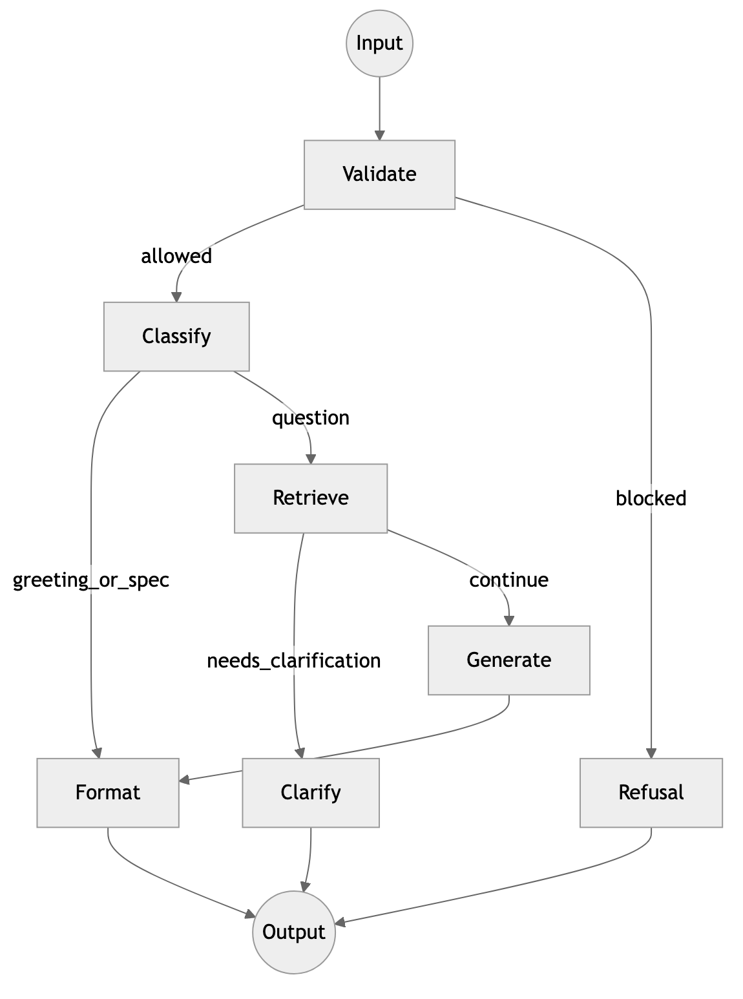
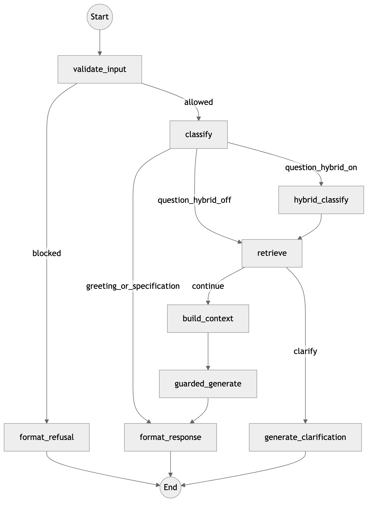

# Orchestrator

## Section summary

The orchestrator is the public OpenAI-compatible face of the platform (`:8100`). It does not embed the corpus and it does not serve Gemma. A compiled LangGraph validates and classifies each turn, retrieves from the knowledge base with sticky subspace memory, optionally clarifies a scattered credit question, packs a bounded prompt, and always generates through guardrails. This chapter anchors every graph node to a file, lists keyword boosts and the evidence floors, and records the `AmbiguityResult` defaults: enabled, instrument-only, margin 0.08. Query embeddings for that score come from MiniLM on `:8003`, fetched with `trust_env=False`.

## Role in the request path

Open WebUI, or any OpenAI client, posts to `create_app` in `components/orchestrator/src/work_rag_orchestrator/api.py`. The API allocates a `request_id`, restores `sticky_subspace` from the LangGraph checkpointer when the conversation continues, and invokes the compiled graph. Downstream dependencies are the knowledge base (`KB_BASE_URL`, default `http://127.0.0.1:8000`) and guardrails (`GUARDRAILS_BASE_URL`, default `http://127.0.0.1:8200`). Thresholds, keyword boosts, and the context budget live in `config.py`. The typed carry bag for every node is `RAGState` in `state.py`.

The user-facing path has one hard invariant: **the orchestrator never opens an HTTP session to Gemma.** `guarded_generate` posts `prompt_messages` to guardrails `POST /v1/chat/completions`. Guardrails alone dials the H200 LLM Inference Manager on `:9000`. Input rails run in `validate_input` via `/v1/rails/check`. The published upstream model name is `UPSTREAM_LLM_MODEL=gemma-4-31b-triton-trt`. `HYBRID_CLASSIFIER_ENABLED` defaults to **false**.

The graph is compiled with `MemorySaver` and exports `rag_graph`. Studio loads the same object as `graph` (`langgraph.json` → `studio_graph.py:graph`). Studio run inputs must include `request_id`.

## Graph node file anchors

Pages technical notes anchor the production nodes as follows. Line numbers are the anchors published with those notes.

| Node | File / line | External call |
|---|---|---|
| `validate_input` | `nodes/validate_input.py:13` | Guardrails `POST /v1/rails/check` (`clients/guardrails.py:91`) |
| `classify` | `nodes/classify.py:67` | Guardrails `/v1/chat/completions` (`clients/guardrails.py:135`) |
| `hybrid_classify` | `nodes/hybrid_classify.py:67` | Guardrails `/v1/chat/completions` (SVM, then Gemma if the SVM is unsure) |
| `retrieve` | `nodes/retrieve.py:851` | KB `POST /search/api` (`clients/knowledgebase.py:61`) |
| `generate_clarification` | `nodes/generate_clarification.py:24` | Guardrails `/v1/chat/completions` |
| `build_context` | `nodes/build_context.py:53` | None (numbered sources and the system prompt) |
| `guarded_generate` | `nodes/guarded_generate.py:16` | Guardrails `/v1/chat/completions`, which calls Gemma |
| `format_response` | `nodes/format_response.py:492` | None (citations and `finish_reason`) |
| `format_refusal` | `graph.py:109` | Alias of `format_response` |

Conditional edges sit in `graph.py`: `should_continue_after_validation` at line 24, `should_route_after_classify` at line 31, and `should_clarify` at line 45. An entity supplement short-circuits clarify. `should_clarify` also reads `subspace_ambiguity_route` and `ambiguity_ambiguous`, then falls back to the scattered-query check `is_scattered_ambiguous`. While the route flag stays false, the ambiguity score is present on the state and does not flip that edge by itself.

The node order operators should memorize:

1. **`validate_input`** extracts the latest user query and calls input rails. If `blocked`, the graph goes to `format_refusal` and ends.
2. **`classify`** buckets the turn as `greeting`, `specification`, or `question`. Greetings and product-spec answers go straight to `format_response` and skip retrieval.
3. **`hybrid_classify`** runs only when the hybrid classifier is enabled. The default is off, so the edge goes from classify to retrieve.
4. **`retrieve`** rewrites coreference when needed, calls KB hybrid search and the entity supplement, applies sticky or inferred `filter_path`, and scores evidence.
5. **`should_clarify`** continues when supplemental or injected entities exist. Otherwise a scattered ambiguous query with no `applied_subspace` branches to **`generate_clarification`** and ends.
6. **`build_context`** numbers sources and enforces `MAX_CHUNKS` and `MAX_CONTEXT`.
7. **`guarded_generate`** asks guardrails for the answer, or receives a content-filter refusal.
8. **`format_response`** shapes the OpenAI payload, RAG citations, and audit fields.

**Figure — High-level orchestrator graph.** Validation and classify sit on the left, retrieval in the center, and a clarify-versus-generate fork reunites at formatting. The picture maps to the node names registered in `graph.py` and leaves out sticky-decay bookkeeping, the whole-KB retry inside `retrieve`, and Langfuse span wiring so the branching contract stays readable. Most of the 4.9 s median bench time accumulates on the generate side of this fork, which is why the clarify exit matters: a scattered question should not pay for a full Gemma decode.

**Figure — Detailed orchestrator graph.** The expanded view shows the refusal path when input rails block, the greeting and specification bypass that skips the KB, the optional `hybrid_classify` hop, the entity short-circuit around clarification, and the chain `build_context` → `guarded_generate` → `format_response`. Conditional helpers are the three functions in the anchor table. Retrieval and trim logic live in `nodes/retrieve.py`; prompt assembly lives in `nodes/build_context.py`; KB HTTP lives in `clients/knowledgebase.py`. Studio runs this same compiled object. Every Studio input includes `request_id` so the checkpoint matches the conversation.

## Keyword boosts and evidence floors

`SUBSPACE_KEYWORD_BOOST` is a per-subspace BM25 bias applied on scoped KB calls. Cheque questions, which lean on short codes and fixed phrases, get the strongest boost.

| Subspace | Keyword boost |
|---|---:|
| `cheque` | 3.5 |
| `facilities_person` | 3.0 |
| `facilities_legal` | 3.0 |
| `general` | 2.5 |

Per-subspace evidence thresholds (the T3 floors in `config.get_evidence_threshold`) sit under the global abstain:

| Subspace | Evidence floor |
|---|---:|
| `cheque` | 0.05 |
| `facilities_person` | 0.10 |
| `facilities_legal` | 0.15 |
| `general` | 0.15 |
| Global `EVIDENCE_MIN_SCORE` | **0.15** |

`filter_path` on the request is authoritative. When it is present, `retrieve` scopes `KnowledgebaseClient.retrieve(..., filter_path=...)` and maps the path back to a subspace label for badges and for the floor above. `sticky_subspace` persists across turns in checkpointed state and is kept distinct from `applied_subspace` in `state.py`, so the scorer can keep or switch. The API re-injects sticky scope for generic follow-ups (pronouns, short confirmations). **`STICKY_DECAY_TURNS` defaults to 3**: after three consecutive generic turns the sticky subspace is dropped. When Open WebUI sends no `X-Request-ID`, sticky scope is mined from user-only history; interrogatives are skipped and declarations set scope. T4 injection applies the sticky `filter_path` on those generic follow-ups.

A filtered retrieval that misses the floor can retry once with `filter_path=None`. That retry is audited as `fallback_used`. `RETRIEVAL_TOP_K` is **20**, formed as a union of 10 RRF hits and 10 cross-encoder hits.

Entity dictionaries (score tables, shareholders, loan titles, providers, report consumers, reason codes) arrive as `injected_entities` or `supplemental`. `trim_supplemental` keeps at most the top three lists **ranked by query relevance** (catalog/score kind boosts; score tables are demoted on pure catalog questions so force-injected bands cannot crowd out loans), about **8 KB** of serialized JSON each, drops bulky `full_list_text` / `full_table_text` dumps first, ranks rows by query-token overlap, and doubles the weight of code-like tokens (Latin letters or digits such as `sbd1`). `build_context` re-ranks the surviving lists into a ~9000-char Entity Data budget. When generation still abstains, returns empty/weak evidence, or bleeds a score-table dump on a catalog question, `format_response._answer_from_supplemental` rebuilds a deterministic answer from `records` / `groups` / `color_groups`.

## AmbiguityResult defaults

The frozen interface is `AmbiguityResult` in `src/work_rag_orchestrator/subspaces.py`. The four subspaces are `cheque`, `facilities_person`, `facilities_legal`, and `general`.

| Setting | Default |
|---|---|
| `subspace_ambiguity_enabled` | **True** (compute the score and keep it for audit) |
| `subspace_ambiguity_route` | **False** (instrument only; the score does not route or clarify) |
| `subspace_ambiguity_margin` | **0.08** |
| `subspace_ambiguity_min_top1` | **0.30** |
| `subspace_ambiguity_entropy_max` | **0.85** |
| `subspace_softmax_temp` | 0.05 |
| `subspace_score_cache_size` | 512 |
| `subspace_protos_path` | `data/subspace_protos.npz` |
| `subspace_clf_path` | `data/subspace_clf.joblib` |

A turn is marked ambiguous when the top class is below `min_top1`, or the margin between the top two classes is below **0.08**, or the entropy of the distribution exceeds `entropy_max`. The score lies in [0, 1]; a higher score means a more ambiguous subspace assignment. The `source` field records where the score came from: `protos`, `classifier`, `fallback`, or `disabled`. Because `subspace_ambiguity_route` is false, `should_clarify` does not treat that boolean as a routing order. The scattered-query fallback and the entity short-circuit still apply. Turning the route flag on is a product change, not the default this report describes.

The head was trained as an SVM-RBF on a **1,000-sample** set (parent changelog, orchestrator v13, 2026-10-24). The same release landed conditional clarify, sticky `MemorySaver` keyed by `X-Request-ID`, `MAX_CHUNKS=20`, context budget **9000**, the **0.15** evidence guard, grounded follow-ups, and a dead-letter path.

## Embeddings on :8003

`embed_base_url` defaults to **`http://127.0.0.1:8003`**. `embed_model` is `paraphrase-multilingual-MiniLM-L12-v2` (384 dimensions), the same family the KB uses for dense search. The orchestrator uses an injected embedder when one is provided. Otherwise it posts to `{embed_base_url}/v1/embeddings` with httpx and **`trust_env=False`**. When the embed server is unreachable, the result is `source="fallback"` and `ambiguous=False`, so the turn continues on the scattered-query check.

Both the knowledge-base client and the guardrails client construct `httpx.AsyncClient(trust_env=False)`. On the H200 host the shell exports a corporate Squid proxy. Inheriting `HTTP_PROXY` would send `127.0.0.1:8000`, `:8003`, and `:8200` to the proxy, and the turn would hang. The flag is what keeps those localhost calls on the loopback interface. The same pattern is required in the LLM manager; chapter 6 covers the proxy address.

## Context packing

`build_context.py` caps retrieval evidence at **`MAX_CHUNKS` = 20** and the packed context at **`MAX_CONTEXT` = 9000**. Lexical matches are preferred when the list must be truncated. Twenty chunks inside that budget, plus the trimmed entity JSON, are what the 8192-token Gemma window is sized to accept together with the answer. History compaction stays available when the running transcript would crowd that budget: older turns collapse to a rolling summary and recent turns stay verbatim, and earlier refusals that reported no evidence are stripped so a later retrieval stands on its own.

## Tooling

| Component | Role in the orchestrator |
|---|---|
| LangGraph | Stateful graph, conditional edges, `MemorySaver` checkpoint |
| FastAPI | OpenAI-shaped HTTP API, health and ready, Studio entry |
| httpx | Async clients to KB, guardrails, and `:8003` (`trust_env=False`) |
| Langfuse | Trace export; JSONL collector on `:3000` is the fallback |

## Bench note

The 41-turn multi-agent bench dated **2026-10-14** (after the 2026-10-12 baseline) reports retrieval hit **0.780** (was 0.537), ambiguity resolution **1.000** (was 0.854), sticky persistence **0.683** (was 0.610), and p50 latency **4872 ms** (was 8006 ms, about 39% lower). Generation through guardrails accounts for most of the wall time. On that after-cut, cheque p50 is about 10.3 s with hit 0.667. These figures are observed artifacts from `bench_report_latest`. They are the comparison point when changing sticky decay, the chunk cap, or the ambiguity route flag.

## Code map

| Concern | Path |
|---|---|
| Graph wiring and edges | `orchestrator/graph.py` |
| `RAGState`, sticky versus applied | `orchestrator/state.py` |
| Thresholds, boosts, budget | `orchestrator/config.py` |
| `AmbiguityResult` | `orchestrator/subspaces.py` |
| Retrieve, sticky decay, trim, fallback | `orchestrator/nodes/retrieve.py` |
| Prompt pack | `orchestrator/nodes/build_context.py` |
| KB `POST /search/api` client | `orchestrator/clients/knowledgebase.py` |
| Guardrails client | `orchestrator/clients/guardrails.py` |
| Chat API and sticky inject | `orchestrator/api.py` |
