

  <h1>Architectures</h1>
  
Mermaid diagrams of paper architectures: SPLIT-RAG, PC-RAG, RAC, ICR, CPP, CALMem, H-RAG, 5ting, GUIR, DUTIR, CoRAG, IM-RAG

## System Architectures

### Our Current Architecture (Post T1-T7 Fixes)

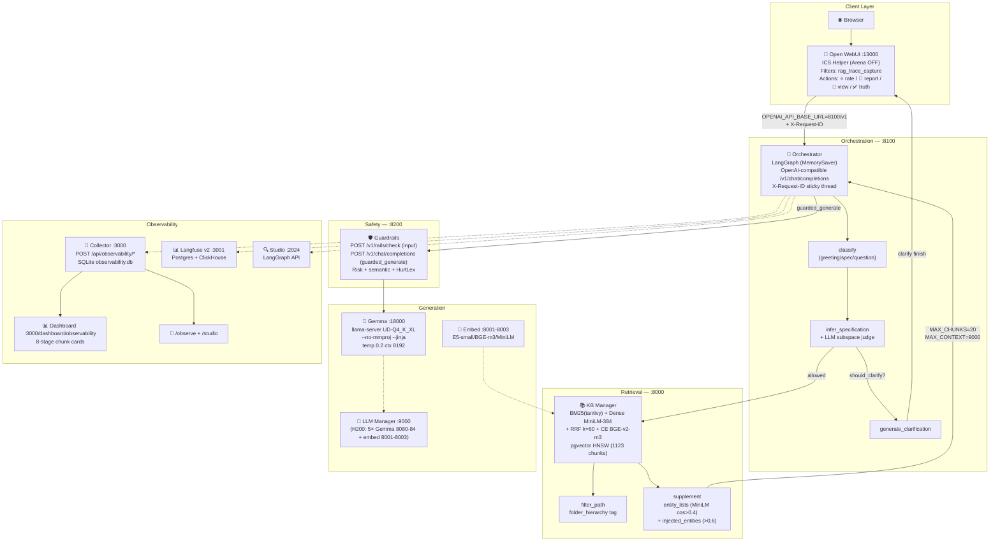

---

### SPLIT-RAG Architecture

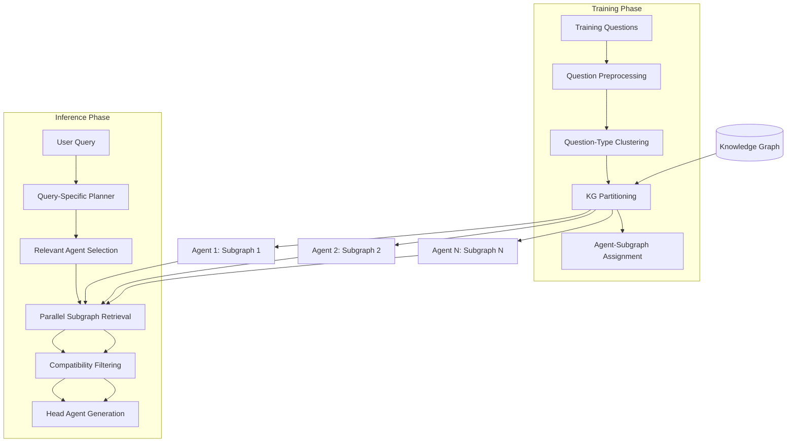

---

### PC-RAG Architecture

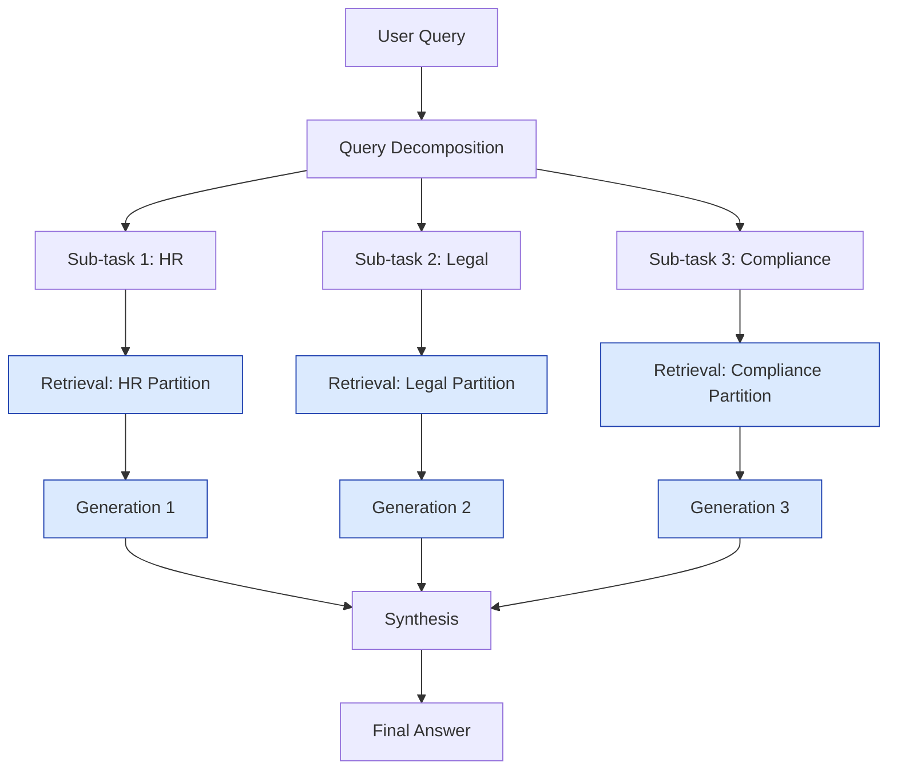

---

### RAC Architecture

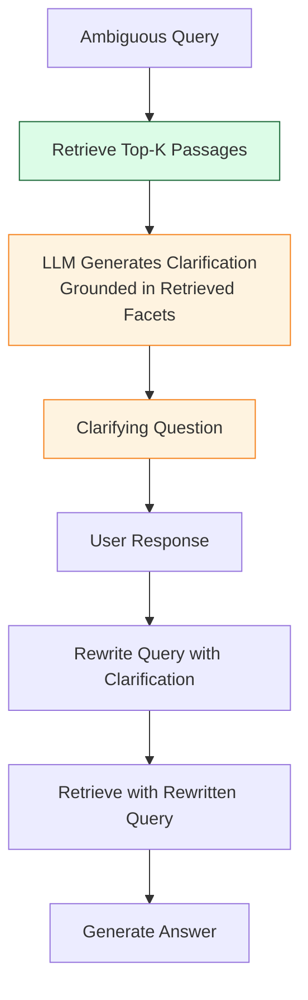

---

### ICR Architecture

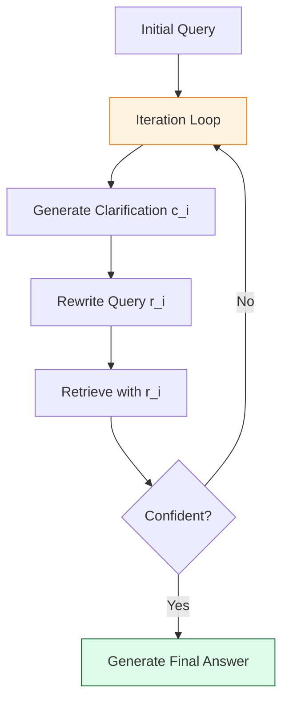

---

### CPP Architecture

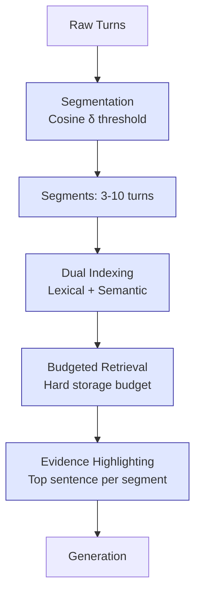

---

### CALMem Architecture

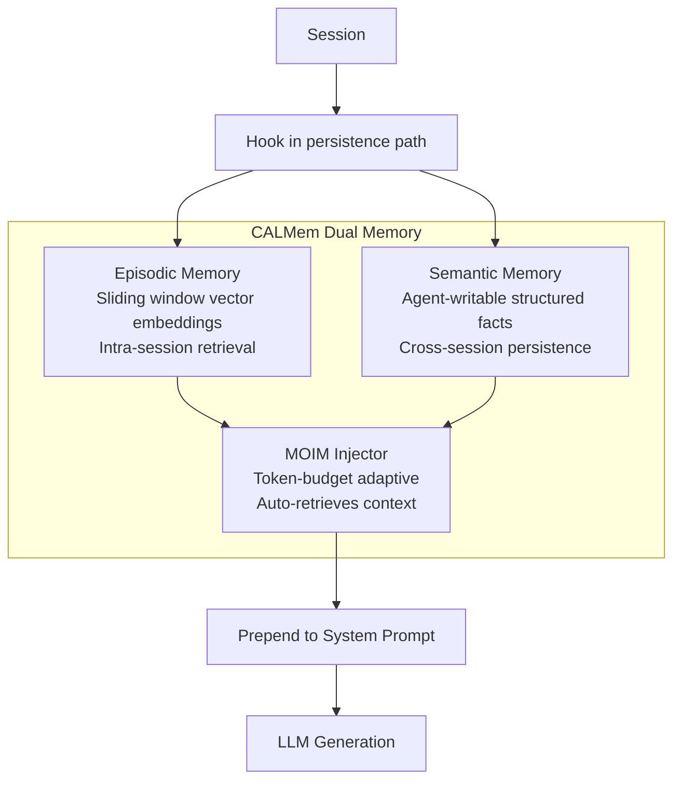

---

### H-RAG Architecture

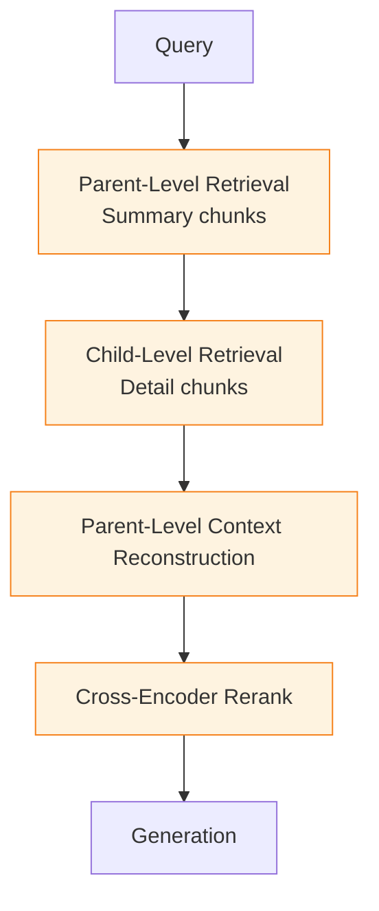

---

### 5ting Architecture

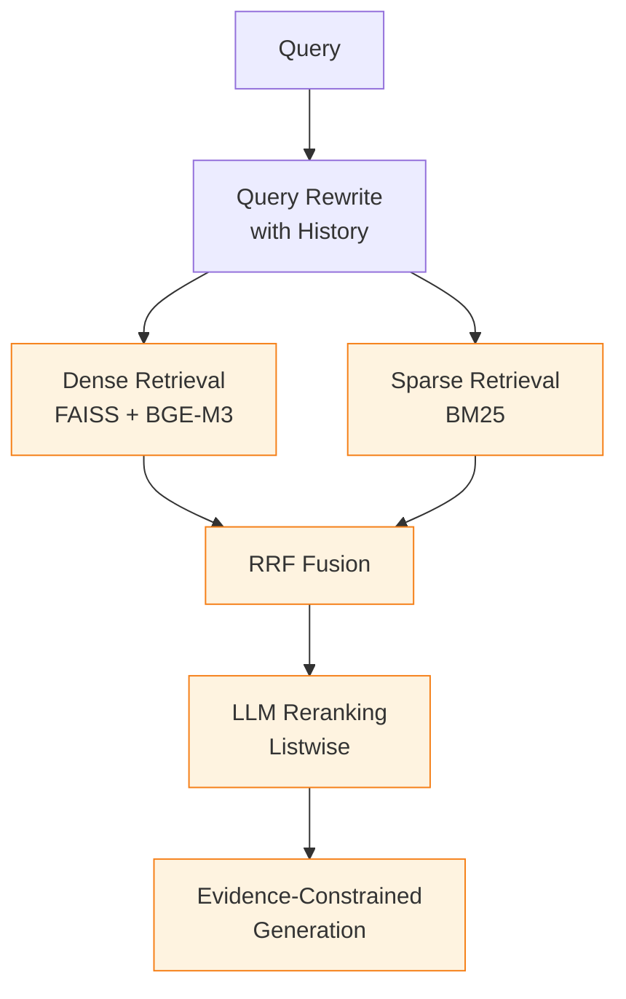

---

### GUIR Architecture

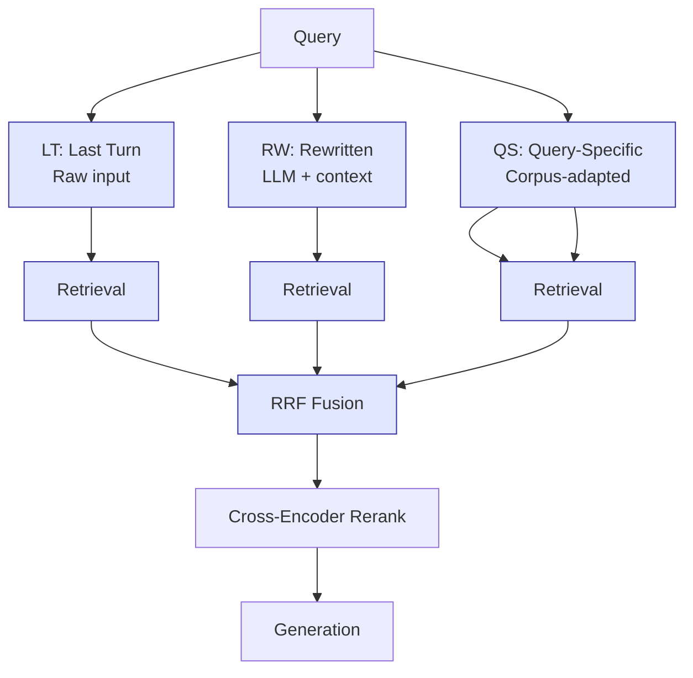

---

### DUTIR Architecture

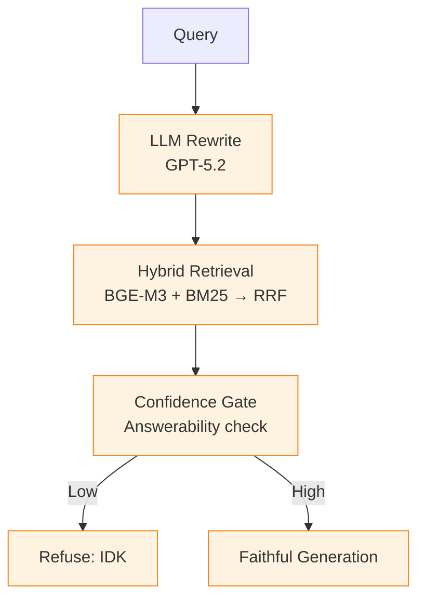

---

### CoRAG Architecture

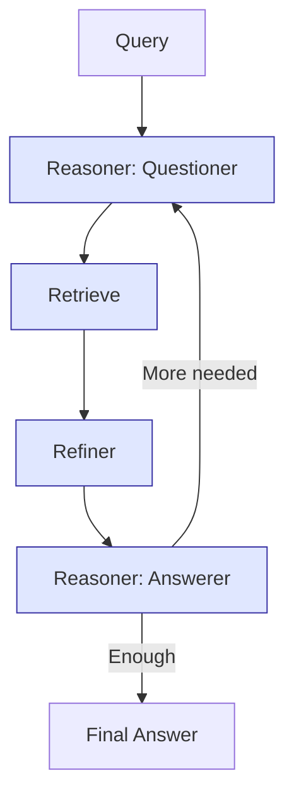

---

### IM-RAG Architecture

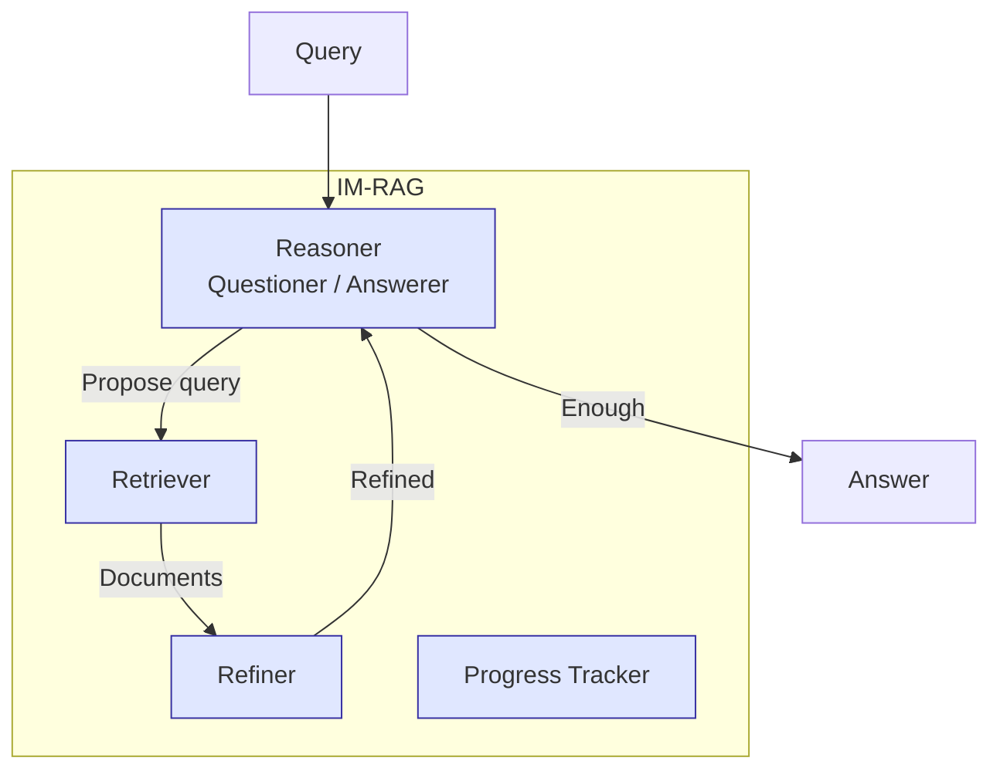

---

## Navigation

| Architecture | Link |
|--------------|------|
| Our Current System | [Above](#our-current-architecture-post-t1-t7-fixes) |
| SPLIT-RAG | [Above](#split-rag-architecture) |
| PC-RAG | [Above](#pc-rag-architecture) |
| RAC | [Above](#rac-architecture) |
| ICR | [Above](#icr-architecture) |
| CPP | [Above](#cpp-architecture) |
| CALMem | [Above](#calmem-architecture) |
| H-RAG | [Above](#h-rag-architecture) |
| 5ting | [Above](#5ting-architecture) |
| GUIR | [Above](#guir-architecture) |
| DUTIR | [Above](#dutir-architecture) |
| CoRAG | [Above](#corag-architecture) |
| IM-RAG | [Above](#im-rag-architecture) |