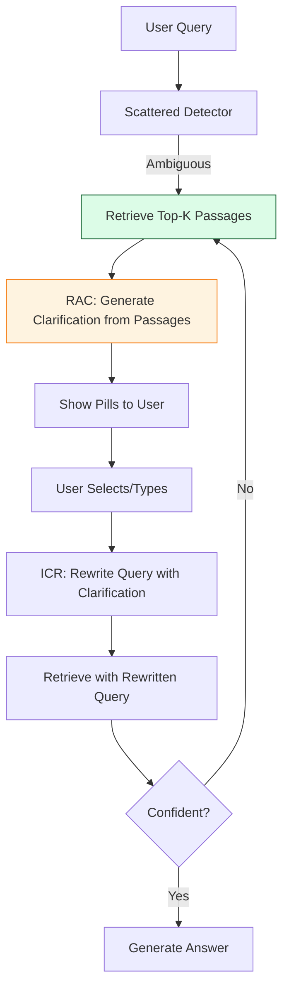

<div class="page-header">
  <h1>Ambiguity & Clarification Papers</h1>
  <p class="lead">RAC, ICR, Qulac/ClariQ/ClariT, CLARITY - Retrieval-grounded clarification, iterative clarify-rewrite loops, multi-facet ambiguity</p>
</div>

## Paper Summaries

### RAC: Retrieval-Augmented Clarification

| Field | Detail |
|-------|--------|
| **Title** | RAC: Retrieval-Augmented Clarification for Faithful Conversational Search |
| **Authors** | Multiple |
| **Venue** | arXiv:2601.11722 (2026) |
| **Key Innovation** | Ground clarifications IN THE CORPUS, not LLM hallucination |

**Key Claims**:
- **Problem**: Prior work focuses on fluency/alignment, not grounding clarifications in corpus
- **Solution**: Retrieve top-k passages → LLM generates clarifying question grounded in retrieved facets
- **Mechanism**: Implicit facet extraction via supplying top-k passages to LLM
- **Evaluation**: Qulac, ClariQ, PaQa, CambigNQ — faithfulness to retrieved content

**Key Insight**: "Facet extraction is performed implicitly by supplying the top-k retrieved passages to the LLM, which then generates the clarifying question."

**Relevance to Our Fix**: 
- Our `is_scattered_ambiguous()` detects vague queries → triggers clarify
- RAC shows: **clarifications should be grounded in retrieved passages**, not just LLM-generated
- Future: Use retrieved facets to generate clarification pills

---

### ICR: Iterative Clarification and Rewriting

| Field | Detail |
|-------|--------|
| **Title** | ICR: Iterative Clarification and Rewriting for Conversational Search |
| **Authors** | Sifei Meng, Dmitry Ilvovsky |
| **Venue** | EMNLP 2025 |
| **Code** | https://github.com/mengsifei/MultiturnRAG |

**Key Claims**:
- **Problem**: CQR ignores feedback from retrieval/generation
- **Solution**: Iterative loop: `clarify → rewrite → retrieve → repeat`
- **Loop**: `c_i ∼ M(r_{i-1})`, `r_i ∼ M(c_i, H, r_{i-1})`
- **Results**: 0.5453 nDCG@5 on Task A (Rank 3/38)

**Algorithm**:
```
for e = 1 to I:
    c_i ∼ M(r_{i-1})          # Generate clarification
    r_i ∼ M(c_i, H, r_{i-1})  # Rewrite with clarification
    if retrieval_confident(r_i): break
return r_i
```

**Relevance to Our Fix**:
- Our T5 = single-shot clarify (no iteration)
- ICR shows: **iterative clarify-rewrite** improves retrieval confidence
- Future: Add iteration for complex ambiguous queries

---

### Qulac / ClariQ / ClariT Datasets

| Dataset | Source | Size | Focus |
|---------|--------|------|-------|
| **Qulac** | Aliannejadi et al. 2019 | 10,277 single-turn | Faceted ambiguous queries from TREC Web Track |
| **ClariQ** | Aliannejadi et al. 2020 | Extended Qulac | Crowdsourced clarifications + answers |
| **ClariT** | Feng et al. 2023 | 108k multi-turn | Task-oriented clarification with user profiles |

**Key Stats**:
- Qulac: 198 topics, 762 facets, 10,277 query-facet-question triplets
- ClariQ: Extended with new topics, crowdsourced
- ClariT: 108k multi-turn conversations with user profiles

**Relevance**: Our 6 scattered queries map to Qulac/ClariQ patterns:
- `وضعیت اعتباری چطور است` → faceted (cheque vs facilities vs general)
- `بدهکار شدم چیکار کنم` → underspecified intent

---

### CLARITY: Multi-Facet Ambiguity in NL2SQL

| Field | Detail |
|-------|--------|
| **Title** | CLARITY: A Framework for Conversational Language Ambiguity and Unanswerability in Interactive NL2SQL Systems |
| **Venue** | ACL 2026 |
| **Key Innovation** | Multi-facet ambiguity + unanswerability with grounded continuations |

**Key Claims**:
- **Multi-facet ambiguity**: Query contains multiple interacting ambiguity sources
- **Framework**: Constraint-driven pipeline generating ambiguous NL2SQL with grounded continuations
- **User behaviors**: Models partially helpful/unhelpful responses

**Relevance**: Our clarify pills = single-facet; CLARITY shows **multi-facet ambiguity** needs multi-turn resolution.

---

## Clarification Approaches Comparison

| Approach | Paper | Mechanism | Iterative? | Grounded? |
|----------|-------|-----------|------------|-----------|
| **Our T5** | — | Keyword-based scattered detection | No | No (static pills) |
| **RAC** | arXiv:2601.11722 | Retrieve → LLM generates clarification from passages | No | **Yes** (corpus-grounded) |
| **ICR** | EMNLP 2025 | Clarify → Rewrite → Retrieve loop | **Yes** | Implicit (via rewrite) |
| **Qulac/ClariQ** | ACL 2019/2020 | Facet annotations for ambiguous queries | No | Facet-based |
| **CLARITY** | ACL 2026 | Multi-facet ambiguity + grounded continuations | Yes (multi-turn) | **Yes** |

---

## Our Implementation vs State-of-the-Art

| Aspect | Our T5 | RAC | ICR | Gap |
|--------|--------|-----|-----|-----|
| **Detection** | Keyword-based | Implicit (retrieve first) | Implicit (via rewrite) | Detection could be learned |
| **Clarification** | Static pills (4 subspaces) | LLM-generated from passages | Iterative clarify-rewrite | Static vs dynamic |
| **Grounding** | None (predefined) | **Corpus-grounded** | Implicit via rewrite | **Major gap** |
| **Iteration** | Single-shot | Single-shot | **Multi-iteration** | No iteration |
| **Feedback** | None | Retrieval confidence | Retrieval + generation | No feedback loop |

---

## Future: Iterative Clarify-Rewrite Loop

Based on ICR + RAC:

```python
async def iterative_clarify_rewrite(query, history, max_iter=3):
    rewritten = query
    for i in range(max_iter):
        # 1. Retrieve with current rewrite
        results = await retrieve(rewritten, top_k=10)
        
        # 2. Generate clarification grounded in results
        clarification = await generate_clarification_grounded(
            rewritten, results, history
        )
        
        # 3. Get user response (or simulate)
        user_response = await get_user_input(clarification)
        
        # 4. Rewrite with clarification
        rewritten = await rewrite_query(user_response, history, rewritten)
        
        # 5. Check retrieval confidence
        if await is_retrieval_confident(rewritten):
            break
    
    return rewritten
```

---

## Architecture: Clarification Flow



---

## Related Pages

- [Problem: Ambiguity Resolution](../problems/ambiguity-resolution.html)
- [Paper: Retrieval Fusion & RRF](./retrieval-fusion.html)
- [Paper: Sticky Context & Memory](./sticky-context.html)
- [Architecture: RAC/ICR](../architectures.html#rac-icr)