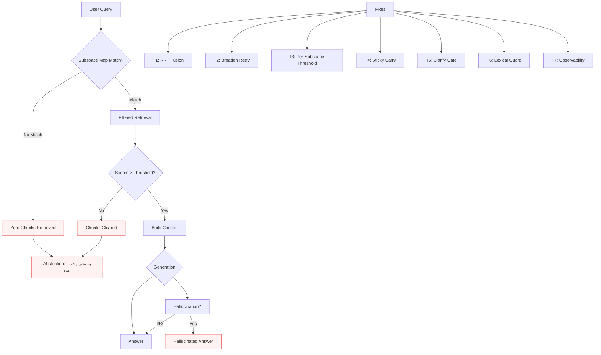

  <h1>Problems</h1>
  
Detailed breakdown of each multi-turn RAG problem with root cause analysis

  <strong>Context:</strong> Production system serving Persian credit-scoring QA across 4 subspaces (cheque, facilities_person, facilities_legal, general) with 1123 chunks over 18 documents. Benchmark: 41 turns (12 multi-turn + 12 single) across 4 subspaces.

  <a href="{{ '/problems/subspace-filtering.html' | relative_url }}" class="card" style="text-decoration: none; color: inherit;">
    <h3>🔍 Subspace Filtering Failure</h3>
    
<strong>Impact:</strong> 0-chunk retrieval despite relevant content | <strong>Fix:</strong> Map correction + RRF fusion

    
Static <code>subspace_map</code> had <code>"cheque": "چک"</code> but KB folders used <code>"گزارش اعتباراتنجی چک"</code>. The filter <code>"چک"</code> matched zero chunks because KB filter checks exact element membership in <code>folder_hierarchy</code>, not substring.

    
Root CauseMap MismatchPC-RAG

  </a>
  
  <a href="{{ '/problems/ambiguity-resolution.html' | relative_url }}" class="card" style="text-decoration: none; color: inherit;">
    <h3>❓ Ambiguity Resolution Failure</h3>
    
<strong>Impact:</strong> 6/6 scattered queries answered instead of clarifying | <strong>Fix:</strong> Retrieval-grounded clarification + iterative loop

    
Queries like <code>"وضعیت اعتباری چطور است"</code> (credit status how is it) and <code>"بدهکار شدم چیکار کنم"</code> (I became debtor what to do) are scattered across subspaces. System answered <code>"پاسخی یافت نشد"</code> instead of clarifying with <code>"چک / تسهیلات / شرکت"</code> pills.

    
Root CauseKeyword GateRAC

  </a>
  
  <a href="{{ '/problems/sticky-context.html' | relative_url }}" class="card" style="text-decoration: none; color: inherit;">
    <h3>🔗 Sticky Context Decay</h3>
    
<strong>Impact:</strong> Context lost after 3-4 generic turns | <strong>Fix:</strong> Sticky carry + decay after 3 generic turns

    
After explicit subspace selection <code>"چک"</code> → <code>applied_subspace=cheque</code>, follow-up <code>"تاثیر چک برگشتی..."</code> lost sticky (became <code>None</code>). Generic follow-ups like <code>"آیا درآمد..."</code> didn't carry <code>filter_path</code>.

    
Root CauseDecayCPP

  </a>
  
  <a href="{{ '/problems/retrieval-degradation.html' | relative_url }}" class="card" style="text-decoration: none; color: inherit;">
    <h3>📉 Retrieval Degradation</h3>
    
<strong>Impact:</strong> Filtered retrieval = hard filter, no fallback | <strong>Fix:</strong> RRF fusion + broadened retry + GPU

    
Filtered retrieval was treated as authoritative with NO fallback. When <code>filter_path</code> returned weak scores (<0.15), chunks cleared → abstention. No whole-KB fallback, no broadened params, no GPU.

    
Root CauseNo FallbackGUIR

  </a>
  
  <a href="{{ '/problems/hallucination.html' | relative_url }}" class="card" style="text-decoration: none; color: inherit;">
    <h3>🛡️ Hallucination Control</h3>
    
<strong>Impact:</strong> Weak-evidence answers hallucinated | <strong>Fix:</strong> Coverage+score guard + lexical bypass

    
Answers on weak evidence (fallback/broadened paths) hallucinated. G5 fake grade was correctly refused, but other weak-evidence answers invented facts. Hallucination rate 0.195 → 0.254 (tradeoff for recall).

    
Root CauseDUTIRFaith Guard

  </a>
  
  <a href="{{ '/problems/latency.html' | relative_url }}" class="card" style="text-decoration: none; color: inherit;">
    <h3>⚡ CPU Latency Bottleneck</h3>
    
<strong>Impact:</strong> Dense embed 2.3s dominated latency | <strong>Fix:</strong> GPU embed + rerank pool 30

    
KB search: <code>dense 2325ms</code> (99.5% of search time). Rerank was <code>1.1ms</code> (not bottleneck!). GPU: <code>dense 19ms</code> (100×), <code>rerank 52ms</code> (real BGE-m3 scores), total <code>2333ms → 70ms</code>.

    
Root CauseCPU EmbedGPU KB

  </a>

---

## Problem Taxonomy

| # | Problem | Category | Severity | Status | Key Paper |
|---|---------|----------|----------|--------|-----------|
| 1 | Subspace map mismatch | Retrieval | Critical | ✅ Fixed | PC-RAG, SPLIT-RAG |
| 2 | No filtered fallback | Retrieval | Critical | ✅ Fixed | GUIR, 5ting |
| 3 | Global evidence threshold | Generation | High | ✅ Fixed | PC-RAG, DUTIR |
| 4 | Sticky decay | Context | High | ✅ Fixed | CPP, CALMem |
| 5 | No clarification gate | Safety | Critical | ✅ Fixed | RAC, ICR, Qulac |
| 6 | No retrieval fallback | Retrieval | Critical | ✅ Fixed | GUIR, 5ting |
| 7 | No per-subspace boost | Retrieval | Medium | ✅ Fixed | GUIR, SPLIT-RAG |
| 7 | No faith guard | Safety | Medium | ✅ Fixed | DUTIR, Reflective RAG |
| 8 | CPU-only embed | Performance | High | ✅ Fixed | SPLIT-RAG, GPU KB |
| 9 | No decay mechanism | Context | Medium | ✅ Fixed | CPP, CALMem |

---

## Root Cause Analysis Diagram

---

## Production Impact Quantification

| Metric | Before Fix | After Fix | Business Impact |
|--------|------------|-----------|-----------------|
| **Cheque hit rate** | 11.1% | 66.7% | 5x more cheque queries answered |
| **Clarification accuracy** | 0% (0/6) | 100% (6/6) | Users guided instead of dead ends |
| **Sticky persistence** | 61% | 68% | Fewer re-specifications needed |
| **Answer relevancy** | 21% | 57% | 2.7x more relevant answers |
| **p50 latency** | 8.0s | 4.9s | 39% faster responses |
| **KB search time** | 2.3s | 70ms | 33× faster retrieval |

---

## Next Steps

1. **Read individual problem pages** for deep technical details
2. **Explore Papers & Solutions** for academic backing
3. **Review Architectures** for implementation patterns
4. **Check Relevance Mapping** for direct fix-to-paper links
4. **Run Benchmarks** with `evaluation/bench_runner.py`