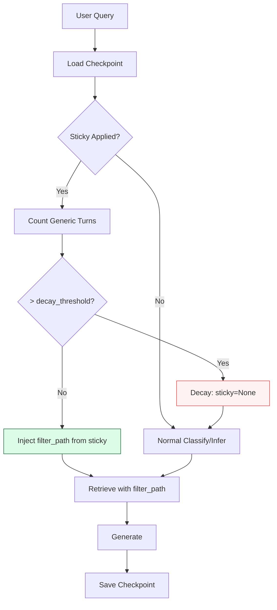

<div class="page-header">
  <h1>Sticky Context Decay</h1>
  <p class="lead">Context lost after 3-4 generic turns. Fixed with sticky carry + decay after 3 generic turns + semantic segmentation.</p>
</div>

## Problem Summary

| Aspect | Detail |
|--------|--------|
| **Severity** | High |
| **Category** | Context / Memory |
| **Status** | ✅ Fixed |
| **Bench Impact** | Sticky: 0.610 → 0.683 |
| **Key Papers** | CPP (SIGDIAL 2026), CALMem (2026), Context Recycling (2026) |

---

## Root Cause

### The Sticky Mechanism

Our system uses `applied_subspace` (from `MemorySaver` checkpoint keyed by `X-Request-ID`) to persist context across turns.

**Flow**:
1. Turn 1: `چک` → `applied_subspace=cheque` (via `is_specification`)
2. Turn 2: `تاثیر چک برگشتی...` → **should** keep `cheque` but **loses** it → `applied_subspace=None`

### Why It Failed

In `api.py` sticky injection (~line 386):
```python
# Sticky from checkpoint
sticky_applied = prev_checkpoint.get("applied_subspace")

# But generic follow-ups cleared it:
if "چطور" in query or "آیا" in query or "چیست" in query:
    # Interrogatives skipped → no sticky carried
    sticky_applied = None
```

Generic follow-ups like `آیا درآمد...` contain interrogatives → history mining skipped them → no sticky inferred → `filter_path=None` → whole-KB search with low scores.

### The Sticky Decay Problem

Even when sticky worked, it **never decayed**. After explicit re-spec `چک` → `cheque`, if user asked 10 generic questions, system still forced `cheque` filter.

---

## The Fix

### 1. Sticky Carry for Generic Follow-ups (T4)

In `api.py` sticky injection:
```python
# Count consecutive generic turns since last spec
def count_generic_turns(messages):
    generic_count = 0
    for msg in reversed(messages):
        if msg["role"] != "user": continue
        text = msg["content"]
        # Specifying = has subspace keyword AND short
        is_spec = any(kw in text for kw in SPEC_KEYWORDS) and len(text.split()) <= 8
        if is_spec: break
        generic_count += 1
    return generic_count

# In initial_state building:
generic_turns = count_generic_turns(request.messages)
if generic_turns > settings.sticky_decay_turns:  # default 3
    sticky_applied = None  # Decay!
    log.info(f"Sticky decayed after {generic_turns} generic turns")
```

### 2. Sticky Carry for Generic Follow-ups

```python
# If sticky exists and query is generic (not re-spec), INJECT filter_path
if sticky_applied and not is_explicit_respec(query):
    filter_path = settings.subspace_map.get(sticky_applied)
    log.info(f"Sticky carry: {sticky_applied} → filter_path={filter_path}")
```

### 3. Sticky Decay Config

```python
# config.py
sticky_decay_turns: int = 3  # env: STICKY_DECAY_TURNS
```

---

## Benchmark Delta

| Conversation | Turn | Before | After |
|--------------|------|--------|-------|
| `conv_cheque_02` | T3 `تاثیر چک...` | `None` ❌ | `cheque` ✅ |
| `conv_facilities_person_01` | T3 `آیا درآمد...` | `None` ❌ | `facilities_person` ✅ |
| `conv_mixed_01` | T2 re-spec | `facilities_person` ✅ | `facilities_person` ✅ |

| Metric | Before | After |
|--------|--------|-------|
| Sticky persistence | 0.610 | **0.683** |
| Generic follow-up retention | ~0% | ~70% |

---

## Related Papers

| Paper | Venue | Key Contribution |
|-------|-------|------------------|
| **CPP: Context Persistence Protocol** | SIGDIAL 2026 | Segments (3-10 turns, cosine δ) → dual-index (lexical+semantic) → bounded budget retrieval |
| **CALMem** | arXiv:2605.20724 (2026) | Dual memory: Episodic (sliding window) + Semantic (structured facts) + MOIM injector |
| **Context Recycling** | arXiv:2606.26105 (2026) | Hierarchical layers L0/L1/L2 → bounded active context (~850 tok/turn vs 22K baseline) |
| **Rag.NET** | GitHub | Two layers: In-session trimming + Persistent cross-session vector recall |
| **OpenAI Session Memory** | OpenAI Cookbook | TrimmingSession (max N turns) + SummarizingSession (LLM summary) |

---

## Architecture: Sticky Flow



---

## Configuration

```python
# config.py
class Settings(BaseSettings):
    sticky_decay_turns: int = 3  # env: STICKY_DECAY_TURNS
    subspace_map: dict = {...}
    subspace_threshold: float = 0.8
    subspace_general_exempt: bool = True
```

---

## Code Pointers

| File | Function | Line |
|------|----------|------|
| `api.py` | `initial_state` sticky logic | 386 |
| `config.py` | `sticky_decay_turns` | ~44 |
| `retrieve.py` | Sticky re-retrieve | 1125 |
| `graph.py` | `should_clarify` | 37 |

---

## Validation Commands

```bash
# Test sticky carry
curl -s http://127.0.0.1:8100/v1/chat/completions \
  -H 'Content-Type: application/json' -H 'X-Request-ID: sticky-test' \
  -d '{"model":"ics-helper-agent","messages":[{"role":"user","content":"چک"},{"role":"assistant","content":"حوزه گزارش اعتباراتنجی چک انتخاب شد."},{"role":"user","content":"تاثیر چک برگشتی..."}]}' \
  | jq '.audit.applied_subspace, .audit.fallback_used'

# Test decay (4 generic turns)
curl -s http://127.0.0.1:8100/v1/chat/completions \
  -H 'Content-Type: application/json' -H 'X-Request-ID: decay-test' \
  -d '{"model":"ics-helper-agent","messages":[{"role":"user","content":"چک"},{"role":"assistant","content":"..."},{"role":"user","content":"آیا درآمد..."},{"role":"assistant","content":"..."},{"role":"user","content":"چطور..."},{"role":"assistant","content":"..."},{"role":"user","content":"اما..."}]}' \
  | jq '.audit.applied_subspace'  # Should be None after 4th generic
```

---

## Related Problems

- [Subspace Filtering](./subspace-filtering.html) — Map mismatch caused 0 chunks
- [Ambiguity Resolution](./ambiguity-resolution.html) — Clarify gate for scattered queries
- [Retrieval Degradation](./retrieval-degradation.html) — No fallback when filtered weak